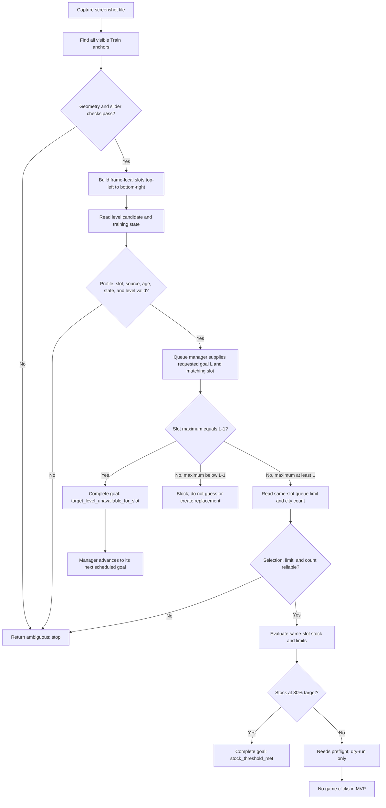

# Army Training Slot Workflow

**Status:** MVP behavior and decisions as of 2026-11-05. This document is the current source of truth for slot detection and the read-only stock-goal workflow. Historical implementation notes in other documents may be stale; follow this contract and the implementation-status table below.

## Purpose

The queue manager schedules stock goals. The visual reader identifies the visible unit training slots and gathers measurements from each slot independently. It does not identify troop names and does not click or scroll the game.

## Running the Read-Only Dry-Run

From the repository root in PowerShell, run:

```powershell
python .\army_training_dry_run.py `
    --input .\screenshots\army_training\pelny_army_training_empty_queue.png `
    --tesseract "C:\Program Files\Tesseract-OCR\tesseract.exe"
```

Replace `--input` with the screenshot to inspect and `--tesseract` with the local path to `tesseract.exe`. If Tesseract is on `PATH`, omit `--tesseract`. Use `python .\army_training_dry_run.py --help` to see CLI options. The report is read-only: it does not click, save a task, or change the game queue. It currently evaluates the configured target `{global_level: 5, match_number: 1}`; that target is not yet resolved dynamically from a profile queue.

For another computer, copy/clone the repository with its `regions.json`, `templates/`, and screenshot fixtures. Install Python and the runtime packages used by the scanner (`opencv-python`, `numpy`, `pytesseract`) plus the Tesseract OCR executable. `requirements-dev.txt` currently lists only `pytest`, not these runtime dependencies, so provision them separately. Verify local paths and run the command above before using another screenshot.

## Terms

- **Slot:** one unit training panel, including its level selector, city count, training amount, slider, costs, duration, food load, and Train button.
- **Frame index:** zero-based position in one captured frame, ordered top-left to bottom-right. It is temporary screen geometry, not a persistent slot identity.
- **Local level:** Roman numeral rendered in a slot selector. A local I/II can represent global VIII/IX in the late list; do not map those to global levels without list context.
- **Highest visible level:** numeral read from the presumed highest selector badge in the current slot. The MVP assumes the largest badge is selected and, by the user's stated default behavior, normally is the highest available level. This is an assumption, not direct proof of unlock state.
- **One-below level:** the immediately preceding visible selector position, only when its badge is detected directly above the largest badge.
- **Queue manager:** the higher-level planner that owns task order and progression. The detector never creates a replacement task when a slot cannot satisfy a requested level.

## Agreed Rules

1. Detect every visible slot; do not impose a three-slot maximum. A scroll operation may expose additional slots in a later frame.
2. Order slots in each frame top-left to bottom-right. Frame indexes restart for every frame and must not be persisted as global `match_number` values.
3. Read each slot's measurements from that slot's translated regions. Never borrow another slot's queue limit or city count.
4. Each slot has its own maximum queue limit. The limit is the same for the two training levels used for that slot (highest and one below), while silver and food costs can differ by level. The adapter that supplies both level entries to `SlotObservation` is not implemented yet.
5. The training amount displayed by default is expected to be the maximum queue amount; the MVP reads the displayed amount and does not move the slider. The current reader does not independently verify that the slider is at its maximum.
6. In approximately 99% of cases, the highest level is selected by default. The MVP uses the largest badge as the presumed highest level and defers selected-marker verification. A manually selected lower level is a known edge case.
7. For requested target level `L`, if reliable slot evidence says its highest available level is exactly `L - 1`, complete that requested goal with reason `target_level_unavailable_for_slot`. Do not train a substitute and do not enqueue a replacement goal. The queue manager advances to its next separately scheduled task.
8. If the slot is more than one level below `L`, keep the decision blocked. Do not silently skip multiple levels.
9. If the OCR, slot geometry, badge ordering, or evidence provenance is uncertain, return `unknown`/`ambiguous`/`blocked`. Never infer a slot or issue a training action from uncertain evidence.
10. MVP does not scroll the list, capture a live window, identify troop names, click level selectors, click Train, or click Help.

## Detection Algorithm

### Visible slot geometry

1. Match the Train-button template at score `>= 0.90`.
2. Group matches into rows when their vertical coordinates differ by at most 3 px; sort each row left-to-right and rows top-to-bottom.
3. Require a horizontal pitch of 261 px within ±2 px between neighboring slots in the same row. Reject overlapping rows.
4. Confirm each candidate with the slider-button template at score `>= 0.90` within the expected translated region.
5. Return all slot regions translated from the base region. Return `none` when no Train anchor is found and `ambiguous` for irregular geometry or failed cross-checks.

These thresholds were checked on the two clean 1920x1080 fixtures only. They are provisional for other scales and UI variants.

### Highest and one-below level candidates

For each slot independently:

1. Detect circular selector badges with Hough circle detection.
2. Choose the largest-radius badge as the presumed selected/highest badge. Require it to be distinctly larger than other badges and the last badge in top-to-bottom order. Otherwise return `unknown`.
3. OCR only that badge's Roman numeral using two preprocessing/segmentation paths and require agreement. The current fixtures read V with confidence 89 and VII with confidence 87-88.
4. If the numeral is local I or II, return `unsupported`: global VIII/IX mapping requires list context that this MVP does not have.
5. The one-below candidate is the immediately preceding detected badge, whose center must be 20-30 px above the presumed-highest badge. Its level is inferred as `highest - 1`; the lower numeral is not separately OCRed.
6. `read_layout_selector_levels` takes the maximum of slot readings in the current frame and returns indexes for slots at that visible maximum and visible maximum-minus-one. Despite the field name `global_highest_visible_level`, this is only a maximum over the supplied frame, not a scan of the entire game list.

## Per-Slot Measurements

`read_slot_readings(image, slot)` reads:

- `queue_limit` from `unit_troop_count_to_train`;
- `city_count` from `current_unit_troop_count`;
- `silver_cost` from `unit_troop_require_silver_to_train`.

Each value carries raw OCR, parsed value, and confidence. The limit, city count, and silver cost are independently read from that slot's own regions. The current reader does not yet return food, time, a level-bound observation, or a complete `SlotObservation`.

Observed fixture values (not independent game-ground-truth labels):

| Fixture | Slot order | Queue amount/limit | City count | Silver cost |
| --- | --- | ---: | ---: | ---: |
| `pelny.png` | 1 | 31,310 | 0 | 9.29M |
| `pelny.png` | 2 | 31,310 | 0 | 9.29M |
| `pelny.png` | 3 | 15,655 | 0 | 9.29M |
| `pelny_army_training_empty_queue.png` | 1 | 1,565 | 1,861 | 12.6M |
| `pelny_army_training_empty_queue.png` | 2 | 31,310 | 13,069 | 12.6M |
| `pelny_army_training_empty_queue.png` | 3 | 31,310 | 14,765 | 12.6M |

## Queue Goal Decision

For a stock goal tied to global level `L` and matching slot `M`, the existing planner's intended calculation is:

```text
target_count = 2 * that_slot_reference_limit
complete when city_count >= ceil(0.80 * target_count)
training_count = min(target_count - city_count, that_slot_training_limit)
```

The limits are per slot. By the agreed rule, the future adapter supplies that same slot-specific maximum for both relevant levels. It must not reuse a neighboring slot's value.

`decide_training_goal` consumes a typed `SlotObservation`, not raw detector output. It first requires fresh, matching profile/slot/source evidence and an idle training state, then a reliable highest-level reading. If that level is exactly `L-1`, it returns `SATISFIED` with reason `target_level_unavailable_for_slot` immediately; city count, queue limits, and selection verification are not needed because no training will happen for this goal. If the level is lower than `L-1`, it returns `BLOCKED`. Only when the slot can meet target `L` does it require verified selection, same-slot queue limits, and city count. A `SATISFIED` decision is reconciled to persistent task status `completed`; its reason is stored in process history. No replacement goal is generated here.

## Flow

This shows the intended composition of components. The CLI dry-run now reports slot candidates and per-slot readings, but it does not yet bind a frame slot to persistent `{global_level, match_number}` or call the stock-goal manager. The branch semantics inside `decide_training_goal` are implemented and covered by tests.



## Implementation Status

| Capability | Status | Code |
| --- | --- | --- |
| Find and order visible slots in a frame | Implemented, read-only | `army_training_slots.py` |
| Translate/crop each slot's UI regions | Implemented | `army_training_slots.py` |
| Read each slot's queue amount, city count, silver cost | Implemented; fixture-tested | `army_training_slot_reader.py` |
| Detect selector badges, use largest badge, OCR its local numeral, infer adjacent one-below position | Implemented; fixture-tested | `army_training_levels.py` |
| Verify actual unlocked/dimmed state | Not implemented; largest/selected-is-highest is an assumption | `army_training_levels.py` |
| Map local I/II to global VIII/IX | Deferred; unsupported | `army_training_levels.py` |
| Assign persistent `{global_level, match_number}` from visible frames/scroll history | Not implemented; frame index is not identity | `army_training_slots.py`, `army_training_plan.py` |
| Adapt slot reads into `SlotObservation`, binding the correct level, source, profile, and timestamp | Not implemented | `army_training_process.py` has the model/decision only |
| Pass the same slot limit for both levels to the stock-goal decision | Agreed, adapter not implemented | `army_training_process.py` |
| Mark exact one-below target unavailable as completed | Implemented in decision/reconciliation, awaits trusted level adapter | `army_training_process.py` |
| Stock-goal queue and dry-run reconciliation | Implemented | `army_training_process.py`, `task_controller.py` |
| Connect the CLI dry-run report to slot detection, level candidates, and per-slot readings | Implemented; reports candidates but does not mutate any queue | `army_training_dry_run.py` |
| Bind a dry-run candidate to persistent `{global_level, match_number}` and call the stock-goal manager | Not implemented; no list-origin/scroll identity proof or `SlotObservation` adapter | `army_training_dry_run.py`, `army_training_process.py` |
| Food/silver live resource preflight and Train/Help click flow | Not implemented | Out of MVP scope |
| Live-window capture and scroll workflow | Not implemented | Out of MVP scope |

## Contract Checks

Use the tests below as executable checks for the corresponding documented rules. When a rule changes, update its test and this document in the same task.

| Rule | Regression test |
| --- | --- |
| Visible slots are ordered in the frame and uncertain geometry is rejected | `tests/test_army_training_slots.py::test_finds_three_slots_left_to_right`, `test_second_row_after_scrolling_is_ordered_top_left_to_bottom_right`, `test_missing_middle_slot_is_ambiguous` |
| Each slot uses its own queue limit and readings | `tests/test_army_training_slot_reader.py::test_each_slot_keeps_its_own_queue_limit_on_the_active_screen`, `test_each_slot_keeps_its_own_queue_limit_on_the_empty_queue_screen` |
| Largest badge is the presumed max; adjacent position provides max-1; unsupported readings do not guess | `tests/test_army_training_levels.py::test_reads_highest_visible_level_per_slot`, `test_layout_reports_global_max_and_one_below`, `test_largest_badge_not_at_end_is_unknown`, `test_local_one_or_two_is_not_misreported_as_global_level` |
| Dry-run reports visible target candidates but does not claim an unverified match number | `tests/test_army_training_dry_run.py::test_dry_run_reads_resources_and_blocks_unverified_training`, `test_dry_run_reports_idle_training_without_active_training_block`, `test_target_candidate_classifies_exact_one_below_for_manager_skip` |
| Exact `L-1` completes with a reason without count/limit reads; more than one level below remains blocked | `tests/test_army_training_process.py::test_slot_one_level_below_target_completes_goal_without_other_readings`, `test_slot_more_than_one_level_below_target_stays_blocked` |
| Stale, mismatched, active, or low-confidence evidence cannot authorize training | `tests/test_army_training_process.py::test_uncertain_evidence_blocks_action`, `test_active_training_cannot_satisfy_goal_or_start_another_order` |

For a future change that connects components, add an integration test that starts with a screenshot fixture, constructs a `SlotObservation`, and verifies the manager decision and persisted reason. Until that adapter exists, component tests do not prove the full screenshot-to-queue flow.

## Next Integration Step

First establish the requested `{global_level, match_number}` against the visible list without treating frame index as identity. The current dry-run finds V candidates on `pelny.png`, but training is active; the idle fixture shows VII/VI, not the configured V target. A clean idle frame of the intended profile/list position is required to validate the first task. Then add the read-only adapter that binds the slot, level evidence, per-slot measurements, training state, profile, timestamp, and source into `SlotObservation`; exercise the manager in dry-run and test the screenshot-to-decision path. Live-window capture, lower-level selection clicks, and the actual Train click remain a separate opt-in stage.
