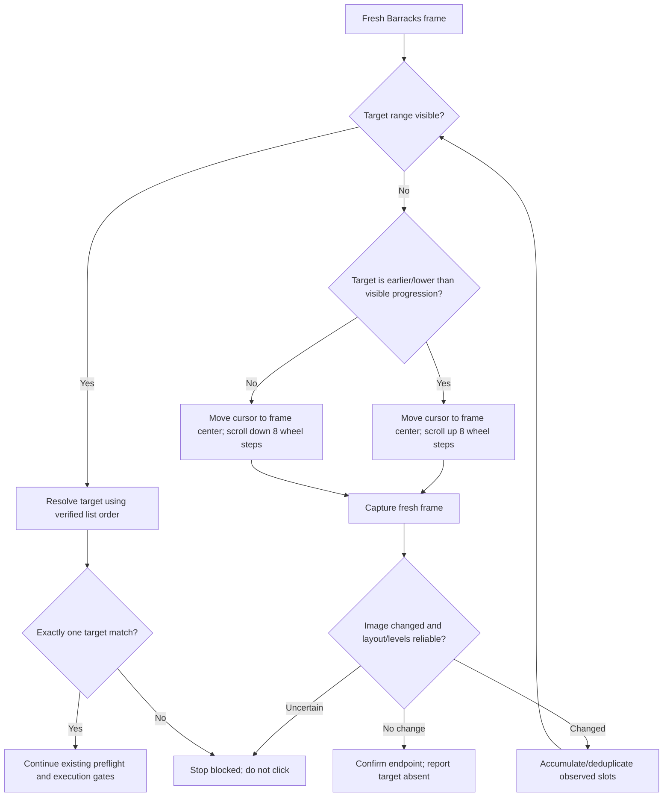
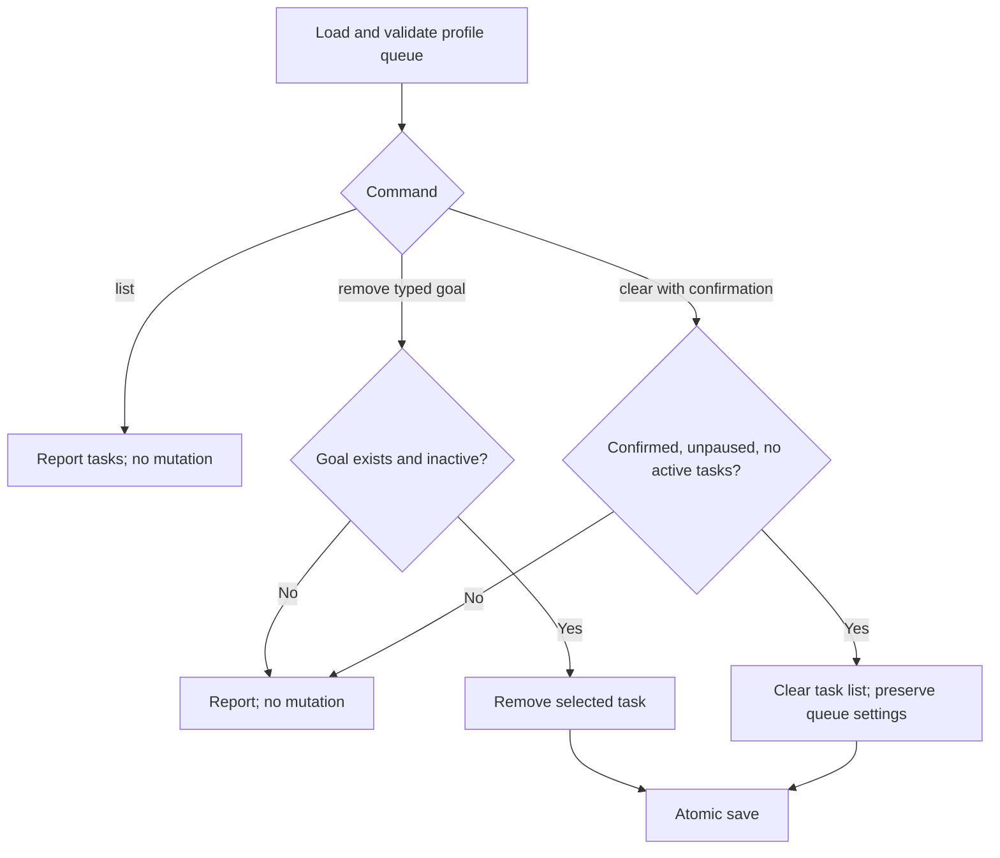
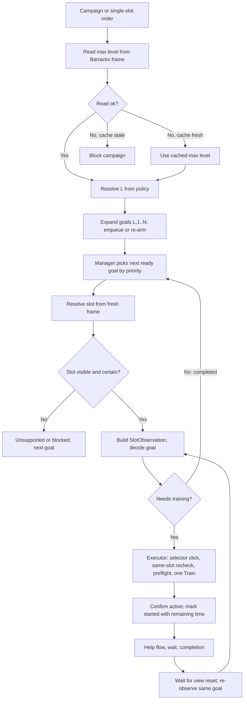
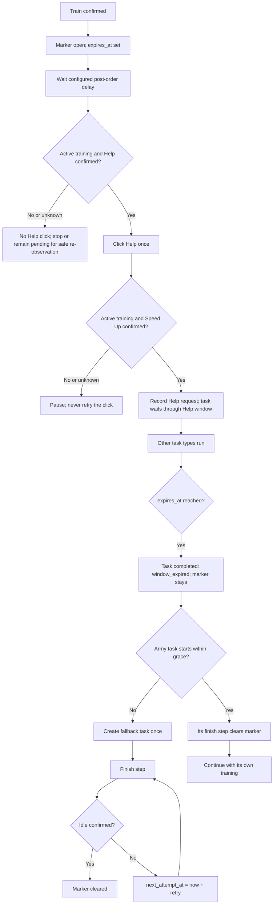
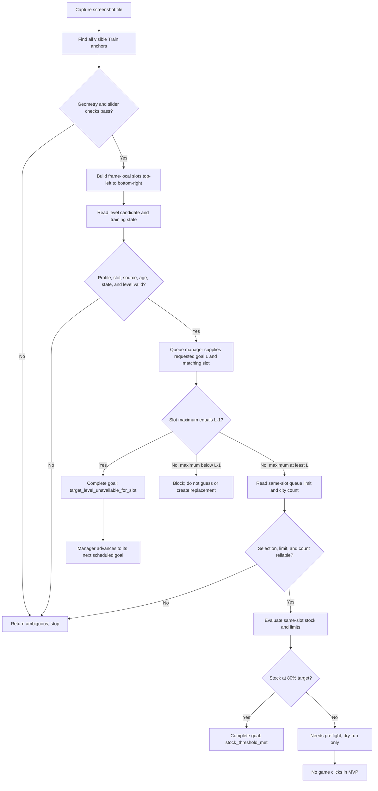

# Army Training Slot Workflow

## Migration Validation Run

Executed 2026-11-10 with the workspace Python 3.13 venv, installed Tesseract temporarily on PATH, plugin autoload disabled, and `--continue-on-collection-errors`: army/queue group **161 passed, 8 failed, 1 collection error**; full repository **345 passed, 19 failed, 8 errors**. Failures cover missing `read_selected_category`, two finish/executor start-confirmation assertions, navigation's unsupported `desktop` variant, and four older portrait-classifier assertions. The training-process test has an unterminated string at line 140 and cannot collect. Earlier source-review-only notes describe their original inspection; this subsequent run adds evidence, not a green release gate or live validation. No Python behavior was changed. Logs: operating-system temporary directory, `tba_docs_army_queue_ocr_20261110.log` and `tba_docs_full_suite_ocr_20261110.log`.

**Test-harness/refactor follow-up (2026-11-11):** removed a stray orphaned source fragment that prevented `tests/test_army_training_process.py` from collecting and removed duplicate function definitions that silently overwrote two tests; the army selector OCR consensus helper was factored without changing recognition rules. The latest combined selector/process/queue/manager suite passed **74/74**. These focused results do not resolve the other failures in the 2026-11-10 full-suite aggregate or establish live execution safety.

## Feature Contents

- [Maximum unlocked army level](#maximum-unlocked-army-level) - documentation-first pilot: current heuristic, inputs, limitations, and proposed manual override.
- [Slot identity and training target selection](#slot-identity-and-training-target-selection) - persistent goal identity, visible-frame resolution, and campaign policies.
- [Training observation and stock reconciliation](#training-observation-and-stock-reconciliation) - scanner states, evidence lifetime, and saved decisions.
- [Resource preflight and quantity](#resource-preflight-and-quantity) - same-slot resource checks and optional quantity entry.
- [Start, Help, finish and evidence](#start-help-finish-and-evidence) - one-order execution, ownership markers, finish retries, and the isolated E2E exception.
- [Live test action checkpoints](#live-test-action-checkpoints-2026-11-09)
- [Parameterless live navigation check](#parameterless-live-navigation-check-2026-11-10)
- [One-command live Barracks test](#one-command-live-barracks-test-2026-11-09)
- [Optional training quantity](#optional-training-quantity-approved-2026-11-09)
- [Implementation status](#implementation-status) - legacy cross-feature table; not a replacement for the pilot's scoped status.

The five feature contracts above own the current descriptions within their stated source-review scope. Dated scenarios, implementation notes, and the legacy implementation table below preserve history and anchors, not a second current status. Navigation, scrolling, browser recognition, and category-registry snapshots are not blanket-certified by this migration. In particular, the later Specialists snapshot conflicts with the reviewed manager/executor path; see the limitations below. Existing maximum-level and slot-identity contracts are retained.

## Maximum Unlocked Army Level

### Purpose and Current Behavior

Estimate the highest visible selector level for the supplied army-training frame. The bot currently treats this as a candidate for the maximum unlocked level, using a default-selection heuristic. It does not independently verify which levels are unlocked or inspect the entire army list. The layout field `global_highest_visible_level` means the maximum across the supplied visible slots, not a proven account-wide maximum.

### Inputs and Defaults

- The visual reader takes an image and detected slots; each slot provides its `unit_troop_level` crop. `observe_image` invokes it when the slot layout is valid.
- There is currently no optional `max_unlocked_level` override in these reader/observation functions. Supplying a target level does not bypass visual level recognition.
- Manager campaign expansion reads the supplied `--image` when present, saves a valid fresh maximum in the profile's army state, and resolves the maximum through the existing fresh-reading/cache policy. Without an image it uses that policy's cached state; it is not a new manual-override API.
- Campaign `fixed`/`--level` selects the desired training level, not the maximum unlocked level. Lower-level campaign functions already accept a `max_level` value for planning; they do not detect unlocks or implement the proposed automatic fallback.

### Algorithm and Outputs

1. Crop each visible slot's selector and detect circular badges with OpenCV Hough circles after 5x enlargement. Order accepted centers from top to bottom.
2. Require the largest badge to exceed the other radii by at least 0.5 selector pixels and to be the last badge. Otherwise return `unknown`.
3. OCR the largest badge's Roman numeral using masked/raw preparations and paired Tesseract modes. Accepted paired readings must agree and meet the reader's confidence threshold (60); conflicting accepted labels or unreadable labels are rejected.
4. Return `unsupported` for local I/II because these can represent global VIII/IX. For other accepted labels, return a `candidate`, preserving the confidence and `uses_default_highest_assumption=True`.
5. Infer max-1 only when the immediately preceding badge is 20-30 selector pixels above. Infer the lowest visible level only when every gap is consecutive.
6. The layout is a `candidate` only if every supplied slot is a candidate. Its maximum is the largest of the slot maxima; otherwise it is `unknown`. `frame_max_level` returns that value for a candidate, or `None`.

### Safety and Limitations

- The documented UI signal is that the selected badge is enlarged. Treating it as the highest unlocked level is a heuristic based on the usual default selection, not independently verified unlock evidence. Manual lower-level selection can invalidate that assumption; ambiguous geometry is rejected, but the heuristic is not a general unlock-state check.
- Dimmed/locked-state verification and local I/II-to-global-VIII/IX mapping are not implemented by this reader. Visible-frame success does not prove that off-screen slots or other troop categories have the same maximum.
- These readers do not click or change the game. A candidate maximum alone never authorizes training: slot identity, selection, resources, and action confirmation remain separate gates.

### Status and Verification

Current implementation: the automatic heuristic and its manager observation path are implemented. An optional manual maximum with automatic fallback is not implemented.

Last source review: 2026-11-10, limited to the selector reader, its manager observation/campaign-expansion callers, campaign level resolution, and the focused selector test source. On 2026-11-11 the repeated per-PSM OCR consensus logic was extracted into `_read_consensus_roman_label` without changing thresholds or output mapping. The focused selector suite passed **10 tests** with the installed Windows Tesseract executable available on PATH for that process. This verifies the current fixtures and synthetic consensus cases, not account-wide unlock state or live interaction.

### Proposed and Deferred Changes

Proposed API contract, recorded for a separate implementation task: accept `max_unlocked_level=None`; a supplied valid integer maximum bypasses automatic maximum determination, while `None` calls a dedicated replaceable detector. Reject an invalid explicit value rather than falling back to detection. An uncertain automatic result must not authorize dependent actions. Manual input does not replace locating the correct slot, selector, or action button.

The dedicated detector would initially retain the existing heuristic and permit later improvement behind the same boundary. Exact integration points and the accepted numeric range must be defined in that implementation task. This documentation migration does not add the parameter, enable new actions, or assert implementation approval for the proposed API.

### Implementation and Tests

- [Selector reader](../../army_training_levels.py): `detect_selector_badges`, `read_slot_selector_levels`, `read_layout_selector_levels`.
- [Manager](../../army_training_manager.py): `observe_image`, `frame_max_level`, `_command_expand`.
- [Campaign planning](../../army_campaign.py): `resolve_campaign_level`, `expand_campaign`; [army state](../../army_state.py): maximum cache resolution.
- [Selector tests](../../tests/test_army_training_levels.py): `test_reads_highest_visible_level_per_slot`, `test_layout_reports_global_max_and_one_below`, `test_local_one_or_two_is_not_misreported_as_global_level`, `test_largest_badge_not_at_end_is_unknown`.
- [Screen evidence](../screens/army_training.md): selector regions and selected-badge appearance. This feature section owns the behavior/status explanation if older duplicated notes differ.

## Slot Identity and Training Target Selection

### Purpose and Current Behavior

Represent a stock goal independently of screen coordinates, then resolve it to a visible training card for observation. This is not troop-name recognition or a complete list-traversal identity system. Campaign expansion creates stock goals; it does not start training or select the next executable task. Scheduling belongs to the [task manager contract](task_manager.md).

### Inputs and Defaults

- A persistent `Slot` contains `{unit_type, global_level, match_number}`. A `TrainingGoal` binds it to a nonempty `profile_id`. `match_number` is one-based among cards matching the requested level, not among all visible cards.
- The resolver takes selector readings already in frame order, the category, requested global level, and matching number. Production callers must supply a validated `Slot`: the low-level resolver does not itself validate the positive range of `level` or `match_number`.
- For Guardsmen, the model accepts levels 1-9, with three matches at levels 1-4 and four at levels 5-9. A valid goal in the model does not prove that the visual reader can resolve it.
- Categories other than Guardsmen may be represented in data, but their slot maps are not verified; current resolution and campaign expansion reject them. Legacy stored campaigns without a category default to Guardsmen.
- A campaign stores category, `level_policy` (`max`, `max_minus_1`, or `fixed`), optional fixed level, enabled state, and optional priority. A fixed policy requires a positive integer level; other policies must not include a fixed level. Maximum acquisition is described in [Maximum unlocked army level](#maximum-unlocked-army-level).

### Algorithm and Outputs

**Resolving a visible slot:**

1. Validate the category and require the verified Guardsmen map.
2. Walk every supplied selector reading. Every reading must be a `candidate` with a known lowest visible level; otherwise return `blocked` with `slot_selector_range_uncertain`, even if another card appears to match.
3. Keep frame indexes whose inclusive selector range contains the requested global level. Preserve the supplied frame order.
4. No matches returns `unsupported` / `level_not_in_visible_slots`. Too few matches for the requested ordinal returns `unsupported` / `match_not_visible_without_scrolling`, carrying the available candidate indexes.
5. Otherwise return `ok` / `slot_resolved`, the requested candidate's `frame_index`, and all matching candidate indexes. That frame index is transient, not the persistent goal ID.

**Choosing and expanding a campaign target:**

1. A disabled campaign expands to no goals. Otherwise `max` selects the supplied maximum, `max_minus_1` subtracts one, and `fixed` selects the configured target independently of that maximum inside the pure policy function. A computed level below one is rejected.
2. Expansion requires the Guardsmen map and a mapped level. It creates one goal for each matching number, with the campaign priority supplied for new goals.
3. Repeated expansion creates missing goals (`created`), reopens completed goals (`rearmed`), and leaves other existing goals in place (`kept`). It does not duplicate pending work or treat expansion as a confirmed game action. Compatibility matching also recognizes older goal payloads without a category.
4. A single-slot goal and the corresponding campaign-generated goal use the same persistent identity. Newly expanded goals still need a valid observation and decision before becoming eligible for execution.

### Safety and Limitations

- The resolver explicitly assumes that the frame starts at the top of the list. It does not verify that origin, scroll, accumulate observations, or deduplicate cards across frames. An `ok` result is therefore conditional on the caller satisfying that assumption; it is not proof of persistent identity after scrolling.
- Known categories without a verified map return `unit_type_slot_map_unverified`; an unknown category returns `unit_type_unknown`. Do not substitute Guardsmen for another category.
- The [maximum-level reader](#maximum-unlocked-army-level) still uses a default-selection heuristic and rejects ambiguous local I/II. The model's ability to store levels VIII/IX does not imply visual support for them.
- Resolving a card does not prove the requested level is selected. Manager observation tests distinguish a presumed-highest selection from a lower target requiring selection and re-observation. Resource preflight, current training state, and confirmed action results remain separate gates.
- The pure `fixed` policy can choose a target without a maximum, but this does not establish that the manager CLI bypasses its maximum/cache checks or that visual level recognition is disabled.

### Status and Verification

Implemented: typed goal identity, current-frame range-based resolution, campaign policies, mapped goal expansion, and handling of existing goals. Not implemented by this resolver: verified list-origin detection, persistent cross-scroll card identity, or slot resolution for other categories.

Last source review: 2026-11-10, limited to `Slot`/`TrainingGoal` validation, `resolve_goal_slot`, campaign policy/expansion, and the focused manager/campaign test source. Tests were inspected, not run during this documentation-only migration. Their assertions cover matching order, missing matches, uncertain ranges, category restrictions, policy results, low/high-level match counts, repeat expansion, and equivalence of single-slot and campaign goals. No new automated PASS result or supervised live identity verification is claimed.

Refactor slice completed 2026-11-11: extracted the existing typed/legacy slot lookup in `expand_goals` into `_find_existing_goal`. Matching order, legacy untyped compatibility, and `created`/`rearmed`/`kept` outcomes are preserved. Added `test_expansion_keeps_existing_legacy_untyped_goal_identity`. Campaign tests passed **11/11**; combined campaign/process/queue tests passed **50/50**. This was a structural cleanup; campaign policy, queue mutations, and task scheduling did not change.

### Proposed and Deferred Changes

Verified list traversal, cross-frame identity, and additional category maps remain follow-up work. Their descriptions elsewhere in this workflow are not evidence that the current resolver implements them. This documentation change adds no scrolling, category switching, new campaign policy, or execution permission. The proposed manual maximum remains a separate change under the maximum-level feature.

### Implementation and Tests

- [Goal model](../../army_training_process.py): `Slot`, `TrainingGoal`.
- [Visible-frame resolver](../../army_training_resolver.py): `resolve_goal_slot`, `SlotResolution`.
- [Campaign](../../army_campaign.py): `Campaign`, `resolve_campaign_level`, `_find_existing_goal`, `expand_goals`, `expand_campaign`.
- [Manager tests](../../tests/test_army_training_manager.py): `test_resolver_picks_mth_slot_containing_the_level`, `test_resolver_reports_unsupported_and_blocked_cases`, `test_unresolvable_goals_do_not_touch_the_queue_and_are_reported`, `test_goal_at_max_level_needs_preflight_and_lower_level_needs_selection`.
- [Campaign tests](../../tests/test_army_campaign.py): `test_expansion_creates_three_goals_for_low_levels_and_four_for_high_levels`, `test_policies_resolve_from_max_level_and_reject_out_of_range`, `test_repeated_expansion_keeps_open_goals_and_rearms_only_completed_ones`, `test_expansion_keeps_existing_legacy_untyped_goal_identity`, `test_single_slot_goal_equals_campaign_goal`, `test_legacy_campaign_defaults_to_guardsmen_and_unverified_type_cannot_expand`.
- [Screen evidence](../screens/army_training.md): card layout and selector appearance; action decisions and persistent identity belong to this workflow.

## Training Observation and Stock Reconciliation

### Purpose and Current Behavior

Turn one Barracks frame into profile-bound stock evidence and a decision, without authorizing clicks by OCR alone. The scanner reports current training controls; the manager resolves persistent goals to frame-local slots and reconciles pending goals. This is separate from task scheduling and from confirming an order's actual completion.

### Inputs and Defaults

- `observe_image` receives an image, timestamp (default current UTC), variant, and caller-supplied category (default Guardsmen). It detects layout/levels and caches per-slot OCR only inside that frame's closure; this is not a reusable resource/stock cache.
- `build_slot_observation` binds profile, typed slot, timestamp, source, training status, highest-level candidate, city count, and that slot's own queue amount. It shares that amount under the goal level, highest, and highest-minus-one keys. Selection is considered verified only when the presumed highest equals the goal level.
- Decision defaults are a 30-second observation lifetime and confidence 70. `evaluate_goals` defaults to dry-run. `run --image --unit-type` persists decisions only with `--save`, although its load helper can persist a legacy-goal migration first.
- The separate maximum cache is category/profile-scoped, defaults to 24 hours, and is used by campaign expansion, not as stock/resource authorization. A valid fresh maximum wins; only `None` permits cache fallback. Future/stale or malformed cache timestamps block; legacy untyped cache maps only to Guardsmen.

### Algorithm and Outputs

1. One desktop control reader evaluates Help/Speed Up at threshold 0.85 and Finish at threshold 0.95 with its existing 2 px search margin. Exactly one recognized state returns `help`, `speedup` or `finish`; no matches returns `absent`; conflicting matches return `ambiguous`. Help/Speed Up means `active`, Finish means `completed`, absence means `idle`, and ambiguity means `unknown`. Panel relocation and separate per-state annotations remain unchanged; portrait texture and button color do not authorize actions.
2. The reader returns matched geometry, confidence scores and the recognized Finish center from the same frame. The test finisher reuses that center instead of matching Finish again. Recognition errors propagate; `observe_image` and `_read_current_training_state` share this classifier. Fresh post-click observations remain mandatory.
3. Evaluate pending `slot_stock_v1` tasks of the requested category only. A paused queue returns no evaluations. Automatic execution enables retry-deadline handling before slot resolution/OCR: a future `next_check_at` returns `deferred` with `next_check_not_due`, preserving the task and its process. Exact-deadline tasks are due. Category selection also skips deferred goals; another due goal may proceed, but a pinned E2E goal is never substituted. Manual `run --image` retains early observation and only saves with `--save`. Bad layout, category mismatch, or unresolved slot is reported without reconciling that goal.
4. The pure decision rejects mismatched profile/slot, missing source, stale/future evidence, unknown state, or unreliable level. Active training yields `waiting_training`. Exact highest `L-1` satisfies the goal as unavailable without count/limit checks; a still-lower highest blocks.
5. Otherwise require selection, reliable positive reference/selected limits and reliable city count. Target is twice the slot reference limit; threshold is its 80% ceiling. Return `satisfied` or `needs_preflight` with counts. Lower-level selection can yield `selection_unverified` / `select_level_then_reobserve`.
6. Non-dry reconciliation stores evidence, decision, expiry at observation time plus lifetime, and history. Satisfied becomes queue `completed`; all other decisions become `queued` and clear `next_check_at`. A saved decision is not a confirmed training start.

### Safety and Limitations

- Desktop absence-of-buttons is a heuristic, not proof against occlusion or a wrong screen. Conflicting matches are unknown and cannot authorize actions. Help and Finish are green, Speed Up is purple, but color-only or blind green clicks are not implemented. The existing Finish and Speed Up annotation crops differ; their coordinates are not merged.
- Profile/category labels come from the caller in this reviewed `observe_image`; it does not independently identify the account or highlighted category. The lower-level selector/default-highest and top-of-list identity assumptions still apply.
- Browser scanner uses its separate empty-unit/detail classifier, not desktop buttons; its recognition-only contract is outside this review. No browser actions are enabled here.
- `decision_valid_until` protects generic scheduler selection, not every manager path. Automatic execution skips future retry times before reconciliation; explicit manual or due-goal reconciliation may still clear `next_check_at`. The manager retains its separate selection path and fallback precedence; see [task selection](task_manager.md#selection-and-priority).
- The later category-registry snapshot claims highlighted-category checks and Specialists execution. The reviewed executor still explicitly rejects non-Guardsmen and manager expects `DEFAULT_CATEGORY_ASSUMED`. Do not infer implemented Specialists execution from that snapshot or from test names.

### Status and Verification

Implemented and offline-tested 2026-11-11: one shared-control result includes Help/Speed Up/Finish confidence, matched Help/Speed Up region and Finish center. Conflicting matches return `ambiguous`/`unknown` without an action point. The test finisher reuses the Finish center from its current snapshot, eliminating the second Finish match on that frame. Scanner/executor/manager/E2E/marker-finish tests passed **96 tests**, including single Finish read, conflict blocking, missing-point blocking and no rematch. The prior broader desktop E2E baseline was 193 passing tests before this slice. No live recognition or action was authorized or validated; runtime speedup is not measured. Color filtering remains deferred.

### Proposed and Deferred Changes

Independent profile/category confirmation, robust obscured-state handling and durable cross-frame identity remain separate work. Cache validity does not approve any of these changes. Shared scanner/Finish semantics are implemented; generic pauses, decision lifetime and expiration behavior remain unchanged.

### Implementation and Tests

- [Manager](../../army_training_manager.py): `observe_image`, `evaluate_goals`, `_command_run`, `_command_expand`; [observation adapter](../../army_training_observation.py): `build_slot_observation`.
- [Process](../../army_training_process.py): `decide_training_goal`, `reconcile_training_goal`; [army state](../../army_state.py): `resolve_max_level`.
- [Scanner](../../army_training_scanner.py): `read_training_button_state_from_image`, `read_army_training_snapshot_from_image`, `locate_finish_training_button`; [execution helper](../../army_training_live_e2e.py): `_read_current_training_state`.
- [Manager tests](../../tests/test_army_training_manager.py): adapter limits/selection, dry-run versus saved decisions, unresolved goals and active/bad layout; [scanner tests](../../tests/test_army_training_scanner.py): button presence, completed fixture and fail-closed Finish errors; [executor tests](../../tests/test_army_training_executor.py): Guardsmen-only execution gate.

## Resource Preflight and Quantity

### Purpose and Current Behavior

Check the selected slot and current resources immediately in the execution path, then optionally set a bounded explicit quantity before a single Train attempt. Stock planning, resource preflight, quantity verification, and start confirmation are distinct gates; none substitutes for another.

### Inputs and Defaults

- `execute_training_goal(..., quantity=None)` leaves the displayed full-queue amount unchanged. An explicit quantity must be a positive integer (not bool) and no larger than the freshly read displayed maximum. CLI exposes it as `--quantity`.
- Reads come from that slot's translated quantity, city-count, silver-cost and duration regions, plus global food/silver. Numeric slot readings require confidence 70-100; resource readings require the resource reader's confidence gate. No resource cache substitutes for these frame reads.
- The displayed quantity is treated as the maximum before explicit entry; the reader does not independently establish slider-at-maximum. Full-queue duration uses the dedicated slot-time reader; the executor requires a non-null value/confidence at least 70.

### Algorithm and Outputs

1. Require idle training and reliable quantity/city/cost/resources. Food must be white and strictly positive; silver must cover displayed cost. This is not a numerical post-order food-budget calculation.
2. Compute `target = 2 * slot_limit`, `completion = ceil(0.8 * target)`, and `order = min(max(0, target-city), slot_limit)`. Satisfied stock and nonpositive order block Train. Without explicit quantity, a planned amount different from the displayed amount blocks rather than moving the slider.
3. With explicit quantity, retain the original limit for the stock threshold. An initial preflight skips only the silver sufficiency comparison (`check_silver=False`), not reliable silver/resource reading. Then click the quantity field, send six Backspaces, and type the digits, with emergency-stop checks.
4. Capture again; require unchanged origin/1920x1080 geometry, the same slot (within 2 px horizontal/3 px vertical), idle state, and reliable quantity OCR exactly equal to the request. Repeat preflight with the new displayed cost and original goal limit; require duration before Train.
5. Results distinguish `BLOCKED_BEFORE_QUANTITY`, `BLOCKED_QUANTITY_UNCONFIRMED`, `BLOCKED_BEFORE_TRAIN`, and later start outcomes. An oversized request is caught before field input; exceptions inside preflight are reported as `BLOCKED_BEFORE_TRAIN`.
6. Approved silver retry integration: only a reliable final preflight with silver insufficiency as its sole blocker enters the passive hidden-resource recovery step. Initial `not_implemented` means no recovery input is sent. Count three total failed attempts; defer attempts one/two by `resource_retry_seconds`, then hold all new army starts for this profile without cancelling tasks. Keep other task types and existing-training completion available. Explicit confirmed `resume-army` preserves attempt history, resets the pending-task budget and invalidates launch decisions for fresh full preflight. No Train, purchases, gold or smaller-order heuristic is introduced. Unknown reads, food problems and other blockers do not consume this budget. Future recovery/read-repair actions require a separate approved workflow.
7. Direct `execute_training_goal` calls also reject a future `next_check_at` before capture, selector or quantity input. The exact deadline is due. Preview and explicit manual image reconciliation remain unchanged; rejection does not consume an attempt or mutate the queue.

Implemented 2026-11-11 in `_confirmed_silver_shortfall`, passive `try_replenish_hidden_silver`, queue `record_resource_retry_failure`/`resume_army_training`, and manager hold/list/resume handling. The normal manager persists the executor's mutated queue. Result statuses are `WAITING_RESOURCES` then `ARMY_TRAINING_HELD`; neither implies training started. The hold reason and per-task retry records are visible through `list`. Resume is a local state operation, for example `army_training_manager.py --profile <profile> resume-army --confirm "RESUME ARMY TRAINING"`; it sends no input and does not itself prove silver sufficiency. Focused safety suite: **180 passed**, including no Train, uncertainty exclusions, fallback availability and marker preservation. No live recovery was validated.

### Safety and Limitations

- An explicit quantity overrides the computed order amount after the stock threshold checks; it is bounded by the initial displayed maximum, not by a separate remaining-deficit cap. It does not redefine the persistent goal.
- A field/input/verification failure never authorizes Train and is not automatically retried; selector or quantity input may already have occurred. `BLOCKED` therefore does not imply no game input.
- The selected level remains unconfirmed in this executor (`selection_confirmed=false`), even after same-slot redetection. Resource/cost reads do not independently prove the intended level was selected.
- The manager uses its latest captured/quantity-confirmed frame for these checks, not a newly captured frame at every individual calculation. Primary-monitor geometry and resource-region offsets are desktop assumptions; no browser action support is implied.

### Status and Verification

Implemented in the reviewed manager-owned executor and shared preflight helper. Source-reviewed 2026-11-10; executor/manager test sources were inspected, not executed by this documentation agent. Assertions cover quantity entry/OCR equality, oversized request rejection, OCR mismatch before Train, and missing duration. No new resource-spend validation or live quantity entry was performed.

### Proposed and Deferred Changes

Independent maximum/selected-level verification, slider manipulation, additional resource-budget rules, and broader supported geometry remain separate tasks. This contract does not approve them or relax preflight for the E2E quantity of 100.

### Implementation and Tests

- [Executor](../../army_training_executor.py): `_enter_training_quantity`, `execute_training_goal`; [shared plan helper](../../army_training_live_e2e.py): `_build_selected_slot_plan`, `_resource_readings`.
- [Slot reader](../../army_training_slot_reader.py), [time reader](../../army_training_slot_time.py), [manager CLI](../../army_training_manager.py): `_positive_quantity`, `_command_execute`.
- [Executor tests](../../tests/test_army_training_executor.py): `test_requested_quantity_is_typed_and_confirmed_before_train`, `test_quantity_ocr_mismatch_blocks_before_train`, `test_requested_quantity_above_queue_maximum_blocks_before_field_click`, `test_missing_or_unreliable_time_blocks_before_train`.

## Start, Help, Finish and Evidence

### Purpose and Current Behavior

Start at most one persistent stock-goal order per manager invocation, request central-panel Help once, and retain ownership until training is observed idle. Task-window expiration is scheduling bookkeeping, not evidence that the game finished. The isolated test-profile finisher is an explicit exception to normal marker ownership.

### Inputs and Defaults

- Live manager execution requires `--execute` and exact `EXECUTE ARMY TRAINING`; preview only reports startup. Navigation-only is separate. The game/account must already be intended and foreground; profile labels isolate local state, not game resources.
- Global queue pause blocks all manager-dispatched automatic input before navigation, including navigation-only, test finish and ordinary fallback. Direct fallback execution also stops before marker reads/mutation or capture. Preview is unchanged. Silver-only army hold remains distinct: it blocks new orders but allows existing-training completion.
- Pause-boundary implementation verified offline 2026-11-11: manager/finish/E2E/queue/executor/lifecycle/process **178 passed**, including six global-pause regressions and existing silver-hold fallback tests. No live pause/finish behavior was exercised. This is not a new broader live-support claim.
- Queue defaults: post-order delay 2 s (allowed 1-3), Help-to-Speed-Up settle 0.2 s, Help window 1800 s, finish grace 600 s, normal retry 3600 s. Task Help-window override wins over queue/default.
- `state_path` identifies the selected profile's army state. Marker contains order/task/goal, start/expiry, attempt counts and retry times. `speedup_fn` is an injected finish adapter; ordinary manager calls reviewed here do not supply one.
- The E2E runner pins its prepared stock goal with `--test-task-id`, restricted to profile `test` in training mode. If that goal is missing, non-pending or ineligible, stop rather than train another queued goal. Ordinary manager scheduling is unchanged.

### Algorithm and Outputs

1. Normal live manager processes expiry and saves, performs Barracks startup, gives a due fallback finish task precedence, then evaluates/selects a stock goal. The executor checks queue pause, pending status, same-type activity and cross-type lifecycle gates, re-resolves a fresh 1920x1080 slot, and only supports Guardsmen.
2. If preexisting state is not idle, the ordinary executor calls `finish_open_training`: foreign active/completed training without a marker blocks. An owned finish requires the adapter and observed-idle result before proceeding; after success wait 5 s and re-observe. An initially idle observation does not enter this finish branch, so it does not itself reconcile a stale marker there.
3. Select a lower target badge if needed, re-detect the same slot without verifying the enlarged marker, perform [preflight](#resource-preflight-and-quantity), and attempt Train once. Require fresh `active` state and unchanged geometry. Uncertain Train acknowledgement/postcondition invalidates the process decision, pauses the profile, and never retries the click.
4. Only confirmed active training calls `mark_task_started`, using actual UTC at confirmation, then writes the marker when `state_path` is supplied. Queue save is the caller's responsibility. Expiry is confirmed start plus post-order delay plus Help window, not the OCR duration.
5. After the post-order delay require active plus exactly Help; click once, wait settle delay, and require active plus Speed Up. Confirmation advances through `waiting_speedup` to `waiting_completion` (or `ready_to_accelerate` for quick finish). `START_CONFIRMED` is the completed start/Help sequence, not finished troops. Missing/uncertain Help evidence and uncertain Help attempts pause; emergency stop immediately before Help retains the started task without pausing or clicking Help.
6. `process_expirations` closes active expired tasks with `window_expired`, retains the marker, and creates at most one `army_finish:<order_id>` after grace. Fallback no-ops when its marker is absent/different; it never re-evaluates stock. Owned finish clears the marker only on idle or an adapter return of idle; failures keep it and mirror a retry timestamp into the pending task without pausing.
7. Attempted failed finishes retry after 120 s while their next count is below 3, then the configured normal interval; unavailable adapters use the normal interval immediately. `needs_attention` starts at 3 failed attempts but does not stop speedup retries. Separately, 3 recorded Finish-button attempts stop further finish actions with `finish_button_attempts_exhausted`; the recorder is persisted before a cooperating adapter's click.
8. E2E-only `--navigate-only --finish-active-for-test` is restricted to profile `test` before navigation. On a verified desktop Barracks frame, a uniquely recognized central Help or Speed Up means `active`, Finish means `completed`, and absence of all three means `idle`. Conflicting matches mean `unknown` and block action. Portrait detail must not decide desktop activity. Browser fixture behavior is unchanged.
9. The test helper may finish unmarked training: click Help at most once if needed, require Speed Up on a fresh frame with unchanged geometry, open its dialog once, and call the existing owned-item module with `execute=True`. Require `FINISHED`, handle a recognized Finish button once, and require fresh idle. Insufficient items, unknown reads, exceptions or unconfirmed outcomes stop without retry or a new goal. Never buy items or spend gold.
10. Keep the old queue and marker unchanged until idle is confirmed. Then reconcile only the marker-owned training task and its fallback, persist the queue before clearing the marker, and prepare the configured test goal without deleting unrelated tasks/history. An unrelated active task or paused queue blocks goal preparation. This exception is not inherited by ordinary marker-based execution or other profiles.
11. Significant actions/decisions use timestamped workflow events. Successful transitions do not need PNGs; failed/uncertain recognition, actions, postconditions or exceptions may save evidence. Diagnostic capture after uncertain input is observation only, never permission to repeat it.

### Safety and Limitations

- Ordinary marker-based finishing is implemented but not fully wired to live speedup execution by the reviewed manager: no adapter is supplied to stock/fallback calls. Expect `speedup_module_unavailable` and scheduled retry, not automatic item consumption. The E2E helper does import the live speedup module. Item-selection safety belongs to the [speedup workflow](speedup_module_workflow.md).
- Queue pause and deferred finish are different: uncertain Train/Help pauses; unsuccessful owned finish does not. Generic quick-finish resource exhaustion can also pause through the [queue lifecycle](task_manager.md#lifecycle-and-isolation). No automatic reconciliation of uncertain game input is promised by manual unpause.
- Manager evaluation on an active scanner frame can return no executable stock goal before reaching its executor finish step. Do not describe every pending army invocation as guaranteed to finish an old order. Due fallback selection is a separate path.
- Marker and queue are separately persisted files, not a cross-file transaction. A marker proves local recorded ownership, not actual account identity. An expired stock goal remains completed until a new campaign expansion re-arms it; expiration is not stock satisfaction.
- The reviewed E2E helper has a `completed`/Finish path in addition to Help/Speed Up; the old absence-of-both-means-proceed scenario omits it. The standalone second-slot one-shot is a different API with no persistent goals/Help and a different confirmation phrase.

### Status and Verification

Current stage 2 structural/offline scope completed 2026-11-11: shared desktop control classification; test-only existing-training completion; no-retry/geometry/profile gates; preserved queue/marker reconciliation; named manager selection decisions; isolated post-start Help coordinator. Final validation: **262 tests passed** across all `tests/test_army_*.py` plus task-controller/client-router/E2E tests, with installed Windows Tesseract temporarily on PATH. Adjacent Speed Up adapter/core/planner/reader tests: **54 passed**. Four old planner fixture assertions were aligned with the approved button-based rather than portrait-based contract. Selection regressions preserve fallback list order and stock-goal priority/creation/report ties; Help regressions preserve lifecycle timestamps, uncertainty pauses, marker ownership and quick-finish readiness without acceleration. `configure_tesseract` imports correctly. No game was launched, no live input was sent and no live completion is certified.

Retained validation limits: the earlier offline verify matched Finish at 100% on the completion fixture, while unrelated screen elements included below-threshold results. Browser fixture tests remain outside desktop certification and were previously blocked by the unchanged `planned` variant gate. Pylance previously reported unresolved live `mss`/`pyautogui` dependencies. Ordinary live finish-adapter integration, independent account confirmation and occluded-screen recovery remain deferred. Stage 2 does not certify the repository-wide suite, unify schedulers or deliver the stage 4 wrapper program.

### Proposed and Deferred Changes

Wire and validate an ordinary owned-training live finish adapter separately; reconcile stale markers and manager eligibility/finish ordering without inferring completion. New categories, browser actions, broader live automation and recovery from uncertain input need their own approved scope. This migration adds no game input or execution permissions.

### Implementation and Tests

- [Executor](../../army_training_executor.py): `execute_training_goal` owns preflight/selection/Train acceptance and marker creation; `_request_help_after_confirmed_start` owns post-start Help/Speed Up confirmation only; `finish_active_training_for_test` remains the isolated E2E finisher. [Manager](../../army_training_manager.py): `_command_execute` owns dispatch and gates, `_next_due_finish_task` and `_select_executable_goal` preserve its existing selection rules, and `_finish_test_training` owns test-only executor invocation and queue-before-marker reconciliation. [Lifecycle](../../army_training_lifecycle.py): pure Help state coordination. These structural extractions change no scheduling or live permissions.
- [Finish](../../army_training_finish.py): `finish_open_training`, `process_expirations`, `execute_finish_task`; [state](../../army_state.py): marker and attempt persistence; [queue](../../task_controller.py): start/expiry transitions.
- [Trace](../../workflow_trace.py), [E2E wrapper](../../tools/run_army_e2e.py); wrapper details below are historical scenario notes, not independently revalidated here.
- Offline module/E2E checks: [test_army_training_module.py](../../tools/test_army_training_module.py) reads the completed-training fixture only; [test_army_queue_e2e.py](../../tools/test_army_queue_e2e.py) runs synthetic stock reconciliation and scheduler selection in memory. The live [run_army_e2e.py](../../tools/run_army_e2e.py) is a separate resource-affecting wrapper and was not run in this stage-4 slice.
- Run offline checks with `python tools/test_army_training_module.py` and `python tools/test_army_queue_e2e.py`; argument and failure reporting contracts are covered by `tests/test_module_wrappers.py`. The E2E wrapper uses the generic Speed Up core with in-memory callbacks, not desktop input or inventory OCR.
- [Executor tests](../../tests/test_army_training_executor.py): single Train/Help, no retry, test finisher geometry/profile/insufficient-items/Finish gates and existing adapter invocation. [Finish tests](../../tests/test_army_training_finish.py): expiry versus marker, fallback/no-op and foreign training. [Manager tests](../../tests/test_army_training_manager.py): failure preserves queue/marker, save-before-clear and pinned task selection. [E2E tests](../../tests/test_run_army_e2e.py): preflight stop/reporting, preserved unrelated tasks/history and preparation blockers.

## Live Test Action Checkpoints (2026-11-09)

**Historical scenario note:** current evidence semantics and verification status are owned by [Start, Help, finish and evidence](#start-help-finish-and-evidence). Statements below about a test stopping before Speed Up refer to the new-order stage, not the test-only pre-finish exception.

The one-command live case records every meaningful transition in `workflow_trace.jsonl`, including timestamp, profile, step, action/decision, observation, and verification. Successful transitions are logged without screenshots. Save a `checkpoint_*.png` only when recognition is blocked, an action result is uncertain, or an expected postcondition fails. If the run fails without a checkpoint image, the wrapper saves one `failure.png` fallback. Do not save screenshots for each Escape press, OCR operation, scroll, or repeated Speed Up `Use` click; those operations belong in the event log and should be grouped at screen-transition or batch boundaries. The test stops before Speed Up.

Implementation status: implemented in `workflow_trace.py`, `army_training_navigation.py`, `army_training_executor.py`, and `tools/run_army_e2e.py`. All checkpoint events append to `workflow_trace.jsonl` and are summarized in `log.txt` and `report.json`; image evidence is failure-only and includes frame size and monitor origin. Uncertain Armia, Train, or Help click acknowledgements trigger one fresh diagnostic capture and never retry the click. The Speed Up adapter similarly keeps captures in memory and writes only the final failure frame for `BLOCKED`, `UNCERTAIN`, or an exception. No live run has yet exercised this instrumentation.

## One-Command Live Barracks Test (2026-11-09)

**Historical scenario snapshot:** category, pre-finish, and validation claims below are not a current implementation certification. See [training observation](#training-observation-and-stock-reconciliation) and [start/finish](#start-help-finish-and-evidence), including the test-profile exception.

## Parameterless Live Navigation Check (2026-11-10)

### Purpose and Contract

Provide a one-command supervised live smoke test for the native desktop client without adding a task, changing a task queue, clicking a troop selector, submitting Train, or consuming game resources. The wrapper has no runtime arguments; its scope is fixed in `tools/run_army_navigation_live.py`.

1. Observe the foreground client and read the visible player name through the normal router. Continue only for a confidently identified desktop player with a resolved profile. The router may add that player's local profile-registry entry if it is new.
2. Invoke the existing navigation-only flow exactly once: send three Escape presses, click only a sufficiently confident local `world_map.armia` template match, then capture a fresh frame and require valid Barracks slot geometry.
3. Stop on any blocked route, capture/OCR failure, unconfirmed template, navigation error, or unconfirmed Barracks layout. Never retry an uncertain input or navigation action.
4. Report the route, navigation result, and artifact directory. Always save a JSON report; save a workflow trace once navigation starts. Screenshots remain failure-only. If navigation raises after a desktop profile is resolved, the wrapper takes at most one fresh diagnostic capture and saves it as `failure.png` only when no checkpoint image exists. Route failures do not trigger capture. This capture is evidence only; never retry navigation or any uncertain input.
5. A successful result is `BARRACKS_OPENED`. It validates only this observed client, account, monitor geometry, and transition; it does not certify training, queue execution, or other UI variants.

Run from the repository root with no arguments:

```powershell
.\.venv\Scripts\python.exe .\tools\run_army_navigation_live.py
```

The native game must already be foregrounded on the primary 1920x1080 monitor at the world map. This live check can send Escape and one Armia click. It may create a local profile-registry entry, but it does not access or modify task queues. The separate `tools/run_army_e2e.py` is the resource-consuming training test and is not the smoke-test command.

### Status and Verification

Implemented and offline-tested 2026-11-11: after a resolved desktop route, a navigation exception triggers at most one fresh diagnostic capture if no checkpoint PNG exists; the result or capture error is included in `report.json`. Route failures do not capture, an existing checkpoint suppresses the fallback, and navigation is never retried. The parameterless wrapper otherwise performs the foreground route check, invokes navigation at most once, and writes a JSON report plus navigation trace. `tests/test_army_navigation_live.py`: 8 passed. No live run has yet been performed; do not claim live validation until the wrapper has been run against the intended desktop game and returns `BARRACKS_OPENED`.

### Implementation and Tests

- Wrapper: [run_army_navigation_live.py](../../tools/run_army_navigation_live.py).
- Tests: [test_army_navigation_live.py](../../tests/test_army_navigation_live.py).
- Tests use injected route/navigation functions and verify the wrapper stops before navigation on an unresolved or unsupported route, makes one navigation attempt, and reports success only after Barracks slots are confirmed.

Navigation accepts the ready `legacy` registry ID as the current desktop client, as well as the transitional `desktop` ID. Browser and unavailable variants remain blocked. This fixes `BLOCKED_UNSUPPORTED_VARIANT` when the default registry resolves to `legacy`.

Run the complete configured live case from the project root with:

```powershell
.\.venv\Scripts\python.exe .\tools\run_army_e2e.py
```

The script uses only the local `test` profile. It first opens Barracks and completes existing training through the isolated test finisher. Only confirmed idle permits marker-owned task/fallback reconciliation and preparation of the configured Guardsmen goal; other tasks and history remain. A completed matching goal is re-armed, not deleted. A remaining marker, active task or paused queue blocks preparation. The manager receives `--quantity 100` and `--test-task-id` so it cannot substitute another stock goal. Evidence is written under `device_runs/<device>/army_training_quantity/<run-number>_<timestamp>/`, including `preflight.json`, `preflight_log.txt`, `report.json`, training `log.txt` and `workflow_trace.jsonl`; failed/uncertain checkpoints alone add PNGs. Success requires a zero training-process exit code, `START_CONFIRMED` and confirmed quantity 100. No Git operation is performed.

Before a separately authorized live run, log into the intended desktop test account, leave the game on the world map and ensure Barracks remembers Guardsmen. Existing training may be completed using owned speedups during preflight; Help, Speed Up and Finish can be clicked once in that stage. New training may click selector, quantity, Train and Help, spends resources for 100 Guardsmen and records a marker; this new-order stage stops before acceleration. Do not rerun an uncertain result. There is no independent foreground-account check in this wrapper and no automatic queue unpause.

## Default Test Profile (2026-11-09)

Army manager commands no longer require `--profile`: when omitted they use the local `test` profile. Passing `--profile <id>` still selects an explicit profile. The E2E wrapper uses that same `test` profile directly and does not depend on foreground-window classification, player-name OCR, or profile registration. Queue and marker data are created lazily under the ignored `profiles/` directory. This profile isolates bot-side task state only; it is not a separate game account and does not isolate in-game resources. Do not start a live order if the visible game account is not the intended test account. The profile router remains available as a separate observer but is not a prerequisite for manager commands or this wrapper.

## Optional Training Quantity (Approved 2026-11-09)

**Approval history:** the single current quantity contract/status is [Resource preflight and quantity](#resource-preflight-and-quantity). Preserve this scenario description as historical context, not a second validation record.

The manager `execute` command accepts an optional positive `--quantity`. When omitted, retain the existing full-queue behavior. When supplied, require the requested count not to exceed the freshly read queue maximum; then, before Train, click the detected `unit_troop_count_to_train` field, press Backspace six times, type the requested digits, capture a fresh frame, confirm the same slot and idle state, and require OCR of that field to equal the requested count. Re-run the resource/cost/time preflight on that frame while retaining the original maximum for the stock-goal threshold. Any input exception, changed geometry/slot/state, weak OCR, or mismatch stops before Train; do not retry an uncertain input sequence. The E2E training test uses `100` to limit resource consumption. This is an execution parameter, not a change to campaign goals or task-controller scheduling.

Implementation status: manager CLI forwards the optional value, and `tools/run_army_e2e.py` is the one-command live test case. It prepares the inactive `test` profile queue and writes each run's manager output/report locally. No live input has been performed. The manager CLI starts and `list` without `--profile` returns the empty local `test` profile. The browser remains unsupported for this action.

**Historical baseline (2026-11-05) and later snapshots:** sections below preserve anchors, decisions and proposed routes; they are not one current implementation status. Use the five feature contracts in [Feature Contents](#feature-contents) for reviewed behavior. Old claims that the observation adapter or Help are absent, all retries are hourly, the scanner uses portraits, or every ordinary manager run finishes previous training conflict with those contracts. The legacy implementation table is not authoritative. Navigation, scrolling, browser and category-specific snapshots remain scoped/unrevalidated unless explicitly covered above.

## Purpose

The queue manager schedules stock goals. The visual reader identifies unit training slots and gathers measurements from each slot independently. Slot-level OCR does not identify troop names. The current manager executor only resolves the visible frame; the approved scrolling extension below is being implemented for desktop Gwardzists.

## Desktop Gwardzist List Scrolling (Approved 2026-11-07; Implementation In Progress)

### Goal and Scope

Search for a queued Gwardzist stock goal when its unit card is outside the current Barracks view. The first implementation is desktop-only. Browser UI, other unit categories, and live execution remain out of scope until separately verified.

### Confirmed Contract

1. A scroll action targets the unit-card list, not the per-slot quantity slider. Before scrolling, move the cursor to the center of the captured training screen; derive the point from the current frame dimensions rather than hard-coding a screen coordinate.
2. One scroll batch consists of eight individual wheel steps. Use eight downward steps when searching toward later/newer units and eight upward steps when searching toward earlier units. Capture and inspect a fresh frame after every batch.
3. If the requested level is absent from the current visible slot ranges and is earlier/lower than the visible progression (for example, target level 5 while the visible maximum is 6), search upward. Otherwise search downward for a subsequent unit not currently visible.
4. Continue by observed list movement, not a fixed number of batches. Detect an endpoint only when the image does not change after a scroll batch. A blank/uncertain slot detection alone is not evidence of an endpoint.
5. Never click a level selector or Train unless the target slot has been resolved unambiguously from the scan. A missing target at a confirmed endpoint remains blocked/unsupported; it does not mark a stock goal completed.
6. Scrolling is a game action. Dry-run must not move the cursor or scroll. Live actions retain explicit execution confirmation, PyAutoGUI fail-safe, emergency stop checks, and no automatic retry after uncertain results.

### Algorithm and Open Uncertainties



The eight-step batch size and center-of-frame pointer placement are user-confirmed. The assumption that a batch preserves enough continuity to identify every card is not yet verified. The current detector provides frame-local slot indexes and level-range candidates, but no stable unit name or cross-frame identity. Before connecting accumulated observations to `match_number`, verify with representative screenshots that cards can be matched/deduplicated across batches and that eight steps cannot skip an unobserved target. If this cannot be established, stop blocked rather than infer identity from a frame-local index. The scroll-up path uses the same eight-step batch size by agreement; its actual UI behavior still requires fixture/supervised verification.

### Current Code Status

Not implemented yet. `resolve_goal_slot` handles one frame and returns `match_not_visible_without_scrolling` when the requested match is beyond its visible candidates. No Barracks list-scroll adapter, cross-frame accumulator, or endpoint comparison is currently connected. Existing tests only synthesize a second row in one image; they do not exercise actual scrolling.

### Expected Tests

- Correct cursor center is derived from each frame size; eight separate wheel calls use the requested direction.
- Dry-run performs no pointer movement or wheel calls.
- A fresh observation follows every batch; a changed frame continues searching, an unchanged frame confirms an endpoint, and an uncertain frame blocks.
- Overlapping views do not count a card twice; matching order remains stable across view transitions.
- Downward search finds a later unseen target, and upward search finds an earlier target such as level 5 when level 6 is visible.
- A skipped/ambiguous target or unreliable slot layout prevents selector and Train clicks and never marks the goal complete.
- Existing visible-target resolution and manager/executor safety gates remain unchanged.
- Run focused tests for slots, levels, manager, and executor; run the full suite if the shared resolver or execution flow changes. Live validation is a separate supervised step and is not authorized by this contract alone.

## Running the Read-Only Dry-Run

From the repository root in PowerShell, run:

```powershell
python .\army_training_dry_run.py `
    --input .\screenshots\army_training\pelny_army_training_empty_queue.png `
    --tesseract "C:\Program Files\Tesseract-OCR\tesseract.exe"
```

Replace `--input` with the screenshot to inspect and `--tesseract` with the local path to `tesseract.exe`. If Tesseract is on `PATH`, omit `--tesseract`. Use `python .\army_training_dry_run.py --help` to see CLI options. The report is read-only: it does not click, save a task, or change the game queue. It currently evaluates the configured target `{global_level: 5, match_number: 1}`; that target is not yet resolved dynamically from a profile queue.

For another computer, copy/clone the repository with its `regions.json`, `templates/`, and screenshot fixtures. Install Python and the runtime packages used by the scanner (`opencv-python`, `numpy`, `pytesseract`) plus the Tesseract OCR executable. `requirements-dev.txt` currently lists only `pytest`, not these runtime dependencies, so provision them separately. Verify local paths and run the command above before using another screenshot.

## One-Shot Live E2E Contract (Implemented; Supervised Live Run Pending)

The first live E2E is a one-shot experiment, not a persistent stock goal and not a permanent `match_number` assignment:

1. The user launches the game and places the Barracks screen fully visible on the primary monitor. Capture the primary monitor at the configured 1920x1080 size. Do not select or attach to another process/window.
2. Detect all visible slots in the fresh frame. Choose the second visible slot in top-left-to-bottom-right order. If fewer than two slots are detected, or geometry is ambiguous, stop.
3. Use the existing default-highest assumption for that slot. Find its immediately preceding visible selector badge as the requested `max-1` level and click that badge. Do not attempt to verify the enlarged selected marker after clicking: no representative post-click fixture is available and the current marker check proved too brittle. Report `selection_confirmed=false`; there is a known risk that the click did not change the level and the existing level remains selected.
4. Require the current training state to be idle. If active or unknown, stop without clicking Train.
5. Read this slot's city count, displayed training amount/limit, selected-level silver cost, and global food/silver. Require reliable OCR, white positive food, and sufficient silver.
6. Use the stock planner math for this one-shot goal: `target=2*slot_limit`, completion threshold `ceil(0.8*target)`, order amount `min(target-city_count, slot_limit)`. The UI quantity must equal the planned amount. If it differs, stop; quantity-slider manipulation is not part of this first executor.
7. Default execution is dry-run. Real execution requires explicit `--execute`. After the level click, capture and recheck only the same slot/anchor; do not gate on selected-marker OCR. Immediately before Train, capture and recheck idle state, same slot/anchor, resources, and displayed amount. Then issue exactly one click at the Train button's position detected in that fresh primary-monitor frame. The level itself remains unconfirmed.
8. Capture after the click and classify training. Only a fresh `active` result confirms acceptance. `idle` or `unknown` is reported as uncertain; never retry the click automatically.
9. Keep queue/goal state in memory for this one-shot test; do not persist a frame index as `{global_level, match_number}`. No Help/Speed Up clicks, scrolling, or additional training orders.
10. Honor PyAutoGUI's fail-safe and check the project's emergency-stop file before selector and Train clicks. The current executor does not write timestamped logs or save debug frames; uncertain outcomes are printed in the JSON report and require manual inspection.

## Live E2E Implementation Status

Implemented as an isolated, opt-in one-shot executor in `army_training_live_e2e.py`. Preview is the default. Live mode requires both `--execute` and the exact confirmation phrase, requires a 1920x1080 primary-monitor capture, and does not persist queue state. It no longer verifies level selection after clicking and reports `selection_confirmed=false`. Mocked tests cover its gates, click sequence, and failures after a click. A real, supervised game run has not yet been performed.

The current workstation lacks `mss` and `pyautogui`. The preview was attempted and safely returned `BLOCKED` with `Live capture requires the 'mss' package`, `actions_executed=false`, and `queue_modified=false`. Primary-monitor capture and physical clicks have not been exercised here. Install the declared runtime packages on the intended PC and inspect the preview there before executing. The one-below click still relies on the default-highest assumption. The planned order must equal the currently displayed amount; slider manipulation is deliberately not implemented. The executor does not create a persistent manager goal or `match_number`.

### Operator Procedure

1. From the repository root, install project runtime dependencies and install Tesseract OCR. Ensure `tesseract.exe` is on `PATH`.
2. Launch the game manually, open Barracks, and leave the full game visible on the primary monitor at 1920x1080. Close overlays/notifications. Confirm there is no active training.
3. Run preview first. It captures the current monitor but performs no clicks and does not change the queue:

```powershell
python -m pip install -r .\requirements-dev.txt
python .\army_training_live_e2e.py
```

4. Review the JSON. Confirm `slot_frame_index` is 1, `requested_level` is the intended max-1, `preflight.blockers` is empty, the game is idle, resources are sufficient, and `planned_quantity` equals the full displayed queue amount. Do not execute if any value is uncertain or the preview is blocked.
5. To execute the one-shot test, enter the explicit confirmation command. The program clicks max-1 without verifying the enlarged marker, checks that the same visible slot remains, repeats resource/stock checks, then can click Train once. This can train the previously selected level if the selector click failed:

```powershell
python .\army_training_live_e2e.py --execute --confirm "TRAIN SECOND SLOT MAX-1"
```

6. Interpret `START_CONFIRMED` as confirmation that some training started, not proof it started at max-1. `BLOCKED` means Train was not submitted, though the level selector may already have been clicked. `UNKNOWN_AFTER_CLICK` means Train may have been submitted: inspect the game manually and do not rerun automatically.
7. Emergency stop: create `%USERPROFILE%\.tba_stop` before the next gated action. PyAutoGUI's corner fail-safe is also enabled for real clicks.

This test uses the second visible slot in one frame; it does not mean global `match_number=2`. It does not persist a manager goal, scroll the list, click Help, or automatically retry.

## Manager-Driven Replenishment Contract (Phases B-D Implemented; Supervised Run Pending)

**Historical integration snapshot:** see [observation](#training-observation-and-stock-reconciliation), [preflight](#resource-preflight-and-quantity), and [start/finish](#start-help-finish-and-evidence) for current scoped contracts. Pending-Help/adapter, category and validation claims in this dated snapshot must not override them.

**Status:** approved 2026-11-06 and implemented through the manager-owned one-goal executor (phases B-D). No supervised live run has been performed. Re-arming follows the recommended option (completed goals are reopened by a new campaign run, history kept). The legacy one-shot executor remains unchanged; the manager executor owns the persistent goal flow.

### Implementation Notes (2026-11-06)

- `army_campaign.py`: typed campaign policy (`max`, `max_minus_1`, `fixed`), persistence in `profiles/<profile>/army_campaign.json`, expansion into goals `(T, L, 1..N)` with `created` / `rearmed` / `kept` actions.
- `army_state.py`: max-level cache in `profiles/<profile>/army_state.json`, TTL 24 hours; a fresh read wins.
- `army_training_levels.py`: `lowest_visible_level` from consecutive badges (gaps 20-30 px); `None` when gaps are irregular. The fixtures show gaps of about 25 px.
- `army_training_resolver.py`: m-th slot, in frame order, whose range contains `L` for the requested type `T`; non-Gwardzist mappings return `unit_type_slot_map_unverified`. Assumes the frame starts at the top of the list.
- `army_training_observation.py`: builds `SlotObservation`; the same slot limit is stored for the goal level, the highest level and the one below. Selection counts as verified only when the largest badge equals the goal level (default-highest assumption). For a lower goal level the decision is `selection_unverified` and the manager reports `select_level_then_reobserve`, because the displayed city count belongs to the selected level.
- `army_training_manager.py`: typed CLI `enqueue --unit-type`, `remove --unit-type --level --match`, `set-campaign --unit-type`, and `run --unit-type`; `expand` uses the campaign's type. `run --image` is an offline decision check, read-only unless `--save`. `execute` without flags previews only the required task startup; `execute --navigate-only --execute` tests live screen navigation without evaluating a goal; normal live `execute --execute` performs startup, then chooses one eligible goal by task priority and calls the category-selection hook before scanning slots.
- `army_training_executor.py`: resolves the goal again from a fresh primary-monitor capture, selects the target badge when needed, re-detects the same slot, checks idle/resources/stock/time, clicks Train once, and requires active-state confirmation before marking the task started. An uncertain result after a Train attempt pauses the profile queue to prevent a duplicate.
- `army_training_lifecycle.py`: coordinates Help/Speed Up/completion transitions only from explicit recognized states; it never clicks. Confirmed idle plus a fresh `SlotObservation` completes or requeues the same stock goal. The visual Help classifier and click adapter are pending because no verified Help fixture/template exists. Quick-finish acceleration remains manual.
- Manager startup preview: `python .\army_training_manager.py --profile <profile> execute`. For a live navigation-only check, use `python .\army_training_manager.py --profile <profile> execute --navigate-only --execute --confirm "EXECUTE ARMY TRAINING"`; it does not inspect a goal or click Train. Normal live `execute --execute --confirm "EXECUTE ARMY TRAINING"` continues from confirmed Barracks into the selected task and may click Train after all existing gates. The assistant has not performed a live run.
- `army_training_slot_time.py`: full-queue training time of a slot (day/hour resolution) is segmented first, then each digit is OCRed at two scales. The value is `None` unless all reads agree and every digit is fixture-verified (currently 1-5); unverified digits fail closed. It is correct on all six fixture slots; under JPEG/noise stress it returned no value rather than a wrong value. The manager executor requires this reading before Train and passes it to `mark_task_started` after active state is confirmed.
- Dry-run on `pelny_army_training_empty_queue.png`: goal `(7, 1)` -> `needs_preflight`, 1269 to train; `(6, 1)` -> `select_level_then_reobserve`; `(6, 4)` -> `match_not_visible_without_scrolling`.

## Army Training Task Startup (Approved 2026-11-06)

## Queue Maintenance Commands (Approved 2026-11-06)

## Goal

The queue manager receives a **campaign** such as "replenish Gwardzists at level `max-1` to 2x the queue limit". A decomposer expands it into per-slot **stock goals**. A single slot can also be ordered directly as one goal. All goals run through the same manager, priority queue (see [task_manager.md](task_manager.md)) and executor.

### Contract

1. Both commands require the target `--profile` and operate only on that profile's validated task queue. Changes use the existing atomic queue save.
2. `list` reads the selected profile queue and reports task IDs, types, statuses, priorities, and typed army goal coordinates. It reports an absent queue as empty and never creates, migrates, or saves queue data.
3. `remove --unit-type <type> --level <level> --match <number>` removes the matching inactive stock goal. It may remove queued, resource-waiting, or completed tasks. An active task is never removed.
4. `clear --confirm "CLEAR ARMY QUEUE"` removes all tasks, including completed history, only when the queue is not paused and contains no active tasks. It preserves profile identity, settings, and other queue metadata.
5. Active-task removal, a paused queue, active tasks during clear, or missing/incorrect clear confirmation produce a status report without modifying the queue.
6. No force option or automatic unpause is provided. A paused queue or active task requires separate reconciliation before clearing.

### Flow



### Confirmed, Assumed, and Deferred

- Confirmed by the user: the manager needs commands to remove one queued task and clear a task queue.
- Approved behavior: individual removal is limited to non-active tasks; bulk clear requires the exact confirmation phrase and is blocked for paused queues or active tasks.
- Deferred: force deletion, unpausing as part of clear, and undo/history restoration.

### Current Code Status

Implemented in `army_training_manager.py` and covered by manager regression tests. `list` is read-only and does not migrate legacy entries; `remove` protects active tasks; `clear` requires the exact phrase and protects paused or active queues.

### Expected Tests

- Remove deletes only the requested inactive task and preserves other tasks and queue settings.
- List shows typed and legacy goals without changing the saved queue; a missing file is reported as empty without being created.
- Remove of a missing or active task reports a blocker and does not save.
- Clear requires the exact confirmation phrase and refuses paused queues or queues with active tasks without mutation.
- Successful clear removes all tasks while preserving queue identity and settings.

## Army Training Task Startup (Approved 2026-11-06)

### Goal

Each army-training task starts from a predictable screen state and opens its own Barracks screen. Reset and navigation are part of the task startup, not separate queue tasks. The Escape reset is a shared helper that future task types can reuse before opening their own screens.

### Contract

1. Require explicit live-execution opt-in and the existing confirmation phrase before sending game input. The game must already be the foreground application; window activation is not implemented.
2. Invoke the shared `clear_game_screen` helper to send exactly three rapid Escape presses. Do not capture or analyze the screen between presses.
3. Capture a fresh primary-monitor frame. Search for the existing `world_map.armia` template in a search window extending 2 px beyond each edge of its annotated region, clamped to the frame. This permits template translation by up to 2 px in either direction while keeping the search local. Click the center of the best match only when it reaches the configured confidence threshold (94.6%); otherwise report the measured confidence, threshold, and expanded search region. Never click a guessed coordinate or a below-threshold match.
4. Wait for the navigation transition, capture a fresh frame, and require `locate_slots` to identify a valid Barracks layout before goal evaluation or any training action.
5. If the button or Barracks layout is missing, ambiguous, or outside the supported desktop geometry, stop the task without continuing to goal execution. Do not retry clicks automatically.
6. This startup is mandatory for each army-training task execution, including a manager cycle that then reports no executable goal. Other task types can reuse the reset helper and define their own navigation after reset.
7. Dry-run reports the planned reset and Barracks navigation without sending keys or clicks. Use `--navigate-only --execute --confirm "EXECUTE ARMY TRAINING"` for a supervised live navigation check; it sends the reset and Armia click but never evaluates a goal or clicks Train. Review that route before running a queued goal live.

### Operator Check: Navigation Only

The first live check opens Barracks and does not submit training. Keep the desktop game in the foreground on the primary 1920x1080 monitor. Preview the route:

```powershell
python .\army_training_manager.py --profile army_test execute --navigate-only
```

Then, only when ready to let the program send three Escape presses and click the detected Armia button, run:

```powershell
python .\army_training_manager.py --profile army_test execute --navigate-only --execute --confirm "EXECUTE ARMY TRAINING"
```

The command reports `BARRACKS_OPENED` only after slot geometry is detected. Any other status means stop and inspect the report; no goal or Train click is attempted. `army_test` is an operator-chosen profile label; navigation-only does not save or modify its queue.

### Confirmed, Assumed, and Deferred

- Confirmed by the user: each army-training task starts with three rapid Escape presses and then opens Barracks; this is intrinsic task startup, not a separate queue task. Reset behavior is shared for reuse by other task types.
- Existing evidence: the 53x46 px world-map `armia` template matches all 2438 pixels exactly in the supplied desktop screenshot at `(912, 919)`, while the annotated full-frame region begins at `(913, 918)`. The current fixed-size comparison therefore scores 85.02% despite the exact match 1 px left and 1 px down. The three world-map fixtures have their best matches at the annotated location or 1 px left. Barracks fixtures contain detectable training slots.
- Assumption: a 2 px translation margin covers expected capture/layout jitter while remaining local; larger displacement or geometry changes must remain blocked and be handled by a separately verified region/template update.
- Assumed until supervised live check: clicking `world_map.armia` opens the Barracks panel and the three Escape presses reliably return to the default world-map view.
- Deferred: openers for other task types and browser-client support.

### Current Code Status

`game_screen.clear_game_screen` and `army_training_navigation.open_army_training_screen` are implemented and covered by injected-input tests. The Armia matcher searches within a 2 px margin around the annotated region, reports that expanded region, and keeps the configured 94.6% threshold. Regression coverage verifies a 1 px shift and fail-closed behavior. `army_training_manager execute` runs this startup for live training; `--navigate-only` isolates it from goal evaluation and Train. A supervised live navigation check is still required to confirm the click-to-Barracks transition in the actual game.

### Expected Tests

- The shared helper emits exactly three Escape presses in live mode and none in dry-run; tests use an injected key-press function and never send real keys.
- Army startup orders reset, scoped `Armia` template match/click, then a fresh Barracks layout check.
- A template shifted by 1 px within the bounded search window is detected above threshold at its actual center; a match below threshold still blocks the click.
- Missing or uncertain `Armia` match or Barracks layout blocks task actions and no Train click occurs.
- A navigation-only live test can verify the route without submitting a training order.
- Existing manager and executor tests continue to verify that no Train click occurs without explicit live opt-in and all existing preflight gates.

### Goal

The queue manager receives a **campaign** such as "replenish level `max-1` to 2x the queue limit". A decomposer expands it into per-slot **stock goals**. A single slot can also be ordered directly as one goal. All goals run through the same manager, priority queue (see [task_manager.md](task_manager.md)) and executor.

### Terms

- **Campaign:** profile-level policy `{level_policy, enabled}` where `level_policy` is `max`, `max_minus_1`, or a fixed global level. It is stored separately from the task queue (`profiles/<profile>/army_campaign.json`, ignored by Git) and is never a task, so `get_next_task` cannot return it for execution.
- **Max level:** highest unit level shown for one unit type in the Barracks. It changes rarely (every few days). It is read from the current frame at the start of each run and cached per profile and unit type in `profiles/<profile>/army_state.json` with `observed_at`, source, confidence, and a TTL (default 24 hours). A fresh read always wins; a cached value is used only when a read fails and it is within TTL; otherwise the run is blocked.
- **Unit type:** one of `guardsmen`, `specialists`, `engineer_corps`, `dragons`, `elementals`, `giants`, or `beasts`. Unit type is mandatory in new goal and command APIs; two categories may have the same level/match without being the same goal.
- **Stock goal `(T, L, m)`:** identity is `{unit_type: T, global_level: L, match_number: m}`. `m` is the 1-based position of a slot within type `T` among slots whose selector range contains `L`, in that category's verified list order.
- **Legacy stock goal `(L, m)`:** old `slot_stock_v1` payloads without unit type are migrated in memory/persisted as `guardsmen`, the only type supported when they were created. Their existing task IDs are retained so open-training markers and fallback lifecycle references remain valid. New goals use a type-scoped task ID.
- **Selector range:** levels offered by a slot, derived as `highest - n + 1 .. highest` from the `n` consecutive badges and the OCRed highest numeral. **Assumption:** badges are consecutive and cover the full range for that slot; verify on more accounts.
- **Verified slots per level:** Gwardzists only: `MATCH_COUNTS_BY_LEVEL`, where levels 1-4 have 3 slots and levels 5-9 have 4. Other types must use separately verified mappings.

### Rules

1. Decomposition: for resolved type `T` and level `L`, create goals `(T, L, 1) .. (T, L, N)` using the verified count for that category. Only the Gwardzists mapping is currently verified; campaigns for other types remain blocked until their slot maps are documented. `max` resolves using the selected type's max-level reading; `max_minus_1` to `max - 1`.
2. Goals are sequenced one at a time: only one training runs in the game. After each completed order the manager waits for the view to reset (about 5 s), captures a fresh frame, and re-reads stock before deciding on the same goal again or moving on.
3. Resolving `(T, L, m)` to a physical slot uses the current category's fresh frame only. If `m` is beyond the visible slots, the goal is `unsupported` in this version (no scrolling) and is never guessed.
4. If no visible slot can be identified with certainty (ambiguous geometry, uncertain badges, local I/II), the goal stays blocked and is not retried automatically.
5. The existing decision rules apply unchanged: slot highest `== L-1` completes the goal with `target_level_unavailable_for_slot`; highest `< L-1` blocks; stock `>= ceil(0.8 * 2 * limit)` completes with `stock_threshold_met`.
6. Both levels of one slot share that slot's queue limit; the adapter builds `SlotObservation` from the slot's own readings only.
7. A single-slot order is a campaign-less goal `(T, L, m)` added through the same enqueue function and executed by the same manager. No separate script logic.
8. Goals inherit the `army_training` priority unless a priority is given; a campaign may supply one for all its goals.
9. Execution is dry-run by default. The manager's `execute` command requires `--execute` plus the exact confirmation phrase, checks the emergency-stop file before clicks, and enables PyAutoGUI fail-safe. It executes at most one goal per invocation. The selector marker is still not verified; reports keep `selection_confirmed=false`.
10. Before Train, require a reliable full-queue time reading. After Train, mark the task started only if a fresh frame confirms active training. Any uncertain result after a Train attempt pauses the profile queue and is never retried automatically.

### Re-arming (decided)

`enqueue_training_goal` is idempotent per `(T, L, m)` and a completed goal is never recreated, so a new campaign run re-arms completed goals by setting `status=queued`, process state `needs_observation` and clearing decision data; a `rearmed` history entry is appended and history is kept.

### Flow



### Confirmed vs Assumed vs Deferred

- Confirmed (user): goal means m-th slot containing level `L`; 3 or 4 slots per level; campaign decomposes into slot goals; single-slot orders required; max level changes rarely and is read from the Barracks; one training at a time; first version without scrolling.
- Assumed: consecutive badges form the whole selector range; TTL 24 h for the cached max level; 5 s view-reset wait; list order is stable between frames.
- Deferred: scrolling and access to off-screen slots, unlock/dim detection, local I/II mapping, timer OCR for `initial_remaining_seconds`, Help/speed-up automation, multi-profile parallelism. The new Barracks navigation route is implemented but awaits supervised live confirmation.

### Unit-Type Scope (Approved 2026-11-06)

**Goal:** Keep army-training goals distinct by Barracks category so equal level/match numbers in Gwardzists and Specialists cannot collide or resolve to the wrong card.

**Confirmed:** The Barracks category list includes Gwardzists, Specialists, Engineers, Dragons, Elementals, Giants, and Beasts. Current army-training fixtures and the first integrated training workflow cover Gwardzists only. The game-mechanics contract requires `{unit_type, global_level}` for unit identity; matching number is scoped within that type and level.

**Assumptions to verify:** Category names and their ordering are taken from the observed UI labels. No assumption is made that category slot counts, unit order, level ranges, or scrolling behavior are identical across categories.

**API contract:** `enqueue --unit-type`, `remove --unit-type --level --match`, `Slot`, `TrainingGoal`, campaigns, resolver calls, persisted goal payloads, and new goal IDs carry an explicit `unit_type`. `remove` addresses a goal by type, global level, and match number rather than an opaque ID. Legacy goals without a type are migrated to Gwardzists while preserving task ID, status, process history, and open-training references. New max-level cache entries are keyed by type; the legacy untyped cache entry maps to Gwardzists.

**Category-selection hook:** Immediately after Barracks is confirmed and before goal slot scanning, call `select_army_type(unit_type)` with the queued goal's type. The current mock performs no UI input, permits the existing Gwardzists default path as an explicit assumption, and blocks every other category. No non-Gwardzist goal may reach the executor until category selection, fixtures, and type-specific slot mapping are verified.

**Category facts and deferred work:** The Barracks lists Gwardzists, Specialists, Engineers, Dragons, Elementals, Giants, and Beasts. Current fixtures and verified slot counts cover Gwardzists only. No assumption is made that category slot counts, unit order, level ranges, or scrolling behavior are identical. Dedicated non-Gwardzist fixtures, real category-selection input/confirmation, and category-specific slot mapping remain deferred.

**CLI examples:**

```powershell
python .\army_training_manager.py --profile army_test enqueue --unit-type guardsmen --level 7 --match 1
python .\army_training_manager.py --profile army_test remove --unit-type guardsmen --level 7 --match 1
python .\army_training_manager.py --profile army_test set-campaign --unit-type guardsmen --policy max_minus_1
python .\army_training_manager.py --profile army_test run --unit-type guardsmen --image .\screenshots\army_training\pelny_army_training_empty_queue.png
```

Non-Gwardzist goals can be explicitly represented in the queue, but the current category mock blocks their live scan and execution. They must not be run until category selection, fixtures, and slot mappings are verified.

**Expected tests:** Equal level/match targets in two types produce distinct task IDs; enqueue/remove require and honor type; resolver and stock observations retain type; legacy Gwardzist goals migrate without losing active lifecycle references; the category mock allows only the documented default Gwardzists path and blocks unsupported categories before execution.

### Planned Code

| Step | Module | Notes |
| --- | --- | --- |
| Campaign model and expander | `army_campaign.py` | implemented |
| Max-level cache | `army_state.py` | implemented |
| Selector range and slot resolver | `army_training_levels.py`, `army_training_resolver.py` | implemented |
| `SlotObservation` adapter | `army_training_observation.py` | implemented |
| Manager dry-run runner and CLI | `army_training_manager.py` | implemented |
| Full-queue time reader | `army_training_slot_time.py` | implemented; 1-5 digits validated on fixtures; unsupported digits fail closed |
| Manager-owned one-goal executor | `army_training_executor.py` | implemented; explicit opt-in, at most one Train, timer required, unknown post-click pauses queue |
| Manager execution command | `army_training_manager.py execute` | implemented; selects the highest-priority eligible goal; dry-run unless `--execute` |
| Help/Speed Up/completion transition coordinator | `army_training_lifecycle.py` | implemented as pure state transitions; visual classifier and click adapter pending |
| Quick-finish acceleration dialog and item selection | future executor step | pending; no verified dialog fixture |

### Expected Tests

- Expansion: level 4 yields 3 goals, level 6 yields 4 for Gwardzists; repeated expansion creates no duplicates; re-arm resets only completed goals.
- Policy resolution `max`, `max_minus_1`, fixed; out-of-range level blocks.
- Max-level cache: fresh read wins, stale cache blocks, fresh cache used on read failure.
- Selector range derived from badges on both fixtures; resolver returns the right slot for `(T, L, m)`, `unsupported` for `m` beyond visible slots, `ambiguous` on uncertain geometry, and blocks unverified types.
- Fixture to `SlotObservation` to manager decision with persisted reason; both levels share the same limit.
- Single-slot enqueue produces the same task as the campaign for the same `(T, L, m)`.
- Executor with mocks: one Train click, no retry, failure after click is uncertain; manager sequencing re-observes after each order.

## Training Completion Without Wake-ups (Approved 2026-11-06)

**Historical approval snapshot:** current status, retry timing/Finish-button cap and actual ordinary-versus-E2E adapter wiring are consolidated in [Start, Help, finish and evidence](#start-help-finish-and-evidence). The hourly-only and unimplemented-Speed-Up claims below do not describe all current paths.

**Status:** approved and being implemented. It supersedes the earlier idea of parking a task and waking it to speed up; the pure coordinator in `army_training_lifecycle.py` stays but its wake-up path is not used by this flow.

### Goal

After a confirmed Train, the executor waits for the configured post-order delay, confirms the active training and its Help button, clicks Help once, and confirms that the same button changes to Speed Up. This completes the immediate order-start execution, not the training lifecycle: the queue task remains active through its configured Help window and later completion handling. When the window expires the queue closes the task. The next army task (or one fallback task) finishes the in-game training with Speed Up. Other task types run in between according to the lifecycle gates.

### Terms

- **Help request:** after the configured `post_order_delay_seconds` (1-3 seconds, default 2), require a fresh observation of active training and the central panel's Help button, click it once, then verify active training and Speed Up after `help_to_speedup_delay_seconds` (default 0.2 seconds). The compact Help buttons in the top task list are not targets.
- **Help window:** per-order time before `expires_at` (default 30 minutes; per-task `help_window_seconds` or queue setting). It remains anchored at the confirmed Train plus the post-order delay; requesting Help does not complete the training task.
- **Open training marker:** `open_training` in `profiles/<profile>/army_state.json` with `order_id`, `task_id`, `goal`, `started_at`, `expires_at`, `speedup_attempts`, `last_attempt_at`, `next_attempt_at`. It means the bot started a training whose end is not yet confirmed.
- **Grace:** extra time after `expires_at` (default 10 minutes) before the fallback task is created.
- **Finish step:** read the active-training state on the open Barracks screen. Idle clears the marker; active with an open marker runs the Speed Up adapter, waits for the view reset (about 5 s), re-observes, and clears the marker only when idle is confirmed.
- **Fallback task:** one army task `finish_training_v1` with id `army_finish:<order_id>`.

### Rules

1. After a confirmed Train, write the marker and set the task `expires_at`.
2. After the post-order delay, capture a fresh frame and require both active training and the Help button in the central current-training panel. If either is absent or uncertain, do not click.
3. Check the emergency stop again, then click Help at most once. If stop is requested after Train, retain the confirmed active task and return without clicking Help. After the configured settle delay, require active training and the same panel button changed to Speed Up. Only then record the Help request and advance the task lifecycle. If the click result is uncertain, pause the queue and never retry automatically.
4. Expiry runs on every manager cycle and at start: an active task past `expires_at` becomes `completed` with `completed_reason=window_expired`. The marker stays open.
5. Every army task starts with the finish step; there is no extra navigation.
6. Active training without a marker is a blocker; Speed Ups are never spent on it.
7. If the marker is still open after `expires_at + grace`, create the fallback task once. If it runs after the marker was cleared, it completes without opening a screen.
8. A failed or impossible Speed Up does not pause the profile and keeps the marker. Set `next_attempt_at = now + retry interval` (default 1 hour) and mirror it in the blocked task's `next_check_at`. Army tasks stay blocked until then; other task types continue.
9. Retries continue at the interval. After `needs_attention_after_attempts` attempts (default 3) the report says `needs_attention`, but retries do not stop.
10. The fallback task does not re-evaluate stock; the next campaign run (`expand`) re-arms goals.
11. The Speed Up dialog and item selection remain separate modules. Desktop Help and Speed Up recognition use the central panel region and separate templates; Help execution is implemented for the manager executor and confirmed against the supplied pre-click and post-click fixtures. Browser recognition/clicking remains unsupported. A supervised live Help click has not yet been performed. Until the Speed Up adapter exists, finish attempts report `speedup_module_unavailable` and schedule the next attempt.

### Flow



### Confirmed vs Assumed vs Deferred

- Confirmed (user): after Train is visually confirmed, request Help from the central active-training panel after the configured delay and verify the button changes to Speed Up; this ends the immediate order-start execution but not the training lifecycle. The task remains active through its Help window; the next army task finishes the previous training; a last-task mechanism exists; Speed Ups may run out and about hourly retry is acceptable; minimise screen visits and clicks.
- Assumed: help window 30 min, grace 10 min, retry 1 hour, one active-training panel shared by all slots, the marker is the only proof that the bot owns the active training.
- Deferred: Speed Up dialog recognition, item selection, stock re-evaluation by the fallback task, supervised live confirmation, and browser Help recognition/clicking. Desktop Help/Speed Up button recognition and the one-click Help flow are implemented and fixture-tested at 1920x1080; do not treat fixture validation as proof of a successful live game click.

### Code Status

Implemented (mock and fixture level): `expires_at`/`help_window_seconds` and `expire_tasks`/`complete_task` in `task_controller.py`; marker helpers in `army_state.py`; `army_training_finish.py` (finish step, expiry processing, fallback creation and execution); integration in `army_training_executor.py` and `army_training_manager.py`. Desktop Help recognition/clicking and post-click Speed Up confirmation are integrated into the manager executor and pass fixture/mocked tests. A supervised live click, Speed Up dialog recognition, and item selection are not implemented/verified.

## E2E Test: Finish Existing Training Before Test Goal (Approved 2026-11-09)

Historical approval anchor retained. The single current contract, implementation status and executed test evidence are maintained in [Start, Help, Finish and Evidence](#start-help-finish-and-evidence); shared classifier semantics are in [Training Observation and Stock Reconciliation](#training-observation-and-stock-reconciliation). The original absence-of-both-means-proceed diagram omitted the separate Finish state and is superseded. Test-profile unmarked completion does not enable ordinary or browser finishing. No live completion has been validated.

### Tests

`tests/test_army_training_finish.py` and the expiry cases in `tests/test_task_controller.py`: expiry reason and persistent marker, later army task clears the marker, a single fallback task and its no-op, foreign training blocker without a click, retry timing without pausing the queue, legacy queues without `expires_at`. `tests/test_army_training_executor.py` and `tests/test_army_training_plan.py` cover the confirmed Help-to-Speed-Up transition, fixture classification, uncertain pre-click state, and no retry after an attempted click.

## Terms

- **Slot:** one unit training panel, including its level selector, city count, training amount, slider, costs, duration, food load, and Train button.
- **Frame index:** zero-based position in one captured frame, ordered top-left to bottom-right. It is temporary screen geometry, not a persistent slot identity.
- **Local level:** Roman numeral rendered in a slot selector. A local I/II can represent global VIII/IX in the late list; do not map those to global levels without list context.
- **Highest visible level:** numeral read from the presumed highest selector badge in the current slot. The MVP assumes the largest badge is selected and, by the user's stated default behavior, normally is the highest available level. This is an assumption, not direct proof of unlock state.
- **One-below level:** the immediately preceding visible selector position, only when its badge is detected directly above the largest badge.
- **Queue manager:** the higher-level planner that owns task order and progression. The detector never creates a replacement task when a slot cannot satisfy a requested level.

## Agreed Rules

1. Detect every visible slot; do not impose a three-slot maximum. A scroll operation may expose additional slots in a later frame.
2. Order slots in each frame top-left to bottom-right. Frame indexes restart for every frame and must not be persisted as global `match_number` values.
3. Read each slot's measurements from that slot's translated regions. Never borrow another slot's queue limit or city count.
4. Each slot has its own maximum queue limit. The limit is the same for the two training levels used for that slot (highest and one below), while silver and food costs can differ by level. The adapter that supplies both level entries to `SlotObservation` is not implemented yet.
5. The training amount displayed by default is expected to be the maximum queue amount; the MVP reads the displayed amount and does not move the slider. The current reader does not independently verify that the slider is at its maximum.
6. In approximately 99% of cases, the highest level is selected by default. The MVP uses the largest badge as the presumed highest level and defers selected-marker verification. A manually selected lower level is a known edge case.
7. For requested target level `L`, if reliable slot evidence says its highest available level is exactly `L - 1`, complete that requested goal with reason `target_level_unavailable_for_slot`. Do not train a substitute and do not enqueue a replacement goal. The queue manager advances to its next separately scheduled task.
8. If the slot is more than one level below `L`, keep the decision blocked. Do not silently skip multiple levels.
9. If the OCR, slot geometry, badge ordering, or evidence provenance is uncertain, return `unknown`/`ambiguous`/`blocked`. Never infer a slot or issue a training action from uncertain evidence.
10. MVP does not scroll the list, capture a live window, identify troop names, click level selectors, click Train, or click Help.

## Detection Algorithm

### Visible slot geometry

1. Match the Train-button template at score `>= 0.90`.
2. Group matches into rows when their vertical coordinates differ by at most 3 px; sort each row left-to-right and rows top-to-bottom.
3. Require a horizontal pitch of 261 px within ±2 px between neighboring slots in the same row. Reject overlapping rows.
4. Confirm each candidate with the slider-button template at score `>= 0.90` within the expected translated region.
5. Return all slot regions translated from the base region. Return `none` when no Train anchor is found and `ambiguous` for irregular geometry or failed cross-checks.

These thresholds were checked on the two clean 1920x1080 fixtures only. They are provisional for other scales and UI variants.

### Highest and one-below level candidates

For each slot independently:

1. Detect circular selector badges with Hough circle detection.
2. Choose the largest-radius badge as the presumed selected/highest badge. Require it to be distinctly larger than other badges and the last badge in top-to-bottom order. Otherwise return `unknown`.
3. OCR only that badge's Roman numeral using two preprocessing/segmentation paths and require agreement. The current fixtures read V with confidence 89 and VII with confidence 87-88.
4. If the numeral is local I or II, return `unsupported`: global VIII/IX mapping requires list context that this MVP does not have.
5. The one-below candidate is the immediately preceding detected badge, whose center must be 20-30 px above the presumed-highest badge. Its level is inferred as `highest - 1`; the lower numeral is not separately OCRed.
6. `read_layout_selector_levels` takes the maximum of slot readings in the current frame and returns indexes for slots at that visible maximum and visible maximum-minus-one. Despite the field name `global_highest_visible_level`, this is only a maximum over the supplied frame, not a scan of the entire game list.

## Per-Slot Measurements

`read_slot_readings(image, slot)` reads:

- `queue_limit` from `unit_troop_count_to_train`;
- `city_count` from `current_unit_troop_count`;
- `silver_cost` from `unit_troop_require_silver_to_train`.

Each value carries raw OCR, parsed value, and confidence. The limit, city count, and silver cost are independently read from that slot's own regions. The current reader does not yet return food, time, a level-bound observation, or a complete `SlotObservation`.

Observed fixture values (not independent game-ground-truth labels):

| Fixture | Slot order | Queue amount/limit | City count | Silver cost |
| --- | --- | ---: | ---: | ---: |
| `pelny.png` | 1 | 31,310 | 0 | 9.29M |
| `pelny.png` | 2 | 31,310 | 0 | 9.29M |
| `pelny.png` | 3 | 15,655 | 0 | 9.29M |
| `pelny_army_training_empty_queue.png` | 1 | 1,565 | 1,861 | 12.6M |
| `pelny_army_training_empty_queue.png` | 2 | 31,310 | 13,069 | 12.6M |
| `pelny_army_training_empty_queue.png` | 3 | 31,310 | 14,765 | 12.6M |

## Queue Goal Decision

For a stock goal tied to global level `L` and matching slot `M`, the existing planner's intended calculation is:

```text
target_count = 2 * that_slot_reference_limit
complete when city_count >= ceil(0.80 * target_count)
training_count = min(target_count - city_count, that_slot_training_limit)
```

The limits are per slot. By the agreed rule, the future adapter supplies that same slot-specific maximum for both relevant levels. It must not reuse a neighboring slot's value.

`decide_training_goal` consumes a typed `SlotObservation`, not raw detector output. It first requires fresh, matching profile/slot/source evidence and an idle training state, then a reliable highest-level reading. If that level is exactly `L-1`, it returns `SATISFIED` with reason `target_level_unavailable_for_slot` immediately; city count, queue limits, and selection verification are not needed because no training will happen for this goal. If the level is lower than `L-1`, it returns `BLOCKED`. Only when the slot can meet target `L` does it require verified selection, same-slot queue limits, and city count. A `SATISFIED` decision is reconciled to persistent task status `completed`; its reason is stored in process history. No replacement goal is generated here.

## Flow

This shows the intended composition of components. The CLI dry-run now reports slot candidates and per-slot readings, but it does not yet bind a frame slot to persistent `{global_level, match_number}` or call the stock-goal manager. The branch semantics inside `decide_training_goal` are implemented and covered by tests.



## Implementation Status

**Historical capability table:** retained for existing links, not a current checklist. In particular, the observation adapter and Help rows are stale; use [Feature Contents](#feature-contents) for the single reviewed status per migrated feature. Unreviewed scrolling/browser/category claims are not certified by this table.

| Capability | Status | Code |
| --- | --- | --- |
| Find and order visible slots in a frame | Implemented, read-only | `army_training_slots.py` |
| Translate/crop each slot's UI regions | Implemented | `army_training_slots.py` |
| Read each slot's queue amount, city count, silver cost | Implemented; fixture-tested | `army_training_slot_reader.py` |
| Detect selector badges, use largest badge, OCR its local numeral, infer adjacent one-below position | Implemented; fixture-tested | `army_training_levels.py` |
| Verify actual unlocked/dimmed state | Not implemented; largest/selected-is-highest is an assumption | `army_training_levels.py` |
| Map local I/II to global VIII/IX | Deferred; unsupported | `army_training_levels.py` |
| Assign persistent `{global_level, match_number}` from visible frames/scroll history | Not implemented; frame index is not identity | `army_training_slots.py`, `army_training_plan.py` |
| Adapt slot reads into `SlotObservation`, binding the correct level, source, profile, and timestamp | Not implemented | `army_training_process.py` has the model/decision only |
| Pass the same slot limit for both levels to the stock-goal decision | Agreed, adapter not implemented | `army_training_process.py` |
| Mark exact one-below target unavailable as completed | Implemented in decision/reconciliation, awaits trusted level adapter | `army_training_process.py` |
| Stock-goal queue and dry-run reconciliation | Implemented | `army_training_process.py`, `task_controller.py` |
| Connect the CLI dry-run report to slot detection, level candidates, and per-slot readings | Implemented; reports candidates but does not mutate any queue | `army_training_dry_run.py` |
| Bind a dry-run candidate to persistent `{global_level, match_number}` and call the stock-goal manager | Not implemented; no list-origin/scroll identity proof or `SlotObservation` adapter | `army_training_dry_run.py`, `army_training_process.py` |
| Food/silver live resource preflight and one Train click | Implemented in opt-in manager executor; fixture/mock validation only | `army_training_executor.py` |
| Help and speed-up click flow | Not implemented | Follow-up after supervised executor run |
| Primary-monitor capture in isolated one-shot executor | Implemented; requires `mss`, fixed 1920x1080 frame | `army_training_live_e2e.py` |
| Opt-in max-1 selector click, same-slot re-detection, preflight, one Train click, post-click confirmation | Implemented; selector marker is not verified and report says `selection_confirmed=false`; mocked tests only | `army_training_live_e2e.py`, `tests/test_army_training_live_e2e.py` |
| Window selection and scroll workflow | Not implemented | Out of MVP scope |

## Contract Checks

Use the tests below as executable checks for the corresponding documented rules. When a rule changes, update its test and this document in the same task.

| Rule | Regression test |
| --- | --- |
| Visible slots are ordered in the frame and uncertain geometry is rejected | `tests/test_army_training_slots.py::test_finds_three_slots_left_to_right`, `test_second_row_after_scrolling_is_ordered_top_left_to_bottom_right`, `test_missing_middle_slot_is_ambiguous` |
| Each slot uses its own queue limit and readings | `tests/test_army_training_slot_reader.py::test_each_slot_keeps_its_own_queue_limit_on_the_active_screen`, `test_each_slot_keeps_its_own_queue_limit_on_the_empty_queue_screen` |
| Largest badge is the presumed max; adjacent position provides max-1; unsupported readings do not guess | `tests/test_army_training_levels.py::test_reads_highest_visible_level_per_slot`, `test_layout_reports_global_max_and_one_below`, `test_largest_badge_not_at_end_is_unknown`, `test_local_one_or_two_is_not_misreported_as_global_level` |
| Dry-run reports visible target candidates but does not claim an unverified match number | `tests/test_army_training_dry_run.py::test_dry_run_reads_resources_and_blocks_unverified_training`, `test_dry_run_reports_idle_training_without_active_training_block`, `test_target_candidate_classifies_exact_one_below_for_manager_skip` |
| Exact `L-1` completes with a reason without count/limit reads; more than one level below remains blocked | `tests/test_army_training_process.py::test_slot_one_level_below_target_completes_goal_without_other_readings`, `test_slot_more_than_one_level_below_target_stays_blocked` |
| Stale, mismatched, active, or low-confidence evidence cannot authorize training | `tests/test_army_training_process.py::test_uncertain_evidence_blocks_action`, `test_active_training_cannot_satisfy_goal_or_start_another_order` |
| Click/capture failures after an action are reported as uncertain and never retried | `tests/test_army_training_live_e2e.py::test_capture_failure_after_level_click_reports_action_and_unknown`, `test_train_click_exception_is_unknown_and_never_retried`, `test_uncertain_post_click_does_not_retry` |
| Skipping marker verification does not skip same-slot redetection or fresh preflight | `tests/test_army_training_live_e2e.py::test_unconfirmed_selection_still_requires_same_slot_and_fresh_preflight` |
| Manager executor starts at most one order, requires reliable time, never retries uncertain Train, and pauses on unknown result | `tests/test_army_training_executor.py` |
| Day/hour time reader returns exact fixture values and rejects merged or incomplete glyph layouts | `tests/test_army_training_slot_time.py` |
| Help timing, Speed Up confirmation, uncertain Help pause, and completion re-observation | `tests/test_army_training_lifecycle.py` |

For a future change that connects components, add an integration test that starts with a screenshot fixture, constructs a `SlotObservation`, and verifies the manager decision and persisted reason. Until that adapter exists, component tests do not prove the full screenshot-to-queue flow.

## Next Integration Step

Install the declared runtime dependencies on the intended PC, keep the game's Barracks fully visible at 1920x1080 on the primary monitor, and run preview first. The first supervised `--execute` run will use only the second visible slot in the current frame and will not persist a manager goal. It can select max-1, run slot-specific preflight, click Train at most once, and confirm active state. If preview blocks because stock is already at target, a queue is active, resources are insufficient, or the planned order is not exactly one full queue, do not bypass the blocker. After that one-shot E2E works, separately build the persistent queue-manager adapter and prove the global `match_number` over the full list.

## Browser client: first-screen recognition contract

**Scope:** Read-only recognition of browser `army_training` slot readings and active/idle training state. This does not enable browser clicks, live execution, window selection, speedup-action detection, or support for other screens.

**Confirmed facts:** All four browser captures used for this slice are 1920x1080 and include browser chrome. They show matching army-training layout and the three Train anchors at `(775,774)`, `(1036,774)`, `(1297,774)` with 261-pixel stride. The active capture is `screenshots/army_training_active_website.png`; the non-active capture is `screenshots/army_training_nonactive_website.png`. At the browser `current_training_unit` region `(668,326,60,58)`, existing read-only signals measured gray detail `57.665` in the active sample and `2.053` in the non-active sample; the latter matches the empty-unit template at `0.9765`. These sample values distinguish these two screenshots, not every possible game state.

**Assumptions to validate:** Browser controls have the same training semantics as desktop controls. The received browser screenshot represents the intended browser zoom and layout. Browser slot indices correspond to the same game ordering as in the desktop capture.

**Uncertain/deferred:** Browser game-client crop and dimensions, browser zoom/DPI, selector-level recognition, resource preflight, speedup/help button state, and any action execution. The current level reader reports unknown on the supplied browser selectors. Active/idle classification is only evidenced by one active and one non-active sample; intermediate/occluded cases must remain unknown. No browser clicks are in scope.

**Algorithm:** Use existing desktop regions/templates only as search references to propose browser candidates. Search browser captures for controls; validate repeated slot anchors against slider tracks and expected stride. For training state, crop only the browser-specific `current_training_unit` region. Classify `idle` when the empty-unit template score is at least `0.90`; otherwise classify `active` only when grayscale detail is at least `20`; all other evidence is `unknown`. A conflict or invalid/out-of-frame crop is an error/unknown, never idle. Save browser-specific regions/templates and fixtures only under browser paths. Keep desktop assets unchanged and never fall back to them at runtime.

```text
browser capture + desktop templates as search references
    -> candidate matches -> validate 3 anchors, slider tracks and slot stride
    -> browser-only regions/templates -> read-only slot detection/OCR
    -> current-training-unit ROI -> empty-template match / detail score
    -> idle / active / unknown (ambiguous cases stop)
    -> pass: verify only covered slot geometry/readings/state
    -> ambiguous/no match/failure: keep unknown and stop for review
```

**Current code status:** The registry uses `desktop` and `browser`; `desktop` remains the default and `legacy` remains a compatibility alias. Browser regions, templates, and three regression captures are isolated under `ui/browser/`. Slot detection/OCR passes on the existing browser fixture. Browser scanner now returns `active`, `idle`, or `unknown` from the state ROI with an explicit unsupported marker for speedup/count readings. Selector-level reading returns `unknown` on the existing fixture. The generic template verifier intentionally reports the empty-state template below threshold on the active-state fixture; state classification is covered by the scanner tests instead. Speedup/help state, resource preflight, window capture, and clicks remain unsupported. Desktop workflow/assets remain unchanged.

**Implementation status:** Implemented after approval. The browser-only scanner classifies the active and non-active fixtures and returns `unknown` for low-detail, non-matching evidence. It leaves speedup detection as `None` and reports the trained-count field as unsupported for browser rather than reusing desktop regions. Tests cover both screenshots, an ambiguous ROI, browser slot/OCR behavior, and asset isolation. No game actions are implemented.

**Contract tests:** `tests/test_browser_army_training.py::test_browser_scanner_classifies_active_and_idle_training_from_fixture_roi`, `test_browser_scanner_keeps_ambiguous_training_roi_unknown`, and existing browser slot/OCR and UI-variant isolation tests. Existing desktop scanner tests continue to validate desktop output.

## Category Registry and Specialists (Implemented 2026-11-07)

**Conflicting historical snapshot, not current execution permission:** the reviewed manager/observation/executor do not implement the highlighted-category path described here; the executor still restricts execution to Guardsmen. See [training observation limitations](#training-observation-and-stock-reconciliation). This section and its anchors are retained without adopting its implementation claims.

**Goal:** Train Specialists through the same goal, campaign, resolver and executor path as Gwardzists, selecting the Barracks category explicitly instead of assuming it.

### Contract

1. `army_unit_types.CATEGORY_PROFILES` is the single registry: label, the `regions.json` entry that shows the category highlighted, and `slot_map` (`verified`, `assumed_like_guardsmen`, `unverified`). `SUPPORTED_TRAINING_UNIT_TYPES` is derived from it; every former `!= guardsmen` gate (campaign expansion, resolver, executor, stock decision, replenishment math) now uses it. Currently `guardsmen` is `verified`, `specialists` is `assumed_like_guardsmen`, the other five are `unverified` and stay blocked.
2. `army_training_category.read_selected_category` finds the highlighted list entry by matching the per-category selected-state templates (`templates/army_training/troops_type_<category>_selected.png`, 128x61) inside the `troops_types` region. A category counts as highlighted only at score >= 0.95 within 3 px of its annotated position and when exactly one category matches; otherwise the result is unknown.
3. `select_army_type(unit_type, execute)`: requires a 1920x1080 frame and recognized Barracks slots; returns `CATEGORY_CONFIRMED` without input when the target is already highlighted; without `execute` returns `CATEGORY_WOULD_SELECT` and sends nothing; with `execute` it checks the emergency stop, clicks the center of the target entry once, waits 0.6 s, recaptures (same origin and size) and returns `CATEGORY_SELECTED` only if the highlight is on the target. Any other result (`BLOCKED_*`) is never retried.
4. The manager continues to goal evaluation only on `CATEGORY_CONFIRMED` or `CATEGORY_SELECTED`; every other status is reported with `actions_executed` and the queue untouched. `observe_image` labels the frame with the highlighted category when it is readable, so a frame of another category is blocked as `frame_unit_type_mismatch`. The executor re-reads the highlighted category on every fresh frame and refuses to continue (before any click) when it differs from the goal's category.
5. `python .\army_training_category.py --unit-type specialists` previews; `--execute --confirm "SELECT ARMY CATEGORY"` clicks. Device scenario: `army_category`.

### Confirmed, Assumed, Deferred

- Confirmed on `screenshots/army_training/specialist_view.png` (1920x1080): same slot geometry (pitch 261 px), Train/slider/readout positions, level badge column and current-training panel as Gwardzists; the highlight is a red 61 px band over the full list width (band y: Gwardzists 265, Specialists 317 in the reference frames). Measured from pixels, not by eye. Offline reading: three slots with selector ranges I-V, I-V and V-VII; goals (5,1), (5,2) and (7,1) resolve to slots 0, 1 and 2; (6,3) is `match_not_visible_without_scrolling`.
- Confirmed: a 1 px vertical frame shift exists between captures (Specialists screenshot vs. empty-queue Gwardzist reference). The empty-training template is now searched within a 2 px margin; before this the Specialists screenshot read as `unknown` instead of `idle`.
- Assumed (user statement, not yet verified): Specialists have the same slot counts per level as Gwardzists (3 for levels 1-4, 4 for 5-9) and the same list order and scrolling behavior. Verify with a supervised run (`army_slots`, `army_scroll`) before relying on campaigns.
- Assumed: the list scroll position resets or stays at the top after a category change; the resolver still assumes the first frame starts at the top.
- Deferred: the other five categories (need their own selected-state templates and verified slot maps), local I/II vs. global VIII/IX levels, scrolling to off-screen slots, and a live run of category selection. No live click has been performed.
- Template and region entries `troops_type_guardsmen_selected` and `troops_type_specialists_selected` were derived from `pelny.png` and `specialist_view.png`; adding another category means measuring its band in a fixture and adding its template and region the same way.

### Current Code Status

Implemented in `army_unit_types.py`, `army_training_category.py`, `army_training_manager.py`, `army_training_executor.py`, `army_training_resolver.py`, `army_campaign.py`, `army_training_process.py`, `army_training_plan.py` and `army_training_scanner.py`. Covered by `tests/test_army_training_category.py` (fixtures, one click, no retry, blocked cases) and updated manager, executor, campaign and process tests.
