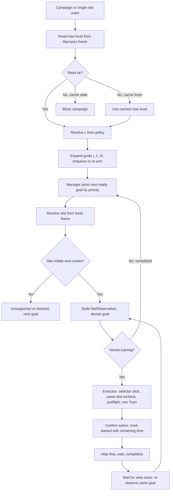
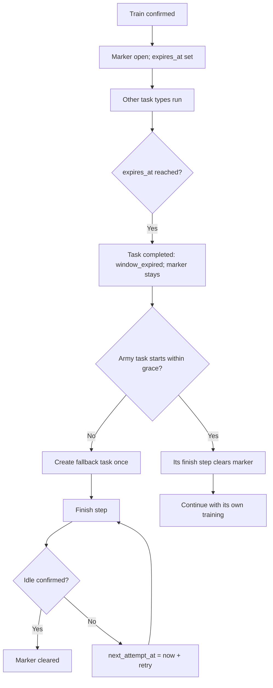
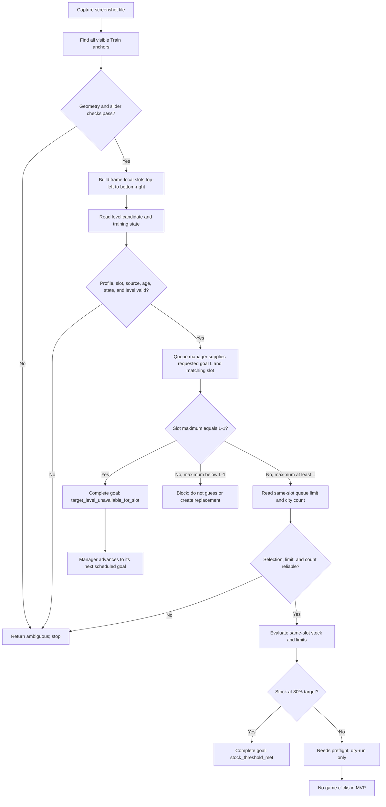

# Army Training Slot Workflow

**Status:** MVP behavior and decisions as of 2026-11-05. This document is the current source of truth for slot detection and the read-only stock-goal workflow. Historical implementation notes in other documents may be stale; follow this contract and the implementation-status table below.

## Purpose

The queue manager schedules stock goals. The visual reader identifies the visible unit training slots and gathers measurements from each slot independently. It does not identify troop names and does not click or scroll the game.

## Running the Read-Only Dry-Run

From the repository root in PowerShell, run:

```powershell
python .\army_training_dry_run.py `
    --input .\screenshots\army_training\pelny_army_training_empty_queue.png `
    --tesseract "C:\Program Files\Tesseract-OCR\tesseract.exe"
```

Replace `--input` with the screenshot to inspect and `--tesseract` with the local path to `tesseract.exe`. If Tesseract is on `PATH`, omit `--tesseract`. Use `python .\army_training_dry_run.py --help` to see CLI options. The report is read-only: it does not click, save a task, or change the game queue. It currently evaluates the configured target `{global_level: 5, match_number: 1}`; that target is not yet resolved dynamically from a profile queue.

For another computer, copy/clone the repository with its `regions.json`, `templates/`, and screenshot fixtures. Install Python and the runtime packages used by the scanner (`opencv-python`, `numpy`, `pytesseract`) plus the Tesseract OCR executable. `requirements-dev.txt` currently lists only `pytest`, not these runtime dependencies, so provision them separately. Verify local paths and run the command above before using another screenshot.

## One-Shot Live E2E Contract (Implemented; Supervised Live Run Pending)

The first live E2E is a one-shot experiment, not a persistent stock goal and not a permanent `match_number` assignment:

1. The user launches the game and places the Barracks screen fully visible on the primary monitor. Capture the primary monitor at the configured 1920x1080 size. Do not select or attach to another process/window.
2. Detect all visible slots in the fresh frame. Choose the second visible slot in top-left-to-bottom-right order. If fewer than two slots are detected, or geometry is ambiguous, stop.
3. Use the existing default-highest assumption for that slot. Find its immediately preceding visible selector badge as the requested `max-1` level and click that badge. Do not attempt to verify the enlarged selected marker after clicking: no representative post-click fixture is available and the current marker check proved too brittle. Report `selection_confirmed=false`; there is a known risk that the click did not change the level and the existing level remains selected.
4. Require the current training state to be idle. If active or unknown, stop without clicking Train.
5. Read this slot's city count, displayed training amount/limit, selected-level silver cost, and global food/silver. Require reliable OCR, white positive food, and sufficient silver.
6. Use the stock planner math for this one-shot goal: `target=2*slot_limit`, completion threshold `ceil(0.8*target)`, order amount `min(target-city_count, slot_limit)`. The UI quantity must equal the planned amount. If it differs, stop; quantity-slider manipulation is not part of this first executor.
7. Default execution is dry-run. Real execution requires explicit `--execute`. After the level click, capture and recheck only the same slot/anchor; do not gate on selected-marker OCR. Immediately before Train, capture and recheck idle state, same slot/anchor, resources, and displayed amount. Then issue exactly one click at the Train button's position detected in that fresh primary-monitor frame. The level itself remains unconfirmed.
8. Capture after the click and classify training. Only a fresh `active` result confirms acceptance. `idle` or `unknown` is reported as uncertain; never retry the click automatically.
9. Keep queue/goal state in memory for this one-shot test; do not persist a frame index as `{global_level, match_number}`. No Help/Speed Up clicks, scrolling, or additional training orders.
10. Honor PyAutoGUI's fail-safe and check the project's emergency-stop file before selector and Train clicks. The current executor does not write timestamped logs or save debug frames; uncertain outcomes are printed in the JSON report and require manual inspection.

## Live E2E Implementation Status

Implemented as an isolated, opt-in one-shot executor in `army_training_live_e2e.py`. Preview is the default. Live mode requires both `--execute` and the exact confirmation phrase, requires a 1920x1080 primary-monitor capture, and does not persist queue state. It no longer verifies level selection after clicking and reports `selection_confirmed=false`. Mocked tests cover its gates, click sequence, and failures after a click. A real, supervised game run has not yet been performed.

The current workstation lacks `mss` and `pyautogui`. The preview was attempted and safely returned `BLOCKED` with `Live capture requires the 'mss' package`, `actions_executed=false`, and `queue_modified=false`. Primary-monitor capture and physical clicks have not been exercised here. Install the declared runtime packages on the intended PC and inspect the preview there before executing. The one-below click still relies on the default-highest assumption. The planned order must equal the currently displayed amount; slider manipulation is deliberately not implemented. The executor does not create a persistent manager goal or `match_number`.

### Operator Procedure

1. From the repository root, install project runtime dependencies and install Tesseract OCR. Ensure `tesseract.exe` is on `PATH`.
2. Launch the game manually, open Barracks, and leave the full game visible on the primary monitor at 1920x1080. Close overlays/notifications. Confirm there is no active training.
3. Run preview first. It captures the current monitor but performs no clicks and does not change the queue:

```powershell
python -m pip install -r .\requirements-dev.txt
python .\army_training_live_e2e.py
```

4. Review the JSON. Confirm `slot_frame_index` is 1, `requested_level` is the intended max-1, `preflight.blockers` is empty, the game is idle, resources are sufficient, and `planned_quantity` equals the full displayed queue amount. Do not execute if any value is uncertain or the preview is blocked.
5. To execute the one-shot test, enter the explicit confirmation command. The program clicks max-1 without verifying the enlarged marker, checks that the same visible slot remains, repeats resource/stock checks, then can click Train once. This can train the previously selected level if the selector click failed:

```powershell
python .\army_training_live_e2e.py --execute --confirm "TRAIN SECOND SLOT MAX-1"
```

6. Interpret `START_CONFIRMED` as confirmation that some training started, not proof it started at max-1. `BLOCKED` means Train was not submitted, though the level selector may already have been clicked. `UNKNOWN_AFTER_CLICK` means Train may have been submitted: inspect the game manually and do not rerun automatically.
7. Emergency stop: create `%USERPROFILE%\.tba_stop` before the next gated action. PyAutoGUI's corner fail-safe is also enabled for real clicks.

This test uses the second visible slot in one frame; it does not mean global `match_number=2`. It does not persist a manager goal, scroll the list, click Help, or automatically retry.

## Manager-Driven Replenishment Contract (Phases B-D Implemented; Supervised Run Pending)

**Status:** approved 2026-11-06 and implemented through the manager-owned one-goal executor (phases B-D). No supervised live run has been performed. Re-arming follows the recommended option (completed goals are reopened by a new campaign run, history kept). The legacy one-shot executor remains unchanged; the manager executor owns the persistent goal flow.

### Implementation Notes (2026-11-06)

- `army_campaign.py`: campaign policy (`max`, `max_minus_1`, `fixed`), persistence in `profiles/<profile>/army_campaign.json`, expansion into goals `(L, 1..N)` with `created` / `rearmed` / `kept` actions.
- `army_state.py`: max-level cache in `profiles/<profile>/army_state.json`, TTL 24 hours; a fresh read wins.
- `army_training_levels.py`: `lowest_visible_level` from consecutive badges (gaps 20-30 px); `None` when gaps are irregular. The fixtures show gaps of about 25 px.
- `army_training_resolver.py`: m-th slot, in frame order, whose range contains `L`; `unsupported` without scrolling, `blocked` on uncertain ranges. Assumes the frame starts at the top of the list.
- `army_training_observation.py`: builds `SlotObservation`; the same slot limit is stored for the goal level, the highest level and the one below. Selection counts as verified only when the largest badge equals the goal level (default-highest assumption). For a lower goal level the decision is `selection_unverified` and the manager reports `select_level_then_reobserve`, because the displayed city count belongs to the selected level.
- `army_training_manager.py`: CLI `enqueue`, `set-campaign`, `expand`, `run`, and `execute`. `run --image` is an offline decision check, read-only unless `--save`. `execute` without flags previews only the required task startup; `execute --navigate-only --execute` tests live screen navigation without evaluating a goal; normal live `execute --execute` performs startup, then chooses one eligible goal by task priority.
- `army_training_executor.py`: resolves the goal again from a fresh primary-monitor capture, selects the target badge when needed, re-detects the same slot, checks idle/resources/stock/time, clicks Train once, and requires active-state confirmation before marking the task started. An uncertain result after a Train attempt pauses the profile queue to prevent a duplicate.
- `army_training_lifecycle.py`: coordinates Help/Speed Up/completion transitions only from explicit recognized states; it never clicks. Confirmed idle plus a fresh `SlotObservation` completes or requeues the same stock goal. The visual Help classifier and click adapter are pending because no verified Help fixture/template exists. Quick-finish acceleration remains manual.
- Manager startup preview: `python .\army_training_manager.py --profile <profile> execute`. For a live navigation-only check, use `python .\army_training_manager.py --profile <profile> execute --navigate-only --execute --confirm "EXECUTE ARMY TRAINING"`; it does not inspect a goal or click Train. Normal live `execute --execute --confirm "EXECUTE ARMY TRAINING"` continues from confirmed Barracks into the selected task and may click Train after all existing gates. The assistant has not performed a live run.
- `army_training_slot_time.py`: full-queue training time of a slot (day/hour resolution) is segmented first, then each digit is OCRed at two scales. The value is `None` unless all reads agree and every digit is fixture-verified (currently 1-5); unverified digits fail closed. It is correct on all six fixture slots; under JPEG/noise stress it returned no value rather than a wrong value. The manager executor requires this reading before Train and passes it to `mark_task_started` after active state is confirmed.
- Dry-run on `pelny_army_training_empty_queue.png`: goal `(7, 1)` -> `needs_preflight`, 1269 to train; `(6, 1)` -> `select_level_then_reobserve`; `(6, 4)` -> `match_not_visible_without_scrolling`.

## Army Training Task Startup (Approved 2026-11-06)

### Goal

Each army-training task starts from a predictable screen state and opens its own Barracks screen. Reset and navigation are part of the task startup, not separate queue tasks. The Escape reset is a shared helper that future task types can reuse before opening their own screens.

### Contract

1. Require explicit live-execution opt-in and the existing confirmation phrase before sending game input. The game must already be the foreground application; window activation is not implemented.
2. Invoke the shared `clear_game_screen` helper to send exactly three rapid Escape presses. Do not capture or analyze the screen between presses.
3. Capture a fresh primary-monitor frame. Search for the existing `world_map.armia` template in a search window extending 2 px beyond each edge of its annotated region, clamped to the frame. This permits template translation by up to 2 px in either direction while keeping the search local. Click the center of the best match only when it reaches the configured confidence threshold (94.6%); otherwise report the measured confidence, threshold, and expanded search region. Never click a guessed coordinate or a below-threshold match.
4. Wait for the navigation transition, capture a fresh frame, and require `locate_slots` to identify a valid Barracks layout before goal evaluation or any training action.
5. If the button or Barracks layout is missing, ambiguous, or outside the supported desktop geometry, stop the task without continuing to goal execution. Do not retry clicks automatically.
6. This startup is mandatory for each army-training task execution, including a manager cycle that then reports no executable goal. Other task types can reuse the reset helper and define their own navigation after reset.
7. Dry-run reports the planned reset and Barracks navigation without sending keys or clicks. Use `--navigate-only --execute --confirm "EXECUTE ARMY TRAINING"` for a supervised live navigation check; it sends the reset and Armia click but never evaluates a goal or clicks Train. Review that route before running a queued goal live.

### Operator Check: Navigation Only

The first live check opens Barracks and does not submit training. Keep the desktop game in the foreground on the primary 1920x1080 monitor. Preview the route:

```powershell
python .\army_training_manager.py --profile army_test execute --navigate-only
```

Then, only when ready to let the program send three Escape presses and click the detected Armia button, run:

```powershell
python .\army_training_manager.py --profile army_test execute --navigate-only --execute --confirm "EXECUTE ARMY TRAINING"
```

The command reports `BARRACKS_OPENED` only after slot geometry is detected. Any other status means stop and inspect the report; no goal or Train click is attempted. `army_test` is an operator-chosen profile label; navigation-only does not save or modify its queue.

### Confirmed, Assumed, and Deferred

- Confirmed by the user: each army-training task starts with three rapid Escape presses and then opens Barracks; this is intrinsic task startup, not a separate queue task. Reset behavior is shared for reuse by other task types.
- Existing evidence: the 53x46 px world-map `armia` template matches all 2438 pixels exactly in the supplied desktop screenshot at `(912, 919)`, while the annotated full-frame region begins at `(913, 918)`. The current fixed-size comparison therefore scores 85.02% despite the exact match 1 px left and 1 px down. The three world-map fixtures have their best matches at the annotated location or 1 px left. Barracks fixtures contain detectable training slots.
- Assumption: a 2 px translation margin covers expected capture/layout jitter while remaining local; larger displacement or geometry changes must remain blocked and be handled by a separately verified region/template update.
- Assumed until supervised live check: clicking `world_map.armia` opens the Barracks panel and the three Escape presses reliably return to the default world-map view.
- Deferred: openers for other task types and browser-client support.

### Current Code Status

`game_screen.clear_game_screen` and `army_training_navigation.open_army_training_screen` are implemented and covered by injected-input tests. The Armia matcher searches within a 2 px margin around the annotated region, reports that expanded region, and keeps the configured 94.6% threshold. Regression coverage verifies a 1 px shift and fail-closed behavior. `army_training_manager execute` runs this startup for live training; `--navigate-only` isolates it from goal evaluation and Train. A supervised live navigation check is still required to confirm the click-to-Barracks transition in the actual game.

### Expected Tests

- The shared helper emits exactly three Escape presses in live mode and none in dry-run; tests use an injected key-press function and never send real keys.
- Army startup orders reset, scoped `Armia` template match/click, then a fresh Barracks layout check.
- A template shifted by 1 px within the bounded search window is detected above threshold at its actual center; a match below threshold still blocks the click.
- Missing or uncertain `Armia` match or Barracks layout blocks task actions and no Train click occurs.
- A navigation-only live test can verify the route without submitting a training order.
- Existing manager and executor tests continue to verify that no Train click occurs without explicit live opt-in and all existing preflight gates.

### Goal

The queue manager receives a **campaign** such as "replenish level `max-1` to 2x the queue limit". A decomposer expands it into per-slot **stock goals**. A single slot can also be ordered directly as one goal. All goals run through the same manager, priority queue (see [task_manager.md](task_manager.md)) and executor.

### Terms

- **Campaign:** profile-level policy `{level_policy, enabled}` where `level_policy` is `max`, `max_minus_1`, or a fixed global level. It is stored separately from the task queue (`profiles/<profile>/army_campaign.json`, ignored by Git) and is never a task, so `get_next_task` cannot return it for execution.
- **Max level:** highest unit level shown in the Barracks. It changes rarely (every few days). It is read from the current frame at the start of each run and cached per profile in `profiles/<profile>/army_state.json` with `observed_at`, source, confidence, and a TTL (default 24 hours). A fresh read always wins; a cached value is used only when a read fails and it is within TTL; otherwise the run is blocked.
- **Stock goal `(L, m)`:** existing `slot_stock_v1` task with id `army_stock:level_{L}:match_{m}`. `m` is the 1-based position of the slot among all list slots whose selector range contains `L`, in list order.
- **Selector range:** levels offered by a slot, derived as `highest - n + 1 .. highest` from the `n` consecutive badges and the OCRed highest numeral. **Assumption:** badges are consecutive and cover the full range for that slot; verify on more accounts.
- **Slots per level:** `MATCH_COUNTS_BY_LEVEL`: levels 1-4 have 3 slots, levels 5-9 have 4.

### Rules

1. Decomposition: for resolved level `L`, create goals `(L, 1) .. (L, N)` where `N = MATCH_COUNTS_BY_LEVEL[L]`. `max` resolves to the max level, `max_minus_1` to `max - 1`; a level outside 1-9 blocks the campaign with a reason.
2. Goals are sequenced one at a time: only one training runs in the game. After each completed order the manager waits for the view to reset (about 5 s), captures a fresh frame, and re-reads stock before deciding on the same goal again or moving on.
3. Resolving `(L, m)` to a physical slot uses the current frame only. If `m` is beyond the visible slots, the goal is `unsupported` in this version (no scrolling) and is never guessed.
4. If no visible slot can be identified with certainty (ambiguous geometry, uncertain badges, local I/II), the goal stays blocked and is not retried automatically.
5. The existing decision rules apply unchanged: slot highest `== L-1` completes the goal with `target_level_unavailable_for_slot`; highest `< L-1` blocks; stock `>= ceil(0.8 * 2 * limit)` completes with `stock_threshold_met`.
6. Both levels of one slot share that slot's queue limit; the adapter builds `SlotObservation` from the slot's own readings only.
7. A single-slot order is a campaign-less goal `(L, m)` added through the same enqueue function and executed by the same manager. No separate script logic.
8. Goals inherit the `army_training` priority unless a priority is given; a campaign may supply one for all its goals.
9. Execution is dry-run by default. The manager's `execute` command requires `--execute` plus the exact confirmation phrase, checks the emergency-stop file before clicks, and enables PyAutoGUI fail-safe. It executes at most one goal per invocation. The selector marker is still not verified; reports keep `selection_confirmed=false`.
10. Before Train, require a reliable full-queue time reading. After Train, mark the task started only if a fresh frame confirms active training. Any uncertain result after a Train attempt pauses the profile queue and is never retried automatically.

### Re-arming (decided)

`enqueue_training_goal` is idempotent per `(L, m)` and a completed goal is never recreated, so a new campaign run re-arms completed goals by setting `status=queued`, process state `needs_observation` and clearing decision data; a `rearmed` history entry is appended and history is kept.

### Flow



### Confirmed vs Assumed vs Deferred

- Confirmed (user): goal means m-th slot containing level `L`; 3 or 4 slots per level; campaign decomposes into slot goals; single-slot orders required; max level changes rarely and is read from the Barracks; one training at a time; first version without scrolling.
- Assumed: consecutive badges form the whole selector range; TTL 24 h for the cached max level; 5 s view-reset wait; list order is stable between frames.
- Deferred: scrolling and access to off-screen slots, unlock/dim detection, local I/II mapping, timer OCR for `initial_remaining_seconds`, Help/speed-up automation, multi-profile parallelism. The new Barracks navigation route is implemented but awaits supervised live confirmation.

### Planned Code

| Step | Module | Notes |
| --- | --- | --- |
| Campaign model and expander | `army_campaign.py` | implemented |
| Max-level cache | `army_state.py` | implemented |
| Selector range and slot resolver | `army_training_levels.py`, `army_training_resolver.py` | implemented |
| `SlotObservation` adapter | `army_training_observation.py` | implemented |
| Manager dry-run runner and CLI | `army_training_manager.py` | implemented |
| Full-queue time reader | `army_training_slot_time.py` | implemented; 1-5 digits validated on fixtures; unsupported digits fail closed |
| Manager-owned one-goal executor | `army_training_executor.py` | implemented; explicit opt-in, at most one Train, timer required, unknown post-click pauses queue |
| Manager execution command | `army_training_manager.py execute` | implemented; selects the highest-priority eligible goal; dry-run unless `--execute` |
| Help/Speed Up/completion transition coordinator | `army_training_lifecycle.py` | implemented as pure state transitions; visual classifier and click adapter pending |
| Quick-finish acceleration dialog and item selection | future executor step | pending; no verified dialog fixture |

### Expected Tests

- Expansion: level 4 yields 3 goals, level 6 yields 4; repeated expansion creates no duplicates; re-arm resets only completed goals.
- Policy resolution `max`, `max_minus_1`, fixed; out-of-range level blocks.
- Max-level cache: fresh read wins, stale cache blocks, fresh cache used on read failure.
- Selector range derived from badges on both fixtures; resolver returns the right slot for `(L, m)`, `unsupported` for `m` beyond visible slots, `ambiguous` on uncertain geometry.
- Fixture to `SlotObservation` to manager decision with persisted reason; both levels share the same limit.
- Single-slot enqueue produces the same task as the campaign for the same `(L, m)`.
- Executor with mocks: one Train click, no retry, failure after click is uncertain; manager sequencing re-observes after each order.

## Training Completion Without Wake-ups (Approved 2026-11-06)

**Status:** approved and being implemented. It supersedes the earlier idea of parking a task and waking it to speed up; the pure coordinator in `army_training_lifecycle.py` stays but its wake-up path is not used by this flow.

### Goal

After a confirmed Train the queue task only waits for a configurable window so other players can Help. When it expires the queue closes the task. The next army task (or one fallback task) finishes the in-game training with Speed Up. Other task types run in between.

### Terms

- **Help window:** per-order time before `expires_at` (default 30 minutes; per-task `help_window_seconds` or queue setting). Because the Help click is not automated yet, the window is anchored at the confirmed Train plus the post-order delay.
- **Open training marker:** `open_training` in `profiles/<profile>/army_state.json` with `order_id`, `task_id`, `goal`, `started_at`, `expires_at`, `speedup_attempts`, `last_attempt_at`, `next_attempt_at`. It means the bot started a training whose end is not yet confirmed.
- **Grace:** extra time after `expires_at` (default 10 minutes) before the fallback task is created.
- **Finish step:** read the active-training state on the open Barracks screen. Idle clears the marker; active with an open marker runs the Speed Up adapter, waits for the view reset (about 5 s), re-observes, and clears the marker only when idle is confirmed.
- **Fallback task:** one army task `finish_training_v1` with id `army_finish:<order_id>`.

### Rules

1. After a confirmed Train, write the marker and set the task `expires_at`.
2. Expiry runs on every manager cycle and at start: an active task past `expires_at` becomes `completed` with `completed_reason=window_expired`. The marker stays open.
3. Every army task starts with the finish step; there is no extra navigation.
4. Active training without a marker is a blocker; Speed Ups are never spent on it.
5. If the marker is still open after `expires_at + grace`, create the fallback task once. If it runs after the marker was cleared, it completes without opening a screen.
6. A failed or impossible Speed Up does not pause the profile and keeps the marker. Set `next_attempt_at = now + retry interval` (default 1 hour) and mirror it in the blocked task's `next_check_at`. Army tasks stay blocked until then; other task types continue.
7. Retries continue at the interval. After `needs_attention_after_attempts` attempts (default 3) the report says `needs_attention`, but retries do not stop.
8. The fallback task does not re-evaluate stock; the next campaign run (`expand`) re-arms goals.
9. The Speed Up dialog, item selection and the Help/Speed Up recognizers are separate modules. Until they exist the Speed Up adapter is absent and every finish attempt reports `speedup_module_unavailable` and schedules the next attempt.

### Flow



### Confirmed vs Assumed vs Deferred

- Confirmed (user): task ends at expiry; the next army task finishes the previous training; a last-task mechanism exists; Speed Ups may run out and about hourly retry is acceptable; minimise screen visits and clicks.
- Assumed: help window 30 min, grace 10 min, retry 1 hour, one active-training panel shared by all slots, the marker is the only proof that the bot owns the active training.
- Deferred: Help/Speed Up/dialog recognition and clicks, item selection, stock re-evaluation by the fallback task. Army task startup now resets and opens Barracks; its click transition awaits supervised live confirmation.

### Code Status

Implemented (mock and fixture level): `expires_at`/`help_window_seconds` and `expire_tasks`/`complete_task` in `task_controller.py`; marker helpers in `army_state.py`; `army_training_finish.py` (finish step, expiry processing, fallback creation and execution); integration in `army_training_executor.py` and `army_training_manager.py`. The Speed Up adapter itself is not implemented.

### Tests

`tests/test_army_training_finish.py` and the expiry cases in `tests/test_task_controller.py`: expiry reason and persistent marker, later army task clears the marker, a single fallback task and its no-op, foreign training blocker without a click, retry timing without pausing the queue, legacy queues without `expires_at`.

## Terms

- **Slot:** one unit training panel, including its level selector, city count, training amount, slider, costs, duration, food load, and Train button.
- **Frame index:** zero-based position in one captured frame, ordered top-left to bottom-right. It is temporary screen geometry, not a persistent slot identity.
- **Local level:** Roman numeral rendered in a slot selector. A local I/II can represent global VIII/IX in the late list; do not map those to global levels without list context.
- **Highest visible level:** numeral read from the presumed highest selector badge in the current slot. The MVP assumes the largest badge is selected and, by the user's stated default behavior, normally is the highest available level. This is an assumption, not direct proof of unlock state.
- **One-below level:** the immediately preceding visible selector position, only when its badge is detected directly above the largest badge.
- **Queue manager:** the higher-level planner that owns task order and progression. The detector never creates a replacement task when a slot cannot satisfy a requested level.

## Agreed Rules

1. Detect every visible slot; do not impose a three-slot maximum. A scroll operation may expose additional slots in a later frame.
2. Order slots in each frame top-left to bottom-right. Frame indexes restart for every frame and must not be persisted as global `match_number` values.
3. Read each slot's measurements from that slot's translated regions. Never borrow another slot's queue limit or city count.
4. Each slot has its own maximum queue limit. The limit is the same for the two training levels used for that slot (highest and one below), while silver and food costs can differ by level. The adapter that supplies both level entries to `SlotObservation` is not implemented yet.
5. The training amount displayed by default is expected to be the maximum queue amount; the MVP reads the displayed amount and does not move the slider. The current reader does not independently verify that the slider is at its maximum.
6. In approximately 99% of cases, the highest level is selected by default. The MVP uses the largest badge as the presumed highest level and defers selected-marker verification. A manually selected lower level is a known edge case.
7. For requested target level `L`, if reliable slot evidence says its highest available level is exactly `L - 1`, complete that requested goal with reason `target_level_unavailable_for_slot`. Do not train a substitute and do not enqueue a replacement goal. The queue manager advances to its next separately scheduled task.
8. If the slot is more than one level below `L`, keep the decision blocked. Do not silently skip multiple levels.
9. If the OCR, slot geometry, badge ordering, or evidence provenance is uncertain, return `unknown`/`ambiguous`/`blocked`. Never infer a slot or issue a training action from uncertain evidence.
10. MVP does not scroll the list, capture a live window, identify troop names, click level selectors, click Train, or click Help.

## Detection Algorithm

### Visible slot geometry

1. Match the Train-button template at score `>= 0.90`.
2. Group matches into rows when their vertical coordinates differ by at most 3 px; sort each row left-to-right and rows top-to-bottom.
3. Require a horizontal pitch of 261 px within ±2 px between neighboring slots in the same row. Reject overlapping rows.
4. Confirm each candidate with the slider-button template at score `>= 0.90` within the expected translated region.
5. Return all slot regions translated from the base region. Return `none` when no Train anchor is found and `ambiguous` for irregular geometry or failed cross-checks.

These thresholds were checked on the two clean 1920x1080 fixtures only. They are provisional for other scales and UI variants.

### Highest and one-below level candidates

For each slot independently:

1. Detect circular selector badges with Hough circle detection.
2. Choose the largest-radius badge as the presumed selected/highest badge. Require it to be distinctly larger than other badges and the last badge in top-to-bottom order. Otherwise return `unknown`.
3. OCR only that badge's Roman numeral using two preprocessing/segmentation paths and require agreement. The current fixtures read V with confidence 89 and VII with confidence 87-88.
4. If the numeral is local I or II, return `unsupported`: global VIII/IX mapping requires list context that this MVP does not have.
5. The one-below candidate is the immediately preceding detected badge, whose center must be 20-30 px above the presumed-highest badge. Its level is inferred as `highest - 1`; the lower numeral is not separately OCRed.
6. `read_layout_selector_levels` takes the maximum of slot readings in the current frame and returns indexes for slots at that visible maximum and visible maximum-minus-one. Despite the field name `global_highest_visible_level`, this is only a maximum over the supplied frame, not a scan of the entire game list.

## Per-Slot Measurements

`read_slot_readings(image, slot)` reads:

- `queue_limit` from `unit_troop_count_to_train`;
- `city_count` from `current_unit_troop_count`;
- `silver_cost` from `unit_troop_require_silver_to_train`.

Each value carries raw OCR, parsed value, and confidence. The limit, city count, and silver cost are independently read from that slot's own regions. The current reader does not yet return food, time, a level-bound observation, or a complete `SlotObservation`.

Observed fixture values (not independent game-ground-truth labels):

| Fixture | Slot order | Queue amount/limit | City count | Silver cost |
| --- | --- | ---: | ---: | ---: |
| `pelny.png` | 1 | 31,310 | 0 | 9.29M |
| `pelny.png` | 2 | 31,310 | 0 | 9.29M |
| `pelny.png` | 3 | 15,655 | 0 | 9.29M |
| `pelny_army_training_empty_queue.png` | 1 | 1,565 | 1,861 | 12.6M |
| `pelny_army_training_empty_queue.png` | 2 | 31,310 | 13,069 | 12.6M |
| `pelny_army_training_empty_queue.png` | 3 | 31,310 | 14,765 | 12.6M |

## Queue Goal Decision

For a stock goal tied to global level `L` and matching slot `M`, the existing planner's intended calculation is:

```text
target_count = 2 * that_slot_reference_limit
complete when city_count >= ceil(0.80 * target_count)
training_count = min(target_count - city_count, that_slot_training_limit)
```

The limits are per slot. By the agreed rule, the future adapter supplies that same slot-specific maximum for both relevant levels. It must not reuse a neighboring slot's value.

`decide_training_goal` consumes a typed `SlotObservation`, not raw detector output. It first requires fresh, matching profile/slot/source evidence and an idle training state, then a reliable highest-level reading. If that level is exactly `L-1`, it returns `SATISFIED` with reason `target_level_unavailable_for_slot` immediately; city count, queue limits, and selection verification are not needed because no training will happen for this goal. If the level is lower than `L-1`, it returns `BLOCKED`. Only when the slot can meet target `L` does it require verified selection, same-slot queue limits, and city count. A `SATISFIED` decision is reconciled to persistent task status `completed`; its reason is stored in process history. No replacement goal is generated here.

## Flow

This shows the intended composition of components. The CLI dry-run now reports slot candidates and per-slot readings, but it does not yet bind a frame slot to persistent `{global_level, match_number}` or call the stock-goal manager. The branch semantics inside `decide_training_goal` are implemented and covered by tests.



## Implementation Status

| Capability | Status | Code |
| --- | --- | --- |
| Find and order visible slots in a frame | Implemented, read-only | `army_training_slots.py` |
| Translate/crop each slot's UI regions | Implemented | `army_training_slots.py` |
| Read each slot's queue amount, city count, silver cost | Implemented; fixture-tested | `army_training_slot_reader.py` |
| Detect selector badges, use largest badge, OCR its local numeral, infer adjacent one-below position | Implemented; fixture-tested | `army_training_levels.py` |
| Verify actual unlocked/dimmed state | Not implemented; largest/selected-is-highest is an assumption | `army_training_levels.py` |
| Map local I/II to global VIII/IX | Deferred; unsupported | `army_training_levels.py` |
| Assign persistent `{global_level, match_number}` from visible frames/scroll history | Not implemented; frame index is not identity | `army_training_slots.py`, `army_training_plan.py` |
| Adapt slot reads into `SlotObservation`, binding the correct level, source, profile, and timestamp | Not implemented | `army_training_process.py` has the model/decision only |
| Pass the same slot limit for both levels to the stock-goal decision | Agreed, adapter not implemented | `army_training_process.py` |
| Mark exact one-below target unavailable as completed | Implemented in decision/reconciliation, awaits trusted level adapter | `army_training_process.py` |
| Stock-goal queue and dry-run reconciliation | Implemented | `army_training_process.py`, `task_controller.py` |
| Connect the CLI dry-run report to slot detection, level candidates, and per-slot readings | Implemented; reports candidates but does not mutate any queue | `army_training_dry_run.py` |
| Bind a dry-run candidate to persistent `{global_level, match_number}` and call the stock-goal manager | Not implemented; no list-origin/scroll identity proof or `SlotObservation` adapter | `army_training_dry_run.py`, `army_training_process.py` |
| Food/silver live resource preflight and one Train click | Implemented in opt-in manager executor; fixture/mock validation only | `army_training_executor.py` |
| Help and speed-up click flow | Not implemented | Follow-up after supervised executor run |
| Primary-monitor capture in isolated one-shot executor | Implemented; requires `mss`, fixed 1920x1080 frame | `army_training_live_e2e.py` |
| Opt-in max-1 selector click, same-slot re-detection, preflight, one Train click, post-click confirmation | Implemented; selector marker is not verified and report says `selection_confirmed=false`; mocked tests only | `army_training_live_e2e.py`, `tests/test_army_training_live_e2e.py` |
| Window selection and scroll workflow | Not implemented | Out of MVP scope |

## Contract Checks

Use the tests below as executable checks for the corresponding documented rules. When a rule changes, update its test and this document in the same task.

| Rule | Regression test |
| --- | --- |
| Visible slots are ordered in the frame and uncertain geometry is rejected | `tests/test_army_training_slots.py::test_finds_three_slots_left_to_right`, `test_second_row_after_scrolling_is_ordered_top_left_to_bottom_right`, `test_missing_middle_slot_is_ambiguous` |
| Each slot uses its own queue limit and readings | `tests/test_army_training_slot_reader.py::test_each_slot_keeps_its_own_queue_limit_on_the_active_screen`, `test_each_slot_keeps_its_own_queue_limit_on_the_empty_queue_screen` |
| Largest badge is the presumed max; adjacent position provides max-1; unsupported readings do not guess | `tests/test_army_training_levels.py::test_reads_highest_visible_level_per_slot`, `test_layout_reports_global_max_and_one_below`, `test_largest_badge_not_at_end_is_unknown`, `test_local_one_or_two_is_not_misreported_as_global_level` |
| Dry-run reports visible target candidates but does not claim an unverified match number | `tests/test_army_training_dry_run.py::test_dry_run_reads_resources_and_blocks_unverified_training`, `test_dry_run_reports_idle_training_without_active_training_block`, `test_target_candidate_classifies_exact_one_below_for_manager_skip` |
| Exact `L-1` completes with a reason without count/limit reads; more than one level below remains blocked | `tests/test_army_training_process.py::test_slot_one_level_below_target_completes_goal_without_other_readings`, `test_slot_more_than_one_level_below_target_stays_blocked` |
| Stale, mismatched, active, or low-confidence evidence cannot authorize training | `tests/test_army_training_process.py::test_uncertain_evidence_blocks_action`, `test_active_training_cannot_satisfy_goal_or_start_another_order` |
| Click/capture failures after an action are reported as uncertain and never retried | `tests/test_army_training_live_e2e.py::test_capture_failure_after_level_click_reports_action_and_unknown`, `test_train_click_exception_is_unknown_and_never_retried`, `test_uncertain_post_click_does_not_retry` |
| Skipping marker verification does not skip same-slot redetection or fresh preflight | `tests/test_army_training_live_e2e.py::test_unconfirmed_selection_still_requires_same_slot_and_fresh_preflight` |
| Manager executor starts at most one order, requires reliable time, never retries uncertain Train, and pauses on unknown result | `tests/test_army_training_executor.py` |
| Day/hour time reader returns exact fixture values and rejects merged or incomplete glyph layouts | `tests/test_army_training_slot_time.py` |
| Help timing, Speed Up confirmation, uncertain Help pause, and completion re-observation | `tests/test_army_training_lifecycle.py` |

For a future change that connects components, add an integration test that starts with a screenshot fixture, constructs a `SlotObservation`, and verifies the manager decision and persisted reason. Until that adapter exists, component tests do not prove the full screenshot-to-queue flow.

## Next Integration Step

Install the declared runtime dependencies on the intended PC, keep the game's Barracks fully visible at 1920x1080 on the primary monitor, and run preview first. The first supervised `--execute` run will use only the second visible slot in the current frame and will not persist a manager goal. It can select max-1, run slot-specific preflight, click Train at most once, and confirm active state. If preview blocks because stock is already at target, a queue is active, resources are insufficient, or the planned order is not exactly one full queue, do not bypass the blocker. After that one-shot E2E works, separately build the persistent queue-manager adapter and prove the global `match_number` over the full list.

## Browser client: first-screen recognition contract

**Scope:** Read-only recognition of browser `army_training` slot readings and active/idle training state. This does not enable browser clicks, live execution, window selection, speedup-action detection, or support for other screens.

**Confirmed facts:** All four browser captures used for this slice are 1920x1080 and include browser chrome. They show matching army-training layout and the three Train anchors at `(775,774)`, `(1036,774)`, `(1297,774)` with 261-pixel stride. The active capture is `screenshots/army_training_active_website.png`; the non-active capture is `screenshots/army_training_nonactive_website.png`. At the browser `current_training_unit` region `(668,326,60,58)`, existing read-only signals measured gray detail `57.665` in the active sample and `2.053` in the non-active sample; the latter matches the empty-unit template at `0.9765`. These sample values distinguish these two screenshots, not every possible game state.

**Assumptions to validate:** Browser controls have the same training semantics as desktop controls. The received browser screenshot represents the intended browser zoom and layout. Browser slot indices correspond to the same game ordering as in the desktop capture.

**Uncertain/deferred:** Browser game-client crop and dimensions, browser zoom/DPI, selector-level recognition, resource preflight, speedup/help button state, and any action execution. The current level reader reports unknown on the supplied browser selectors. Active/idle classification is only evidenced by one active and one non-active sample; intermediate/occluded cases must remain unknown. No browser clicks are in scope.

**Algorithm:** Use existing desktop regions/templates only as search references to propose browser candidates. Search browser captures for controls; validate repeated slot anchors against slider tracks and expected stride. For training state, crop only the browser-specific `current_training_unit` region. Classify `idle` when the empty-unit template score is at least `0.90`; otherwise classify `active` only when grayscale detail is at least `20`; all other evidence is `unknown`. A conflict or invalid/out-of-frame crop is an error/unknown, never idle. Save browser-specific regions/templates and fixtures only under browser paths. Keep desktop assets unchanged and never fall back to them at runtime.

```text
browser capture + desktop templates as search references
    -> candidate matches -> validate 3 anchors, slider tracks and slot stride
    -> browser-only regions/templates -> read-only slot detection/OCR
    -> current-training-unit ROI -> empty-template match / detail score
    -> idle / active / unknown (ambiguous cases stop)
    -> pass: verify only covered slot geometry/readings/state
    -> ambiguous/no match/failure: keep unknown and stop for review
```

**Current code status:** The registry uses `desktop` and `browser`; `desktop` remains the default and `legacy` remains a compatibility alias. Browser regions, templates, and three regression captures are isolated under `ui/browser/`. Slot detection/OCR passes on the existing browser fixture. Browser scanner now returns `active`, `idle`, or `unknown` from the state ROI with an explicit unsupported marker for speedup/count readings. Selector-level reading returns `unknown` on the existing fixture. The generic template verifier intentionally reports the empty-state template below threshold on the active-state fixture; state classification is covered by the scanner tests instead. Speedup/help state, resource preflight, window capture, and clicks remain unsupported. Desktop workflow/assets remain unchanged.

**Implementation status:** Implemented after approval. The browser-only scanner classifies the active and non-active fixtures and returns `unknown` for low-detail, non-matching evidence. It leaves speedup detection as `None` and reports the trained-count field as unsupported for browser rather than reusing desktop regions. Tests cover both screenshots, an ambiguous ROI, browser slot/OCR behavior, and asset isolation. No game actions are implemented.

**Contract tests:** `tests/test_browser_army_training.py::test_browser_scanner_classifies_active_and_idle_training_from_fixture_roi`, `test_browser_scanner_keeps_ambiguous_training_roi_unknown`, and existing browser slot/OCR and UI-variant isolation tests. Existing desktop scanner tests continue to validate desktop output.
