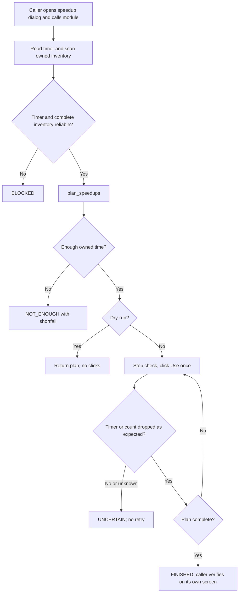
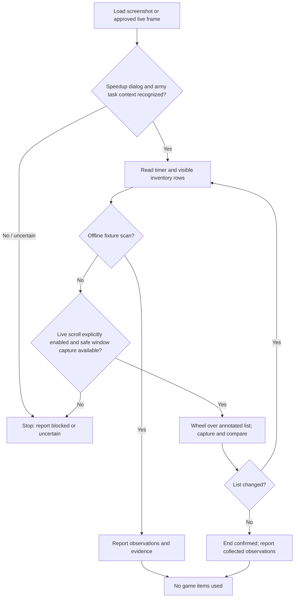

# Speedup Module Workflow

**Status:** Standalone speedup function approved 2026-11-06. Calibration-only live scrolling is implemented in `speedup_calibration.py` and covered by fake-adapter tests; it has not been run against the live game. The full direct-run finisher remains blocked on the inventory row reader. Implemented: `speedup_readings.py` (parsers), `speedup_planner.py` (pure use planner), `speedup_reader.py` (timer reader) and `speedup.py` (orchestrator over injected screen functions, tested on a fake dialog). Not implemented: the inventory row reader (duration labels and quantities), the full direct-run finisher, the army adapter and live item-use integration. Bounded wheel scrolling over the annotated inventory list is approved. The live polling cadence needed to detect timer milestones remains undecided.

## Goal and scope

Finish the active task whose speedup dialog is open: read the remaining time and owned inventory, plan which items to use, use them, and report. It does not buy items, spend gold, or change any task queue.

The reader is intended to be reusable for a shared speedup dialog, but only army training is in the first game-integration scope. Academy research and building upgrades remain deferred until their dialog behavior is verified and separately approved.

## Standalone speedup module (approved 2026-11-06)

`speedup.py` finishes the active task whose speedup dialog is open. It is independent of the task queue, profile markers and task type. Whoever needs a task finished calls it; the caller decides when, and confirms completion on its own screen. There are no `quick_finish` or permission flags: a live call is the request to finish. Planning is a separate pure module, `speedup_planner.py`; screen reading reuses `speedup_readings.py`.

Public operation: `finish_with_speedups(capture_fn, read_dialog_fn, click_fn, scroll_fn, stop_fn, sleep_fn, dry_run=True, max_scrolls=12)`. `read_dialog_fn(frame)` returns a `DialogReading` (timer, owned rows with click points, whether every row was readable, a list-position signature) or `None` when the dialog is not recognized. It starts with the dialog already open and returns `FINISHED`, `NOT_ENOUGH` (with shortfall seconds), `UNCERTAIN`, `BLOCKED` or, in dry-run, `PLANNED`, plus the plan, performed uses and a reason. The first caller is the army-training finish step; other task types may call it once their own dialog entry and completion check are verified.

## Scroll calibration workflow (approved 2026-11-06)

The calibration command is a separate, non-finishing mode. The user opens the speedup dialog before starting it. It captures the initial screen, then performs up to 20 single downward wheel steps and saves a fresh, ordered screenshot after each step. It performs no item, purchase, or task-control clicks and cannot invoke the planner or item-use loop.

Dialog recognition searches for the annotated `speedup_dialog_anchor` within an 8 px margin around its expected location, with normalized template-match score at least 0.95. This tolerance is based on the three bot captures from 2026-11-06: the title was consistently detected at (902, 255), 2 px right and 5 px down from the annotated (900, 250), with score 0.9973. The captured frame and display were both 1920x1080. The expected annotation itself remains unchanged.

Before every wheel step, move the pointer to the center of the annotated `speedup_inventory_viewport` region (x=959, y=585 in the 1920x1080 desktop fixture), safely inside the list and away from the navigation bar and Use/Buy controls. Then send one wheel notch downward and capture after a short settle. Capture uses the primary monitor and adds its desktop origin to the region-relative pointer point. Refuse to scroll if the captured frame is not 1920x1080 or the pointer-coordinate display size does not match the capture size.

Save `step_000_initial.png` and each resulting `step_NNN_after_scroll.png`, plus a JSON manifest with timestamps, action, point, frame geometry and viewport change score, under a unique `debug/speedup/calibration_<timestamp>/` folder. Compare only the annotated inventory viewport between consecutive captures. Save the first unchanged view and stop there; otherwise stop after the configured maximum (default 20). The calibration report does not claim that all inventory rows were recognized or that the end of the inventory was reached.

Live invocation requires an explicit calibration command and confirmation phrase. Check the existing emergency-stop file before every pointer move and wheel event. An unexpected frame size, display-size mismatch, capture error, stop request, or output error aborts without another input action. Automated tests use injected capture/move/scroll/sleep functions and temporary output folders; they do not launch or control the game.

Run the supervised calibration from the project directory with:

```powershell
python .\speedup_calibration.py --calibrate-scroll --confirm "SCROLL SPEEDUP LIST"
```

Use `--steps N` to request a different limit from 1 to 20; the default and maximum is 20. The command stops earlier when consecutive inventory viewport captures are unchanged.

The full standalone finisher remains separate: the future `--execute` path must not be added until the inventory reader and use verification are fixture-backed.

## Direct-run finishing workflow (deferred)

The user wants to be able to launch the speedup module directly, with the speedup dialog already open. Opening the dialog, choosing the active task, and preparing the game state are outside this module; another process or the user owns those steps. The module operates only on the currently open dialog and does not read or mutate task queues, task markers, or profiles.

The earlier proposed command interface is deferred until image-based inventory reading is verified:

- `python speedup.py` runs in dry-run mode: recognize the open dialog, scan the complete inventory, and report the plan. It may perform bounded list-navigation actions needed to inspect every row, but it never clicks `Use`, `Buy`, or any task control.
- `python speedup.py --execute` performs the planned uses. No task-type, queue, or permission flags are added. This is the single explicit switch from planning to item use.
- Both modes capture a fresh frame after every navigation input and every `Use` click. Save ordered, timestamped captures and recognition evidence under a run-specific directory in `debug/speedup/`. The report identifies the action and recognized list position for each capture. Do not save credentials or profile secrets.
- After each navigation input, continue only if the dialog remains recognized and the visible rows/list position match an expected transition. If the transition is unknown, rows do not overlap as expected, the dialog changes, or any owned row cannot be read, stop with an incomplete/uncertain result; never guess a click coordinate or skip a row.
- After each `Use`, verify the inventory count from a fresh capture. Never retry an uncertain use. The module does not open the dialog or verify completion on the caller's task screen.

Navigation details remain evidence-dependent. The existing contract approves bounded wheel scrolling over the annotated inventory viewport. Place the pointer over the first visible owned speedup icon (for example, the 1m entry), inside the list and away from the game navigation bar and Use/Buy controls. Send one bounded wheel step, capture and inspect the resulting screen, then continue only if the expected list transition is confirmed. Stop at the first confirmed no-change view; do not force a fixed number of steps. The proposed 3-4 navigation clicks to expose groups of about four speedups are not verified; use them only if supplied captures establish the control, its effect, and safe annotated click region. Do not click an item row to navigate. The Buy offer remains a terminal recognition cue only if its position is confirmed; it is never clicked or counted as inventory.

### Confirmed facts, assumptions, and deferred cases

- Confirmed: the user will ensure that the speedup dialog is already open for a supervised run; another process may open it. Automated tests should use fake-game/fixture adapters and must not require launching the game.
- Confirmed: current captures and candidate regions describe the desktop client at 1920x1080. `Automator.update()` captures the primary monitor, not a selected game window.
- Assumption to verify: the open dialog is visible on the primary monitor and the capture dimensions/scale match the annotated desktop fixtures. If not, stop; window selection and coordinate conversion are a separate capability.
- Deferred: exact navigation clicks and their expected row groups until transition screenshots are supplied and annotated. Browser-client behavior remains unsupported.
- Deferred: live item use until the inventory reader, regions, and post-click count verification pass fixture tests and the user explicitly starts a supervised execution.

### Calibration implementation and validation

1. Implemented: bounded dialog-anchor search based on bot captures, display-geometry preflight, pointer reposition before each wheel step, per-step screenshots and manifest, first-no-change stop, up to 20 steps, and emergency-stop handling.
2. Implemented: tests for bot-capture and fixture anchor recognition, non-dialog rejection, action order, pointer coordinates, captures, preflight failures, step limits and emergency stop.
3. Pending: the user opens the desktop dialog, runs the confirmed calibration command, then shares or confirms the generated captures for review.
4. Deferred: full image-based inventory reader, completeness/overlap scanner, direct-run item-use mode and army adapter.
5. Validation: run focused and full tests; run `tools/verify.py` if screen recognition assets or regions change. Live validation remains a supervised user-run operation.

The calibration behavior above is approved; the deferred item-use CLI remains unapproved for implementation until its reader and verification requirements are satisfied.

### Rules

1. Dry-run is the default and never clicks `Use` or `Buy`; it may scroll to read the complete inventory. Live calls check the emergency stop before every navigation input and click.
2. Recognize the dialog, read the timer, and scan the complete owned inventory with bounded wheel scrolling over the annotated viewport only; no viewport change confirms the end of the list. Never drag the scrollbar thumb. The Buy offer is not inventory. An unreadable timer, unrecognized row or incomplete scan returns `BLOCKED`; nothing is guessed or treated as zero.
3. Build the plan with `plan_speedups`. If owned items cannot cover the remaining time, return `NOT_ENOUGH` with the shortfall and use nothing.
4. For each planned use: stop check, click Use once, capture a fresh frame, and require the item count to drop by one. An uncertain result returns `UNCERTAIN` and is never retried. A zero timer after a use, or a closed dialog after the last planned use, ends the run as `FINISHED` and skips the rest of the plan. A dialog that closes earlier is `UNCERTAIN` (`dialog_closed_before_plan_end`) because a closed dialog cannot be told apart from an accidental close; the caller confirms on its own screen.
4a. Re-planning (approved 2026-11-06): the first time a readable timer after a use is below 20% of the timer at the start of the call, the plan is rebuilt once with `plan_speedups` from that timer and the remaining stock (scan quantities minus confirmed uses). This corrects deviations such as clan Help or day/hour rounding. If the rebuilt plan cannot be covered, return `NOT_ENOUGH` with the uses already made. An unreadable timer never triggers or cancels a re-plan.
5. `FINISHED` means the dialog closed or shows a zero timer after the last planned use. The exact look of a finished dialog is not yet confirmed; any other state after the plan is `UNCERTAIN`. The timer has only day/hour resolution, so a use is verified by the item count dropping by one (a vanished row counts as zero), not by the timer. The caller still verifies completion on its own screen.
6. Known limits: dry-run scrolls the list (it must, to read the whole inventory) but never clicks; scanning is bounded by `max_scrolls`; if an item runs out and the list shortens, the module returns `UNCERTAIN` (`list_changed`) rather than guessing the position. A stop requested after a click reports `UNCERTAIN`; before any click it reports `BLOCKED`.
7. The result carries a reason; debug captures on uncertainty are a caller responsibility for now.
6. The result carries evidence (timer and inventory readings, planned and performed uses, reason) and a timestamped debug capture on uncertainty.

### Planning algorithm (`plan_speedups`)

Input: remaining seconds and owned inventory (`duration seconds -> quantity`). Output: ordered `(duration, count)` uses, breached floors, shortfall seconds and a status (`ok`, `nothing_to_do`, `shortfall`).

- Preferred durations by remaining time: up to 5 days `1h 3h 8h`; over 5 up to 15 days `8h 15h`; over 15 up to 100 days `15h 1d 3d`; over 100 days `3d 7d 30d`. Preferences are soft; the bucket is re-evaluated as time is used.
- Floors: keep 3 of `3d`, `7d`, `30d` and 10 of every other duration.
- If the whole inventory is shorter than the remaining time: status `shortfall`, no uses.
- Otherwise repeat until nothing remains, choosing among items whose stock is above their floor, in this order: the largest preferred item not longer than the remaining time; the largest item not longer than the remaining time; the smallest preferred item longer than the remaining time (last, overshooting step); the smallest item longer than the remaining time. Only when no item above its floor is left, use floor-breaking items: the largest that fits, else the smallest.
- A floor is reported as breached only for a duration the plan used that ends below its floor. Floors outrank overshoot: a large item may be spent on a small remainder rather than breaching a floor.

### Flow



### Caller integration (army training)

`army_training_finish.finish_open_training` already accepts `speedup_fn`. The manager supplies a thin adapter: click the panel Speed Up button at the scanner's `training_button_region`, wait for the dialog, call `finish_with_speedups`, and return the observed training state. Completion is confirmed by the existing idle check, not by the module result. The finish step is only run for a bot-owned open-training marker, so the module never spends items on a foreign training. The earlier `quick_finish` gate for this path is dropped.

### Open questions

- Whether the game asks for confirmation or a quantity after Use.
- How the dialog looks once the task has finished.

Both are confirmed against fixtures or a supervised run before the use loop is enabled.

### Required evidence and tests

- Annotate with `tools/annotate.py`: dialog anchor, timer, inventory viewport, row duration and quantity, Use button, scroll track. Nothing is derived from guessed coordinates.
- `tests/test_speedup_planner.py` (pure): preferred buckets, floors, overshoot on the last item, floor-breaking and its report, shortfall, empty and invalid input.
- Module tests with injected capture/click: dry-run never clicks Use or Buy and performs only bounded, verified navigation; incomplete scan blocks; each use is a single click verified by a fresh frame; an uncertain use is never retried; the stop check runs before every navigation action and click.
- Fixture tests over the complete inventory across `speedup_view*.png` before live use.

## Confirmed facts

- The supplied speedup screenshots are desktop-client captures at 1920x1080. They show a remaining-time display, acceleration entries with quantities and individual Use controls, a scrollable list, and a Buy entry.
- Visible duration labels include 1m, 15m, 1h, 3h, 8h, 15h, 1d, 3d, 7d, and 30d. Quantities vary between screenshots.
- The Buy entry is not owned inventory and must never be treated as a usable item.
- The typed task queue stores remaining duration in seconds and models `quick_finish` and speedup-related statuses, but it does not read the dialog or inventory.
- The game-flow integration currently covers army training only.

These observations do not verify that all task types use identical dialog behavior or that browser-client speedup screens match the desktop client.

## User-agreed preferences

Duration preferences are soft preferences, not an allowlist. Other durations may be used when helpful to finish the task.

| Remaining time | Preferred durations |
|---|---|
| Up to and including 5 days | 1h, 3h, 8h |
| More than 5 and up to 15 days | 8h, 15h |
| More than 15 and up to 100 days | 15h, 1d, 3d; favor 1d/3d more as remaining time grows |
| More than 100 days | 3d, 7d, 30d |

Preserve-stock floors are also soft preferences:

- Keep at least 3 each of 3d, 7d, and 30d accelerations.
- Keep at least 10 of every other duration.
- Prefer a recommendation that stays above these floors. If no such combination can finish the task, a reserve-breaking alternative may be recommended only if it is sufficient to finish the task; label it clearly and report which floors it breaches.
- If even using the reserve-breaking inventory cannot finish the task, stop and report the remaining shortfall. Do not imply that the task can be completed.

The observation stage may scroll the speedup list during dry-run to read the complete inventory, but it never uses or buys items. The `--execute` mode is required for item use. The emergency stop is checked before every scroll and click.

## Screen reader contract

The screen card is [docs/screens/speedup.md](../screens/speedup.md). The scanner's observations should include:

- Dialog/context recognition result and confidence.
- Remaining-time raw OCR, normalized seconds, confidence, and capture timestamp.
- For each visible inventory row: raw label/duration and quantity text, normalized duration (where parsed), integer quantity (where parsed), confidence, and whether the row is owned inventory or a purchase offer.
- Scan completeness status and reason if blocked/uncertain, including any unrecognized row.

An unrecognized or unreadable owned row means the inventory scan is incomplete. Do not silently omit it or report a complete inventory. The Buy offer is never owned inventory. Do not click any Use, Buy, Help, or task control.

### Implemented parsing foundation

`speedup_readings.py` provides geometry-independent, confidence-gated parsers for remaining day/hour text, duration labels, and integer quantities. It accepts the Polish hour abbreviation `g` seen in the supplied screenshots as well as `h`, and preserves raw OCR text and an explicit status. Low-confidence, malformed, and out-of-range values return `value=None`; quantities never default to zero. This module does not perform OCR, classify inventory ownership, scan images, or claim scan completeness.

Fixture-backed image reading is still pending. Before implementing it, annotate and verify the dialog anchor, army-task context, timer, inventory viewport/rows, purchase offer, and any required row controls with `tools/annotate.py`; do not infer coordinates from screenshots or reuse desktop regions for browser assets.

### Offline fixture scan

1. Read the supplied screenshot without interacting with the game.
2. Recognize the speedup dialog and active-task context, then read the current remaining timer.
3. Extract each visible inventory row's duration and count; distinguish an owned item row from the purchase offer.
4. Return explicit confidence and incomplete/unknown status rather than guessing.

### Optional live list scan — implementation approval pending

The user approved mouse-wheel scrolling over the recognized list area as the preferred interaction, but code and live operation have not been approved. If implemented later:

1. Offline fixture scanning performs no game interaction. A live dry-run may perform bounded scrolling to read the inventory, but never clicks Use or Buy; all scrolling is emergency-stop aware.
2. Require the speedup dialog, timer, list viewport, and scrollbar track to be recognized with sufficient confidence before a scroll.
3. Capture the list viewport and scrollbar thumb position before scrolling. Scroll down by a bounded wheel step over the annotated list viewport only; never drag the thumb and never click item controls.
4. Capture again and verify the list/scrollbar changed. Parse visible rows and retain their raw evidence. If the state is uncertain, stop rather than continuing to scroll blindly.
5. Detect the end of the list by comparing the list viewport before and after a scroll. If it does not change, stop; use thumb position as supporting evidence, not as a substitute for the no-change check.
6. Prevent an endless loop with a configured maximum number of consecutive scroll attempts without progress. Report the scan as incomplete if the limit is reached before end-of-list is confirmed.
7. Continue only while the same dialog/task context remains visible. Do not infer completion of a task from list movement.

**Live interaction blocker:** `Automator.update()` currently captures the primary monitor, not a selected game window, and project coordinates are not yet window-relative. Therefore the wheel method must not be executed against guessed desktop coordinates. Live scrolling remains blocked until the capture/window and coordinate contract is separately resolved and approved. Offline fixture scanning can proceed independently.

## Deferred recommendation and execution policy

The agreed duration preferences and stock floors are implemented in `speedup_planner.py` (see the planning algorithm above). The single 20% re-plan is implemented in `speedup.py` (rule 4a); the 50% checkpoint remains deferred. The timer may change due to clan Help, so the module re-reads it before planning and after every use.

## Reader state and failure handling



- A missing dialog, mismatched task, ambiguous row, unreadable timer, stale frame, or low-confidence quantity blocks a complete observation; never substitute a guessed value or a success-shaped default.
- Any uncertain result should be timestamped and saved to `debug/` with a description when the reader is implemented.
- The reader and planner must remain profile-isolated; they must not mix frames, OCR, inventory, or recommendations across game windows/accounts.
- Dry-run may scroll to inspect the full list, so it is read-only with respect to inventory use, not screen navigation. Scrolling still changes the visible game screen and must remain bounded and emergency-stop aware.
- The use loop is dry-run by default, stops safely on uncertainty, and never retries a click.

## Confirmed facts, assumptions, and deferred work

### Assumptions to verify

- The visible timer can be reliably parsed into seconds for all relevant formats.
- Inventory row labels and quantities can be read consistently across list positions and scroll states.
- The scrollbar thumb can be reliably distinguished from its track across the captured scroll positions.
- The speedup dialog may be shared across task types, but only the army-training flow is in scope until verified.

### Deferred

- Browser-client speedup fixtures and UI annotations.
- Academy/building game-flow integration.
- Queue updates after use (the caller owns them).
- Purchase, gold, or other paid actions.
- Recommendation planner using duration preferences and preserve-stock floors.
- Live polling cadence for reliably detecting the 50% and below-20% remaining-time milestones.
- Live scrolling until the inventory region is annotated and fixture-tested; wheel scrolling is approved only over that region. Selected-window capture and game-window-relative coordinates remain a separate unresolved capability.

## Current implementation status

- The task queue records remaining time and speedup lifecycle state, but it does not read screenshots or inventory.
- `speedup_readings.py` implements pure timer/duration/quantity parsing with confidence gates; `tests/test_speedup_readings.py` covers supplied Polish formats, grouping separators, malformed input, and low confidence.
- The speedup screen card and reader contract are documented. Dialog regions and templates are candidates (see the screen card). `speedup_reader.py` reads the remaining time on all four fixtures with digits 1, 3, 4, 6, 7 verified and others rejected; `tests/test_speedup_reader.py` covers it.
- `speedup.py` implements the orchestrator (scan with wheel scrolling, plan, one verified use at a time, stop checks); `tests/test_speedup.py` covers it on a fake dialog. Reading duration labels and quantities from item icons is not implemented: icon digits are about 8 px high and raw OCR was unstable, and neighbouring labels (3d, 7d, 30d) are too similar for plain template matching, so this needs verified expected values from the user.
- `speedup_planner.py` implements the pure use planner; `tests/test_speedup_planner.py` covers it. The army adapter is not wired.

## Expected tests before implementation is considered complete

- Parsing tests for timer formats, duration labels, and quantities, including malformed, clipped, unknown, and low-confidence values.
- Fixture regressions for timer, inventory rows, purchase-offer exclusion, and scrollbar/viewport states from the supplied desktop screenshots; expected annotated regions must be created with the project annotator, not guessed.
- Tests that an unrecognized owned row makes the inventory scan incomplete rather than silently disappearing.
- Scroll simulation tests proving wheel steps occur only inside the list, rows are collected across views, no-change ends the scan, and safety limits prevent endless scrolling.
- Tests that direct execution defaults to dry-run, never uses items without `--execute`, and refuses navigation when the dialog or annotated display geometry is not confidently recognized.
- Isolation tests proving one profile's frame and inventory cannot affect another profile's observation.
- 50% re-planning tests remain deferred with that checkpoint. The 20% re-plan is covered in `tests/test_speedup.py` (single re-plan after clan Help, no re-plan above 20%).
- Run the focused tests, full test suite when feasible, and `tools/verify.py` for any screen recognition changes; report unavailable tooling explicitly.
