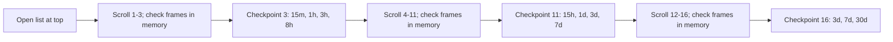
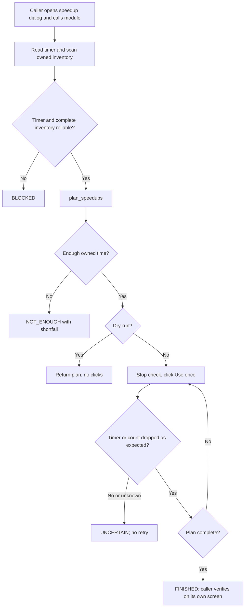
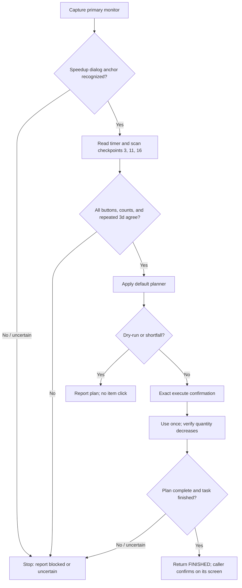

**Implementation update (2026-11-07):** The standalone OCR, checkpoint runner, and live adapter are implemented; 142 focused Speed Up and army-bridge tests pass. Run `7_20261107_200245` failed closed at checkpoint 3 because all four Use-button matches were uniformly offset by (+2,+4) px from the calibration map, beyond the previous 2 px tolerance. The initial dialog and timer were recognized, and no item click was sent. The reader now accepts a uniform <=6 px offset (<=1 px variation between rows) and uses the fresh matched rectangles for quantity OCR and click centers. Re-reading the saved frame succeeds with counts 15m=4853, 1h=5257, 3h=3383, 8h=475. Full manager execution remains blocked by pre-existing import errors: `task_controller.py` lacks `DEFAULT_FINISH_GRACE_SECONDS`, and `army_training_process.py` lacks `goal_task_id` imported by campaign code. No game input was sent by this implementation/analysis session.

Earlier status snapshots and pending notes
# Speedup Module Workflow

**Current status (2026-11-07):** `speedup.py` launches the supervised checkpoint workflow. `speedup_inventory_reader.py` reads all nine supported owned-item counts from checkpoints 3/11/16 with OCR consensus; `speedup_checkpoint_runner.py` plans and verifies each use against a fresh count. The army bridge now clicks only a visually confirmed `Speed Up` control, runs the same checkpoint finisher, and rechecks the army state. The focused speedup suite passes (71 tests). Live scrolling/item use has not been run against the game and still requires operator supervision. The manager integration is currently blocked because existing `army_campaign.py`/`army_training_finish.py` imports refer to missing APIs in the modified `army_training_process.py` and `task_controller.py`; manager, executor, and finish tests cannot collect. The 1m item, browser UI, and other task types remain out of scope.

Earlier status snapshots and pending notes in this document are historical; the current behavior and remaining limits are summarized above and in the approved workflow section below.
At each checkpoint, detect the existing `speedup_use_button` template inside the inventory viewport, sort complete matches top-to-bottom, and associate them with the known duration labels for that checkpoint. Save every complete button occurrence, including the repeated 3d entry, with button rectangles and centers relative to the viewport. The 7d button at step 11 is clipped and omitted; its complete step-16 location is used. The similar-looking shop row is excluded by the `Use`-template match and must never be added as owned inventory.

## Approved Checkpoint Inventory and Use Strategy (2026-11-07)

### Goal and scope

Complete the standalone speedup flow for the already-open desktop speedup dialog: read the remaining time and owned quantities, use the existing planner, and use only owned items needed by its plan. Do not buy items, spend gold, open the dialog, or mutate the task queue. The current user approval covers implementation and tests; an actual game run still requires the operator to start the explicit live command while the intended army-training dialog is open.

### Algorithm

1. Require the speedup dialog anchor and a 1920x1080 capture. The list must start at its top. Read the initial timer, then move the pointer to the center of the annotated inventory viewport before each individual wheel step.
2. Capture and validate the known checkpoints after cumulative steps 3, 11, and 16. Every intervening step must keep the dialog recognized and change the viewport. Stop on any unchanged/uncertain frame; do not infer that a checkpoint was reached.
3. At each checkpoint, verify the expected complete `Use` button matches from `speedup_button_map.json`, in top-to-bottom order. Require every runtime match to be within 6 px of its mapped position and require the detected offsets to be uniform within 1 px across rows. The map binds row order to known duration; fresh matched button geometry, not stale map coordinates, anchors both the quantity crop and any eventual click. Read each quantity from the annotated quantity region translated by the detected button's offset, inset 5 px on the left and 3 px on the right. Run OCR at scales 4 and 6 with PSM 8; accept a quantity only when both normalized readings agree and `parse_quantity` accepts it. Preserve raw readings and consensus status. Empty, conflicting, malformed, too-shifted, or non-uniform OCR/layout blocks the complete scan; it never becomes zero.
4. The 3d item appears at checkpoints 11 and 16. Require equal quantities for repeated durations; disagreement blocks the scan. The 30d shop offer has no mapped `Use` button and is excluded. The 1m item is intentionally omitted per the user's accepted precision tradeoff.
5. Plan against the latest readable timer and the complete supported inventory with `plan_speedups`, retaining the existing soft duration preferences and stock floors. If the inventory is short, report the exact shortfall and use nothing. A zero timer returns already-finished.
6. Dry-run is the default: it may scroll to inspect the checkpoints, prints the inventory and plan, and never clicks. Item use requires `--execute` plus the exact confirmation phrase. Before every scroll and click, check the emergency stop. For a planned item, navigate to its earliest mapped checkpoint and re-capture; require its mapped `Use` button and quantity to match the current expected row before clicking once. After a click, capture again and require the same owned quantity to fall by exactly one. Any uncertain transition or click result stops immediately without retry; the caller confirms task completion on its own screen.

### Confirmed facts, assumptions, and deferred cases

- Confirmed from reviewed checkpoint screenshots: 3/11/16 scroll landmarks and duration labels; complete `Use` button positions; 7d is clipped at checkpoint 11; the final 30d shop row says `Kup`; owned counts are printed at the annotated icon quantity region. Tesseract 5.4.0 is installed at the standard Windows path on this workstation, although it is not currently on the activated environment's `PATH`.
- Assumption to verify by fixtures: the relative quantity-to-button offset remains stable across the desktop UI and the two scale-diverse OCR reads provide sufficient agreement for every visible quantity. A disagreement remains unreadable.
- Confirmed in run `7_20261107_200245`: at checkpoint 3 all four Use templates matched at confidence 1.0, with a uniform viewport translation of (+2,+4) px relative to the calibration map. The previous exact/two-pixel geometry check falsely blocked this otherwise matching view. Fixture regression now replays that offset and requires OCR values and button centers to follow live matches.
- Assumption to verify by fixtures: the relative quantity-to-button offset remains stable across the desktop UI and the two scale-diverse OCR reads provide sufficient agreement for every visible quantity. A disagreement remains unreadable.
- Deferred: 1m inventory, other task types, browser UI, alternate resolutions/scales, automatic opening of the dialog, and live execution by the assistant. The user must supervise any live run.
- Deferred safety edge: if consuming the last item in a row changes list layout such that its identity cannot be re-established from the mapped checkpoint, stop uncertain rather than infer the new row identity.

### Implementation status and expected tests

The checkpoint inventory reader is implemented in `speedup_inventory_reader.py`; its fixture suite covers the nine supported owned entries, repeated `3d` quantity agreement, the `30d` quantity, OCR disagreement, bad button positions and incomplete frames. The checkpoint use orchestrator is implemented in `speedup.py` and covered with a fake dialog by `tests/test_speedup.py`. This implementation pass adds a real desktop adapter and wires it to the army finish callback. Live execution still requires the explicit command confirmation and operator supervision; no live use is performed during tests.

The desktop adapter starts with an open speedup dialog, checks the annotated dialog anchor and 1920x1080 display geometry, scans the known 3/11/16 wheel-step checkpoints, and reads only mapped owned `Use` buttons. It uses one-notch navigation and the existing viewport map; it never clicks `Buy`. Dry-run may navigate and read but never clicks `Use`. Live item use requires `--execute --confirm "USE SPEEDUPS"`; the army manager uses its existing `EXECUTE ARMY TRAINING` confirmation. On army integration, the adapter may open the dialog only from a freshly confirmed `Speed Up` panel button, then calls the same finisher and returns a freshly read army state. If the dialog, timer, inventory, item decrement, or post-finish army state is uncertain, it stops without retrying and does not clear the open-training marker.

Tests cover mapped quantities, checkpoint progression, input direction/coordinates, dry-run no-use, exact one-click verification, shortfall, emergency stop, uncertain results and army finish-state confirmation. Focused tests should run after implementation; live game validation remains a separate supervised operator action.

## Goal and scope

Finish the active task whose speedup dialog is open: read the remaining time and owned inventory, plan which items to use, use them, and report. It does not buy items, spend gold, or change any task queue.

The reader is intended to be reusable for a shared speedup dialog, but only army training is in the first game-integration scope. Academy research and building upgrades remain deferred until their dialog behavior is verified and separately approved.

## Standalone speedup module (approved 2026-11-06)

`speedup.py` finishes the active task whose speedup dialog is open. It is independent of the task queue, profile markers and task type. Whoever needs a task finished calls it; the caller decides when, and confirms completion on its own screen. There are no `quick_finish` or permission flags: a live call is the request to finish. Planning is a separate pure module, `speedup_planner.py`; screen reading reuses `speedup_readings.py`.

Public operation: `finish_with_speedups(capture_fn, read_dialog_fn, click_fn, scroll_fn, stop_fn, sleep_fn, dry_run=True, max_scrolls=12)`. `read_dialog_fn(frame)` returns a `DialogReading` (timer, owned rows with click points, whether every row was readable, a list-position signature) or `None` when the dialog is not recognized. It starts with the dialog already open and returns `FINISHED`, `NOT_ENOUGH` (with shortfall seconds), `UNCERTAIN`, `BLOCKED` or, in dry-run, `PLANNED`, plus the plan, performed uses and a reason. The first caller is the army-training finish step; other task types may call it once their own dialog entry and completion check are verified.

## Scroll calibration workflow (approved 2026-11-06)

The calibration command is a separate, non-finishing mode. The user opens the speedup dialog before starting it. It captures the initial screen, then performs up to 20 single downward wheel steps and saves a fresh, ordered screenshot after each step. It performs no item, purchase, or task-control clicks and cannot invoke the planner or item-use loop.

Dialog recognition searches for the annotated `speedup_dialog_anchor` within an 8 px margin around its expected location, with normalized template-match score at least 0.95. This tolerance is based on the three bot captures from 2026-11-06: the title was consistently detected at (902, 255), 2 px right and 5 px down from the annotated (900, 250), with score 0.9973. The captured frame and display were both 1920x1080. The expected annotation itself remains unchanged.

Before every wheel step, move the pointer to the center of the annotated `speedup_inventory_viewport` region (x=959, y=585 in the 1920x1080 desktop fixture), safely inside the list and away from the navigation bar and Use/Buy controls. Then send one wheel notch downward and capture after a short settle. Capture uses the primary monitor and adds its desktop origin to the region-relative pointer point. Refuse to scroll if the captured frame is not 1920x1080 or the pointer-coordinate display size does not match the capture size.

Save `step_000_initial.png` and each resulting `step_NNN_after_scroll.png`, plus a JSON manifest with timestamps, action, point, frame geometry and viewport change score, under a unique `debug/speedup/calibration_<timestamp>/` folder. Compare only the annotated inventory viewport between consecutive captures. Save the first unchanged view and stop there; otherwise stop after the configured maximum (default 20). The calibration report does not claim that all inventory rows were recognized or that the end of the inventory was reached.

Live invocation requires an explicit calibration command and confirmation phrase. Check the existing emergency-stop file before every pointer move and wheel event. An unexpected frame size, display-size mismatch, capture error, stop request, or output error aborts without another input action. Automated tests use injected capture/move/scroll/sleep functions and temporary output folders; they do not launch or control the game.

Run the supervised calibration from the project directory with:

```powershell
python .\speedup_calibration.py --calibrate-scroll --confirm "SCROLL SPEEDUP LIST"
```

Use `--steps N` to request a different limit from 1 to 20; the default and maximum is 20. The command stops earlier when consecutive inventory viewport captures are unchanged.

### User-reported list landmarks and approved checkpoint test

The user reports these cumulative wheel-scroll observations from a run starting at the top of the list:

| Cumulative scrolls | Reported visible speedup durations |
|---:|---|
| 3 | 15m, 1h, 3h, 8h |
| 11 | 15h, 1d, 3d, 7d |
| 16 | 3d, 7d, 30d; reported list end |

The 1m acceleration may be omitted from the eventual inventory coverage requirement. These labels and scroll counts are user observations, not yet independently verified from calibration captures or OCR.

Approved next calibration run: begin with the list manually positioned at the top, perform exactly 16 single-notch downward scrolls (groups of 3, then 8, then 5), and analyze only the named checkpoints at cumulative steps 3, 11 and 16. Capture the initial frame and intermediate frames in memory for dialog/viewport checks, but save screenshots only at those three checkpoints. Do not scroll past 16. If the viewport becomes unchanged before a checkpoint, stop and report a landmark mismatch. Do not click the scrollbar, any item, or the Buy offer. The user's duration labels remain visual guidance for later review, not an OCR assertion.
The approved run completed with `CHECKPOINTS_CAPTURED` after exactly 16 scrolls. Its manifest records all 16 dialog-recognized, changed frames. The three checkpoint screenshots visually confirm the reported owned-item groups. At checkpoint 16, an owned 30d row has a `Use` button; a separate lower 30d shop offer has `Buy` and is not inventory. The 1m item remains intentionally out of the map.



Run the checkpoint-only test from the project directory with:

```powershell
python .\speedup_calibration.py --checkpoint-scan --confirm "SCROLL SPEEDUP LIST"
```

The run saves only `checkpoint_003_after_scroll.png`, `checkpoint_011_after_scroll.png`, and `checkpoint_016_after_scroll.png`, plus the manifest. Each intervening frame is checked in memory to confirm the dialog remains open and the list is moving; if the viewport becomes unchanged before step 16, it stops with `LANDMARK_MISMATCH`. It performs no 17th scroll. The user and assistant then inspect the three saved screens for row labels and readable `Użyj` buttons; this phase does not automatically identify every item or click a button.
The run saved only `checkpoint_003_after_scroll.png`, `checkpoint_011_after_scroll.png`, and `checkpoint_016_after_scroll.png`, plus the manifest. Each intervening frame was checked in memory; no 17th scroll was sent. The screenshots have been visually reviewed. At each checkpoint, detect the existing `speedup_use_button` template inside the inventory viewport, sort matches top-to-bottom, and associate them with that checkpoint's known visible durations. Save every checkpoint occurrence, including repeated 3d/7d entries, with button rectangles and centers relative to the viewport. For later navigation, the earliest checkpoint containing a duration is preferred. The similar-looking shop row is excluded by the `Use`-template match and must never be added as owned inventory.

The approved map implementation is offline and read-only. It consumes the three saved checkpoint images, validates the expected number of button matches for each checkpoint, and writes a JSON map. It does not infer inventory quantity, run OCR, change the game, or click any control. Tests verify the detected buttons and duration association for each checkpoint, viewport-relative geometry, repeated durations at both checkpoints, and exclusion of the shop `Buy` offer.
The approved map implementation is offline and read-only. It consumes the three saved checkpoint images, validates the expected number of complete button matches for each checkpoint, and writes a JSON map. At step 11 the 7d row is visible but its `Use` button is clipped at the viewport edge and does not fully match; omit that location and use the fully visible step-16 button instead. The map entries are therefore step 3: 15m/1h/3h/8h; step 11: 15h/1d/3d; step 16: 3d/7d/30d. It does not infer inventory quantity, run OCR, change the game, or click any control. Tests verify the detected buttons and duration association, viewport-relative geometry, the repeated 3d entry, and exclusion of the shop `Buy` offer.
Generate the map from a completed checkpoint run with:

```powershell
python .\speedup_button_map.py --input-dir .\debug\speedup\calibration_20261107_010155_371887 --output .\speedup_button_map.json
```

The output contains one entry per complete visible owned-item `Use` button. Coordinates are relative to the annotated inventory viewport; each entry includes its rectangle, center, duration in seconds, and template-match confidence. `preferred_scroll_count_by_duration` selects the earliest complete button location. The checked-in map from the reviewed run is `speedup_button_map.json`. Tests validate 4/3/3 complete detections at steps 3/11/16, the duration associations, viewport-relative geometry, repeated 3d, and rejection of unexpected match counts.

The checkpoint finisher is implemented and fixture-backed. `army_training_speedup.py` wires it to the existing army finish callback, but manager commands currently cannot import their queue/campaign dependencies (see the current status above). No live item-use run has been performed.

## Direct-run finishing workflow (implemented; live test pending)

The user wants to be able to launch the speedup module directly, with the speedup dialog already open. Opening the dialog, choosing the active task, and preparing the game state are outside this module; another process or the user owns those steps. The module operates only on the currently open dialog and does not read or mutate task queues, task markers, or profiles.

The user opens the intended speedup dialog and sets its list to the top before running the standalone module. The first implementation supports the desktop client at 1920x1080 and the known checkpoints only:

- Preview and plan (scrolls the list but never clicks): `python .\speedup.py --confirm "SCAN SPEEDUP LIST FROM TOP"`
- Use owned items from the plan (requires this exact phrase): `python .\speedup.py --execute --confirm "USE OWNED SPEEDUPS FROM TOP"`
- `--tesseract "C:\\Program Files\\Tesseract-OCR\\tesseract.exe"` is optional when auto-detection via `PATH` or the standard Windows location is unavailable.
- Both modes require the game on the primary monitor at 1920x1080, the intended dialog already open, and the inventory list at the top. The scan stops if any of the 16 wheel steps does not change the viewport or a checkpoint is not recognized. It captures fresh frames after navigation and item use, writes a timestamped JSON report to `debug/speedup/run_<timestamp>/`, and saves the latest frame on `BLOCKED` or `UNCERTAIN`.
- Dry-run does move the list by scrolling, so the exact scan confirmation is required; it never clicks `Use` or `Kup`. `--execute` requires a separate exact confirmation and checks the emergency-stop file before every pointer move, scroll, and click. PyAutoGUI fail-safe remains enabled.
- The plan uses the existing soft duration preferences and stock floors. If the supported owned items cannot cover the remaining time, return `NOT_ENOUGH` and click nothing. Each item use is one click and must be confirmed by a fresh quantity reading; uncertain results are never retried. The caller still confirms task completion on its own screen.

Navigation uses one downward notch per step, always with the pointer at the center of the annotated inventory viewport. The checkpoint map is validated at steps 3, 11, and 16; the 30d shop `Kup` row is excluded. No scrollbar dragging or item-row navigation clicks are used.

### Confirmed facts, assumptions, and deferred cases

- Confirmed: the user will ensure that the speedup dialog is already open for a supervised run; another process may open it. Automated tests should use fake-game/fixture adapters and must not require launching the game.
- Confirmed: current captures and candidate regions describe the desktop client at 1920x1080. `Automator.update()` captures the primary monitor, not a selected game window.
- Assumption to verify: the open dialog is visible on the primary monitor and the capture dimensions/scale match the annotated desktop fixtures. If not, stop; window selection and coordinate conversion are a separate capability.
- Deferred: exact navigation clicks and their expected row groups until transition screenshots are supplied and annotated. Browser-client behavior remains unsupported.
- Deferred: actual live execution until the user starts a supervised run; browser behavior, 1m inventory, and additional unit/task categories remain unsupported. Manager-driven execution is blocked by the current queue/campaign import mismatches.

### Calibration implementation and validation

1. Implemented: bounded dialog-anchor search based on bot captures, display-geometry preflight, pointer reposition before each wheel step, per-step screenshots and manifest, first-no-change stop, up to 20 steps, and emergency-stop handling.
2. Implemented: tests for bot-capture and fixture anchor recognition, non-dialog rejection, action order, pointer coordinates, captures, preflight failures, step limits and emergency stop.
3. Implemented: checkpoint inventory OCR with two-scale consensus, count consistency for repeated 3d, and a fail-closed direct-run executor with exact confirmation gates.
4. Deferred: dynamic scanning outside the reviewed checkpoints; manager execution awaits repair of the existing queue/campaign imports.
5. Validation: run focused and full tests; run `tools/verify.py` if screen recognition assets or regions change. Live validation remains a supervised user-run operation.

The direct-run CLI is approved and implemented. Its first actual live execution remains a supervised operator action; the assistant has not sent game input.

### Rules

1. Dry-run is the default and never clicks `Use` or `Buy`; it may scroll to read the complete inventory. Live calls check the emergency stop before every navigation input and click.
2. Recognize the dialog, read the timer, and scan supported owned inventory at checkpoints 3/11/16 over the annotated viewport only. Every wheel step must change the viewport; the final checkpoint is not followed by a 17th scroll. Never drag the scrollbar thumb. The Buy offer and omitted 1m item are not inventory. An unreadable timer, unrecognized button, quantity disagreement, or incomplete checkpoint returns `BLOCKED`; nothing is guessed or treated as zero.
3. Build the plan with `plan_speedups`. If owned items cannot cover the remaining time, return `NOT_ENOUGH` with the shortfall and use nothing.
4. For each planned use: stop check, click Use once, capture a fresh frame, and require the item count to drop by one. An uncertain result returns `UNCERTAIN` and is never retried. A zero timer after a use, or a closed dialog after the last planned use, ends the run as `FINISHED` and skips the rest of the plan. A dialog that closes earlier is `UNCERTAIN` (`dialog_closed_before_plan_end`) because a closed dialog cannot be told apart from an accidental close; the caller confirms on its own screen.
4a. Re-planning (approved 2026-11-06): the first time a readable timer after a use is below 20% of the timer at the start of the call, the plan is rebuilt once with `plan_speedups` from that timer and the remaining stock (scan quantities minus confirmed uses). This corrects deviations such as clan Help or day/hour rounding. If the rebuilt plan cannot be covered, return `NOT_ENOUGH` with the uses already made. An unreadable timer never triggers or cancels a re-plan.
5. `FINISHED` means the dialog closed or shows a zero timer after the last planned use. The exact look of a finished dialog is not yet confirmed; any other state after the plan is `UNCERTAIN`. The timer has only day/hour resolution, so a use is verified by the item count dropping by one (a vanished row counts as zero), not by the timer. The caller still verifies completion on its own screen.
6. Known limits: dry-run scrolls the list (it must, to read the whole inventory) but never clicks; scanning is bounded by `max_scrolls`; if an item runs out and the list shortens, the module returns `UNCERTAIN` (`list_changed`) rather than guessing the position. A stop requested after a click reports `UNCERTAIN`; before any click it reports `BLOCKED`.
7. The result carries a reason; debug captures on uncertainty are a caller responsibility for now.
6. The result carries evidence (timer and inventory readings, planned and performed uses, reason) and a timestamped debug capture on uncertainty.

### Planning algorithm (`plan_speedups`)

Input: remaining seconds and owned inventory (`duration seconds -> quantity`). Output: ordered `(duration, count)` uses, breached floors, shortfall seconds and a status (`ok`, `nothing_to_do`, `shortfall`).

- Preferred durations by remaining time: up to 5 days `1h 3h 8h`; over 5 up to 15 days `8h 15h`; over 15 up to 100 days `15h 1d 3d`; over 100 days `3d 7d 30d`. Preferences are soft; the bucket is re-evaluated as time is used.
- Floors: keep 3 of `3d`, `7d`, `30d` and 10 of every other duration.
- If the whole inventory is shorter than the remaining time: status `shortfall`, no uses.
- Otherwise repeat until nothing remains, choosing among items whose stock is above their floor, in this order: the largest preferred item not longer than the remaining time; the largest item not longer than the remaining time; the smallest preferred item longer than the remaining time (last, overshooting step); the smallest item longer than the remaining time. Only when no item above its floor is left, use floor-breaking items: the largest that fits, else the smallest.
- A floor is reported as breached only for a duration the plan used that ends below its floor. Floors outrank overshoot: a large item may be spent on a small remainder rather than breaching a floor.

### Flow



### Caller integration (army training)

`army_training_finish.finish_open_training` already accepts `speedup_fn`. The manager supplies a thin adapter: click the panel Speed Up button at the scanner's `training_button_region`, wait for the dialog, call `finish_with_speedups`, and return the observed training state. Completion is confirmed by the existing idle check, not by the module result. The finish step is only run for a bot-owned open-training marker, so the module never spends items on a foreign training. The earlier `quick_finish` gate for this path is dropped.

### Open questions

- Whether the game asks for confirmation or a quantity after Use.
- How the dialog looks once the task has finished.

Both are confirmed against fixtures or a supervised run before the use loop is enabled.

### Required evidence and tests

- Annotate with `tools/annotate.py`: dialog anchor, timer, inventory viewport, row duration and quantity, Use button, scroll track. Nothing is derived from guessed coordinates.
- `tests/test_speedup_planner.py` (pure): preferred buckets, floors, overshoot on the last item, floor-breaking and its report, shortfall, empty and invalid input.
- Module tests with injected capture/click: dry-run never clicks Use or Buy and performs only bounded, verified navigation; incomplete scan blocks; each use is a single click verified by a fresh frame; an uncertain use is never retried; the stop check runs before every navigation action and click.
- Fixture tests over the complete inventory across `speedup_view*.png` before live use.

## Confirmed facts

- The supplied speedup screenshots are desktop-client captures at 1920x1080. They show a remaining-time display, acceleration entries with quantities and individual Use controls, a scrollable list, and a Buy entry.
- Visible duration labels include 1m, 15m, 1h, 3h, 8h, 15h, 1d, 3d, 7d, and 30d. Quantities vary between screenshots.
- The Buy entry is not owned inventory and must never be treated as a usable item.
- The typed task queue stores remaining duration in seconds and models `quick_finish` and speedup-related statuses, but it does not read the dialog or inventory.
- The game-flow integration currently covers army training only.

These observations do not verify that all task types use identical dialog behavior or that browser-client speedup screens match the desktop client.

## User-agreed preferences

Duration preferences are soft preferences, not an allowlist. Other durations may be used when helpful to finish the task.

| Remaining time | Preferred durations |
|---|---|
| Up to and including 5 days | 1h, 3h, 8h |
| More than 5 and up to 15 days | 8h, 15h |
| More than 15 and up to 100 days | 15h, 1d, 3d; favor 1d/3d more as remaining time grows |
| More than 100 days | 3d, 7d, 30d |

Preserve-stock floors are also soft preferences:

- Keep at least 3 each of 3d, 7d, and 30d accelerations.
- Keep at least 10 of every other duration.
- Prefer a recommendation that stays above these floors. If no such combination can finish the task, a reserve-breaking alternative may be recommended only if it is sufficient to finish the task; label it clearly and report which floors it breaches.
- If even using the reserve-breaking inventory cannot finish the task, stop and report the remaining shortfall. Do not imply that the task can be completed.

The observation stage scrolls the supported inventory during dry-run to read checkpoints 3, 11, and 16; the 1m item is omitted by agreement. It never uses or buys items. Item use requires `--execute` and its separate exact confirmation. The emergency stop is checked before every pointer move, scroll, and click.

## Screen reader contract

The screen card is [docs/screens/speedup.md](../screens/speedup.md). The scanner's observations should include:

- Dialog/context recognition result and confidence.
- Remaining-time raw OCR, normalized seconds, confidence, and capture timestamp.
- For each visible inventory row: raw label/duration and quantity text, normalized duration (where parsed), integer quantity (where parsed), confidence, and whether the row is owned inventory or a purchase offer.
- Scan completeness status and reason if blocked/uncertain, including any unrecognized row.

An unrecognized or unreadable mapped owned quantity means the inventory scan is incomplete. Do not silently omit it or report a complete inventory. The Buy offer is never owned inventory. `Use` is clicked only by the explicitly confirmed execution path; `Buy`, `Help`, and task controls are never clicked by this module.

### Implemented parsing foundation

`speedup_readings.py` provides geometry-independent, confidence-gated parsers for remaining day/hour text, duration labels, and integer quantities. It accepts the Polish hour abbreviation `g` seen in the supplied screenshots as well as `h`, and preserves raw OCR text and an explicit status. Low-confidence, malformed, and out-of-range values return `value=None`; quantities never default to zero. This module does not perform OCR, classify inventory ownership, scan images, or claim scan completeness.

`speedup_inventory_reader.py` implements fixture-backed quantity OCR using the annotated crop translated from the mapped `Use` button position. Tesseract reads at 4x and 6x must agree. The map supplies the known duration labels, so the reader does not OCR similar-looking duration glyphs. The verified checkpoint template excludes the shop's `Buy` row.

### Offline fixture scan

The three viewport-only checkpoint fixtures in `tests/data/speedup/` verify button locations and all nine supported owned quantities. `tests/test_speedup_inventory_reader.py` covers OCR consensus, repeated 3d consistency, shop exclusion by the button map, unreadable values, and mismatched button positions.

### Live checkpoint scan and use (implemented; supervised run pending)

1. The user opens the intended dialog and sets the inventory list to the top. The command captures the primary monitor and refuses dimensions other than 1920x1080.
2. The runner moves to the center of the annotated viewport before each individual wheel step, checks the emergency stop before pointer and wheel input, and requires a changed viewport and recognized dialog after each step.
3. It reads only the known checkpoints 3, 11, and 16. The exact complete button matches and two-scale quantity consensus are mandatory; repeated 3d quantities must agree.
4. The dry-run command reports the timer, inventory, and plan without clicking. The execution command requires a separate exact phrase, navigates to the earliest mapped location, clicks once, then requires the same quantity to decrease by one.
5. Unknown geometry, unreadable OCR, missing controls, unexpected movement, a failed count check, or an emergency stop blocks or returns uncertain. The runner never retries an uncertain click. It does not open the dialog or verify completion on the caller's task screen.

The runner uses the primary monitor, not selected-window capture. The user must keep the game foregrounded on the primary 1920x1080 display; other window selection, resolutions/scales, and browser behavior remain unsupported.

## Deferred recommendation and execution policy

The agreed duration preferences and stock floors are implemented in `speedup_planner.py` (see the planning algorithm above). The single 20% re-plan is implemented in `speedup.py` (rule 4a); the 50% checkpoint remains deferred. The timer may change due to clan Help, so the module re-reads it before planning and after every use.

## Reader state and failure handling



- A missing dialog, unexpected frame size, unreadable timer, unmatched button, quantity disagreement, or incomplete checkpoint blocks the run; no value is guessed or defaulted to zero.
- `speedup_run.py` writes a timestamped JSON report. On `BLOCKED` or `UNCERTAIN`, it saves the latest captured frame to the same run directory.
- The standalone reader has no profile or task-queue dependency; callers own profile isolation and task completion.
- Dry-run scrolls to inspect the supported checkpoints, so it is read-only with respect to item inventory, not screen navigation. It is bounded to 16 downward steps and emergency-stop aware.
- The use loop is dry-run by default, requires a different exact phrase for item use, stops on uncertainty, and never retries a click.

## Confirmed facts, assumptions, and deferred work

### Assumptions to verify

- Quantity-to-button offsets and 4x/6x OCR consensus match the nine supplied checkpoint rows; other UI scales and unseen quantities remain unverified.
- The operator has opened the intended task dialog and positioned the list at the top; the runner validates the checkpoint sequence but does not recognize task type.
- The static button map remains valid only for the annotated desktop layout at 1920x1080.

### Deferred

- Browser-client speedup fixtures and UI annotations.
- Academy/building game-flow integration.
- Queue updates after use (the caller owns them).
- Purchase, gold, or other paid actions.
- The 1m item, dynamic inventory rows outside the reviewed checkpoints, other resolutions/scales, and browser support.
- Army-manager integration and other task types; the caller owns task markers and completion verification.
- The 50% re-plan milestone; only the 20% re-plan is implemented.
- A supervised live run. The assistant has not sent game input.

## Current implementation status

- The task queue remains independent and does not read screenshots or inventory.
- `speedup_readings.py` provides pure timer/duration/quantity parsing; `speedup_reader.py` reads the timer and resolves Tesseract from `PATH` or its standard Windows install path.
- Timer digit verification ledger: `1, 3, 4, 6, 7` are confirmed by the original supplied fixtures. Other digits are no longer blocked by this list; a digit is accepted only when both OCR scales agree. The live-run timer `5 d. 20 g.` is now a regression fixture and reads as 504000 seconds. The ledger is informational, not an OCR acceptance whitelist.
- `speedup_button_map.py` maps verified `Use` button positions for the reviewed checkpoints and excludes `Buy`.
- `speedup_inventory_reader.py` reads nine supported counts with two-scale OCR consensus and rejects disagreement; `tests/test_speedup_inventory_reader.py` covers the real checkpoint fixtures.
- `speedup_checkpoint_runner.py` scans checkpoints, applies `speedup_planner.py`, and verifies each use; `tests/test_speedup_checkpoint_runner.py` uses injected fake-game adapters. `speedup_run.py` provides the supervised CLI behind `python speedup.py` and enforces separate scan/use confirmation phrases.
- `speedup.py`'s generic fake-dialog orchestrator remains available and is still covered by `tests/test_speedup.py`. `army_training_speedup.py` routes its verified panel action to `speedup_run.run_open_dialog`; current manager commands remain blocked by the import errors noted above.

## Expected tests before implementation is considered complete

Implementation acceptance checks now covered: all mapped OCR values and repeated-duration agreement; malformed/disagreeing OCR and button mismatch block; dry-run has no clicks; shortfall has no clicks; item use requires exact confirmation, clicks once, and requires a one-count decrement; emergency stop and uncertain clicks do not retry; timer and inventory evidence are included in the report. Run the focused Speed Up tests and `tools/verify.py --screen speedup --input .\screenshots\speedup_module`; full `pytest` is reserved for shared or cross-module changes.
