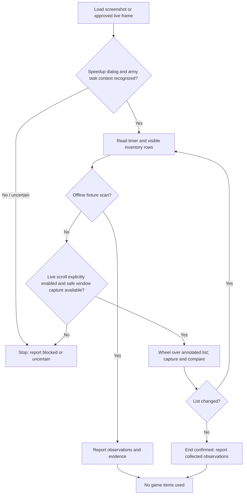

# Speedup Module Workflow

**Status:** Reader contract documented; implementation has not been approved or started. The live polling cadence needed to detect timer milestones remains undecided.

## Goal and scope

Read the remaining time and owned acceleration inventory from the speedup dialog. The first implementation proposed here is a read-only scanner: it does not click Use, consume items, buy items, spend gold, calculate a use plan, or change the task queue.

The reader is intended to be reusable for a shared speedup dialog, but only army training is in the first game-integration scope. Academy research and building upgrades remain deferred until their dialog behavior is verified and separately approved.

## Confirmed facts

- The supplied speedup screenshots are desktop-client captures at 1920x1080. They show a remaining-time display, acceleration entries with quantities and individual Use controls, a scrollable list, and a Buy entry.
- Visible duration labels include 1m, 15m, 1h, 3h, 8h, 15h, 1d, 3d, 7d, and 30d. Quantities vary between screenshots.
- The Buy entry is not owned inventory and must never be treated as a usable item.
- The typed task queue stores remaining duration in seconds and models `quick_finish` and speedup-related statuses, but it does not read the dialog or inventory.
- The game-flow integration currently covers army training only.

These observations do not verify that all task types use identical dialog behavior or that browser-client speedup screens match the desktop client.

## User-agreed preferences

Duration preferences are soft preferences, not an allowlist. Other durations may be used when helpful to finish the task.

| Remaining time | Preferred durations |
|---|---|
| Up to and including 5 days | 1h, 3h, 8h |
| More than 5 and up to 15 days | 8h, 15h |
| More than 15 and up to 100 days | 15h, 1d, 3d; favor 1d/3d more as remaining time grows |
| More than 100 days | 3d, 7d, 30d |

Preserve-stock floors are also soft preferences:

- Keep at least 3 each of 3d, 7d, and 30d accelerations.
- Keep at least 10 of every other duration.
- Prefer a recommendation that stays above these floors. If no such combination can finish the task, a reserve-breaking alternative may be recommended only if it is sufficient to finish the task; label it clearly and report which floors it breaches.
- If even using the reserve-breaking inventory cannot finish the task, stop and report the remaining shortfall. Do not imply that the task can be completed.

The initial scanner reports observations only. Recommendation/planning and any future Use clicks or automatic use require a separate approved workflow. Live reading may scroll the speedup list only after explicit opt-in; dry-run is the default and an emergency-stop key is required.

## Screen reader contract

The screen card is [docs/screens/speedup.md](../screens/speedup.md). The scanner's observations should include:

- Dialog/context recognition result and confidence.
- Remaining-time raw OCR, normalized seconds, confidence, and capture timestamp.
- For each visible inventory row: raw label/duration and quantity text, normalized duration (where parsed), integer quantity (where parsed), confidence, and whether the row is owned inventory or a purchase offer.
- Scan completeness status and reason if blocked/uncertain, including any unrecognized row.

An unrecognized or unreadable owned row means the inventory scan is incomplete. Do not silently omit it or report a complete inventory. The Buy offer is never owned inventory. Do not click any Use, Buy, Help, or task control.

### Offline fixture scan

1. Read the supplied screenshot without interacting with the game.
2. Recognize the speedup dialog and active-task context, then read the current remaining timer.
3. Extract each visible inventory row's duration and count; distinguish an owned item row from the purchase offer.
4. Return explicit confidence and incomplete/unknown status rather than guessing.

### Optional live list scan — implementation approval pending

The user approved mouse-wheel scrolling over the recognized list area as the preferred interaction, but code and live operation have not been approved. If implemented later:

1. Dry-run is default and logs planned scrolls without performing them. Real scrolling requires explicit opt-in and an emergency stop.
2. Require the speedup dialog, timer, list viewport, and scrollbar track to be recognized with sufficient confidence before a scroll.
3. Capture the list viewport and scrollbar thumb position before scrolling. Scroll down by a bounded wheel step over the annotated list viewport only; never drag the thumb and never click item controls.
4. Capture again and verify the list/scrollbar changed. Parse visible rows and retain their raw evidence. If the state is uncertain, stop rather than continuing to scroll blindly.
5. Detect the end of the list by comparing the list viewport before and after a scroll. If it does not change, stop; use thumb position as supporting evidence, not as a substitute for the no-change check.
6. Prevent an endless loop with a configured maximum number of consecutive scroll attempts without progress. Report the scan as incomplete if the limit is reached before end-of-list is confirmed.
7. Continue only while the same dialog/task context remains visible. Do not infer completion of a task from list movement.

**Live interaction blocker:** `Automator.update()` currently captures the primary monitor, not a selected game window, and project coordinates are not yet window-relative. Therefore the wheel method must not be executed against guessed desktop coordinates. Live scrolling remains blocked until the capture/window and coordinate contract is separately resolved and approved. Offline fixture scanning can proceed independently.

## Deferred recommendation and execution policy

The previously agreed duration preferences, stock reserves, and 50%/20% remaining-time checkpoints are requirements for a future planner/execution phase, not for the scanner. The timer may change due to clan Help, so any later planner must use fresh observations. Do not implement planning or clicks as part of the screen-reader change.

## Reader state and failure handling

- A missing dialog, mismatched task, ambiguous row, unreadable timer, stale frame, or low-confidence quantity blocks a complete observation; never substitute a guessed value or a success-shaped default.
- Any uncertain result should be timestamped and saved to `debug/` with a description when the reader is implemented.
- The reader and planner must remain profile-isolated; they must not mix frames, OCR, inventory, or recommendations across game windows/accounts.
- A live scroll-only reader must have a dry-run mode that logs planned scrolling without performing it and an emergency-stop key. Scrolling is not a Use or purchase action, but it still changes the visible game screen.
- Any future speedup-use flow must be separately approved, dry-run by default, and stop safely on uncertainty; it is not part of this plan's initial implementation.

## Confirmed facts, assumptions, and deferred work

### Assumptions to verify

- The visible timer can be reliably parsed into seconds for all relevant formats.
- Inventory row labels and quantities can be read consistently across list positions and scroll states.
- The scrollbar thumb can be reliably distinguished from its track across the captured scroll positions.
- The speedup dialog may be shared across task types, but only the army-training flow is in scope until verified.

### Deferred

- Browser-client speedup fixtures and UI annotations.
- Academy/building game-flow integration.
- Any use of speedup items, queue updates after use, or automatic `quick_finish` execution.
- Purchase, gold, or other paid actions.
- Recommendation planner using duration preferences and preserve-stock floors.
- Live polling cadence for reliably detecting the 50% and below-20% remaining-time milestones.
- Live scrolling until selected-window capture and game-window-relative coordinates are available and approved.

## Current implementation status

- The task queue records remaining time and speedup lifecycle state, but it does not read screenshots or inventory.
- The speedup screen card and reader contract are documented; no speedup regions/templates, OCR reader, planner, or tests exist yet.
- Existing queue policy and mechanics documentation describe future `quick_finish` behavior. This screen-reader change does not implement that behavior; any planner or execution phase needs its own approved contract.

## Expected tests before implementation is considered complete

- Parsing tests for timer formats, duration labels, and quantities, including malformed, clipped, unknown, and low-confidence values.
- Fixture regressions for timer, inventory rows, purchase-offer exclusion, and scrollbar/viewport states from the supplied desktop screenshots; expected annotated regions must be created with the project annotator, not guessed.
- Tests that an unrecognized owned row makes the inventory scan incomplete rather than silently disappearing.
- Scroll simulation tests proving wheel steps occur only inside the list, rows are collected across views, no-change ends the scan, and safety limits prevent endless scrolling.
- Tests that live mode defaults to dry-run and refuses to scroll without explicit opt-in or safe window-relative capture.
- Isolation tests proving one profile's frame and inventory cannot affect another profile's observation.
- Planner, reserve, 50%/20% re-planning, and execution tests are deferred to a separately approved implementation.
- Run the focused tests, full test suite when feasible, and `tools/verify.py` for any screen recognition changes; report unavailable tooling explicitly.
