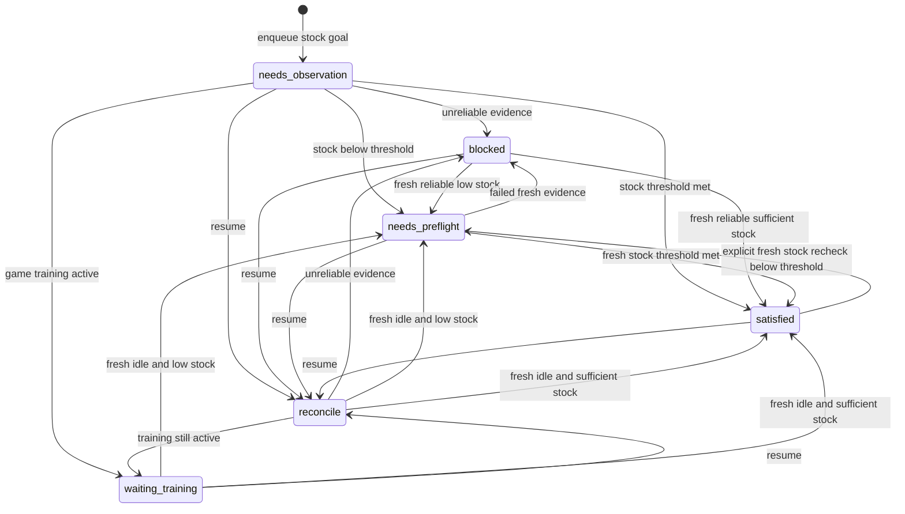

# Ekran: army_training

Current slot-detection and stock-goal rules, flow diagram, implementation status, and MVP limitations are maintained in [docs/game/army_training_slot_workflow.md](../game/army_training_slot_workflow.md). That workflow document is authoritative where this screen card's older mechanics notes differ.

## Jak rozpoznać
- Referencyjny zrzut: `screenshots/army_training/pelny.png`.
- Dodatkowe screeny z panelu Koszar: `templates/army_training3.png` i `templates/army_training4.png`. Oba pokazują aktywne szkolenie `Rycerz III`, przycisk „Przyspiesz” i wybór poziomów Gwardzistów.
- Widok okna „Koszary” z listą kategorii wojsk po lewej i kartami jednostek po prawej.
- Kandydat na kotwicę: nagłówek „Koszary” i lista kategorii. Osobny szablon kotwicy nie został zatwierdzony.
- Aktywne szkolenie rozpoznawaj niezależnie od samego otwartego okna. Powiadomienia mogą zasłonić wiersz aktywnej produkcji; brak odczytu nie oznacza braku szkolenia.
- Głównym sygnałem rozróżniania pustej kolejki od aktywnego szkolenia ma być obszar obrazu jednostki w panelu bieżącego szkolenia, ponieważ pozostaje niezasłonięty. Nie uznawaj samego powiadomienia ani przycisku „Przyspiesz” za dowód aktywnego szkolenia. Dedykowany wycinek tego obszaru i wzorce dla pustego oraz aktywnego stanu trzeba jeszcze oznaczyć i zweryfikować na obu zrzutach; nie zgaduj jego współrzędnych.
- Region `current_training_unit` jest oznaczony na pustym zrzucie. Skaner lokalizuje panel bieżącego szkolenia, aby uwzględnić jego pionowe przesunięcie, a następnie ocenia względny wycinek obrazu jednostki. Detal obrazu `>= 20` przy odnalezionym panelu oznacza `active`; stan `idle` wymaga dopasowania co najmniej `0.90` do pustego wzorca w jego zapisanym położeniu. W pozostałych przypadkach wynik to `unknown`. Dostępne aktywne próbki mają detal `55.84–70.07`, pusty wzorzec dopasowuje się z wynikiem `1.0`; progi nie są jeszcze zweryfikowane dla wszystkich jednostek i skal.
- Stan aktywnego szkolenia jest klasyfikowany wyłącznie z obrazu jednostki w panelu bieżącego szkolenia; rozpoznawany jest tylko stan `active`, `idle` lub `unknown`.

## Klient przeglądarkowy

- Fixture: `ui/browser/tests/army_training/zrzut_pulpitu_website.png` (1920x1080, zawiera chrome przeglądarki).
- Browser regions i templates są osobne w `ui/browser/`. `python .\army_training_slots.py .\ui\browser\tests\army_training\zrzut_pulpitu_website.png --variant browser` rozpoznaje trzy widoczne sloty i ich wartości liczbowe.
- Fixture'y `ui/browser/tests/army_training/army_training_active_website.png` i `army_training_nonactive_website.png` pokazują odpowiednio aktywne i puste szkolenie. Browserowy skaner używa ROI `current_training_unit`: pusty wzorzec >= 0.90 oznacza `idle`; w innym przypadku detal obrazu >= 20 oznacza `active`; pozostałe lub sprzeczne przypadki są `unknown`. Progi sprawdzono na tej jednej parze screenów.
- Selektor poziomu nie został wiarygodnie odczytany; stan przycisku Pomoc/Przyspiesz i zasoby nie są rozpoznawane dla browsera. Nie wykonuj akcji w przeglądarce na podstawie tych danych.
- Szablony wycięte z tego samego fixture dają 100% w `verify.py`; potwierdza to ścieżki i pozycje, nie odporność na inne zrzuty, skale ani stany.

## Elementy (wg regionów i opisany.png)
Współrzędne są względem kadru `screenshots/army_training/pelny.png`; nazwy odpowiadają `regions.json`.

1. `troops_types` – lista kategorii: Gwardziści, Specjaliści, Korpus inżynierów, Smoki, Żywiołaki, Olbrzymy, Bestie. Szczegółowe zachowanie kategorii poza Gwardzistami nie zostało jeszcze sprawdzone.
2. `unit_troop_level` – selector badges are ordered vertically and can differ per slot. The MVP treats the largest badge as the presumed highest because the highest level is selected by default in about 99% of cases. This is an assumption, not direct locked/unlocked verification; a manually selected lower level is an acknowledged edge case. The read-only detector OCRs only the largest badge's numeral and derives the one-below candidate from the immediately preceding badge when its center is 20–30 px above.
3. Stan zaznaczenia poziomu – aktualnie wybrany poziom ma lekko powiększony krążek z numerem. MVP używa tego sygnału jako założenia o najwyższym poziomie; nie potwierdza jeszcze osobno stanu odblokowania. Weryfikacja zaznaczenia po kliknięciu będzie wymagana przed przyszłym wykonaniem akcji.
4. `current_trainin_army` – obszar bieżącego szkolenia: typ/poziom jednostki i liczba aktualnie szkolonych wojsk. To kluczowy stan blokujący rozpoczęcie następnego szkolenia.
5. `speedup_panel` – zmienny stan przycisku w obszarze aktywnego szkolenia: po dodaniu jednostki do kolejki pojawia się „Pomoc”; kliknięcie prosi klan o pomoc i zmienia przycisk w „Przyspiesz”. Pomoc innych osób może skracać czas. Przed kliknięciem „Pomoc” odczekaj konfigurowalne 1-3 sekundy na ustabilizowanie ekranu (domyślnie 2); po kliknięciu odczekaj domyślnie 0,2 sekundy i potwierdź zmianę stanu przycisku. Tryb szybkiego kończenia może następnie automatycznie użyć przyspieszeń.
6. `current_unit_troop_count` – licznik już wyszkolonych jednostek wybranego typu/poziomu dostępnych w mieście; nie jest liczbą wojsk w trwającym szkoleniu. `army_training_slot_reader.py` odczytuje go osobno dla każdego wykrytego slotu, z confidence 89–96 na obecnych fixture. Odczyt jest gotowy, lecz nie jest jeszcze połączony z poziomem i celem managera w `SlotObservation`.
7. `unit_troop_count_to_train` – bieżąca ilość ustawiona do nowego szkolenia. Odczytuj ją osobno od licznika już wyszkolonych wojsk i limitu możliwego do ustawienia.
8. `unit_troop_coount_scroll` i `unit_troop_coount_scroll_button` – pasek do ustawiania liczby wojsk; dokładne zachowanie do sprawdzenia.
9. `unit_troop_require_silver_to_train` – koszt srebra dla wybranego szkolenia.
10. `unit_troop_require_time_to_train` – przewidywany czas szkolenia.
11. `unit_troop_food_production_load` – wpływ szkolenia na obciążenie/zużycie food; dokładna semantyka i relacja z czerwonym tekstem food pozostają do potwierdzenia.
12. `unit_troop_train_button` – przycisk „Wyszkol”. Nie klikaj, jeśli trwa inne szkolenie albo preflight zasobów nie przeszedł.
13. `close_army_screen_button` – zamknięcie okna Koszar.

## Sekwencja jednostek i poziomów Gwardzistów
- Lista może zaczynać się od różnych jednostek; nie zakładaj, że pierwszym widocznym slotem są łucznicy ani że pozycja slotu jest stała.
- Pierwsza część: łucznicy, włócznicy i jeźdźcy na poziomach I–V.
- Dalej: jednostka latająca na poziomach V–VII, następnie łucznicy, włócznicy i jeźdźcy na poziomach VI–VII.
- W ostatnich czterech slotach numeracja rzymska zaczyna się ponownie: łucznik, włócznik, jeździec i jednostka latająca pojawiają się z oznaczeniem I/II, które odpowiada globalnym poziomom VIII/IX.
- Po odblokowaniu wyższych poziomów interfejs automatycznie przewija listę ku nowszym jednostkom; starsze sloty mogą zniknąć z widoku. Koniec listy wykrywaj po braku zmiany obrazu po przewinięciu.
- Jednostkę identyfikuj po typie oraz globalnym poziomie, wyprowadzonym z sekwencji; nie używaj samego numeru rzymskiego ani bieżącej pozycji na ekranie. Potwierdź odblokowanie oraz powiększony znacznik aktualnego wyboru osobno.
- Nie identyfikuj konkretnego typu jednostki. Cel jest określony globalnym poziomem i numerem pasującego slotu w ustalonej kolejności listy.
- Poziomy 1-4 mają po trzy sloty jednostek, a poziomy 5-9 po cztery. Szukaj wszystkich slotów z żądanym poziomem i wybieraj wymagany numer dopasowania; nie zakładaj stałej współrzędnej ani nie szkol pierwszej widocznej karty bez sprawdzenia poziomu.
- Numery lokalne mogą się powtarzać (np. I/II dla globalnych poziomów VIII/IX), dlatego oznaczenie poziomu interpretuj w kontekście sekwencji listy.
- Lista zachowuje zasadniczo stałą kolejność, ale karty mogą zaczynać się w różnym miejscu lub zmieniać widoczność przy przewijaniu. Przeszukuj listę do końca, a koniec potwierdzaj brakiem zmiany obrazu po przewinięciu.
- Potwierdź osobno, że docelowy poziom jest odblokowany i że zaznaczenie poziomu jest ustawione na wymaganej wartości.

## Army replenishment algorithm

The intended plan is to maintain a target troop count per profile and matching unit slot, rather than blindly executing a fixed number of training runs. Do not identify the troop by its name: identify the matching slot in the army list and read that slot's own queue limits. Let `L_ref` be the queue limit for this slot at one level below its highest unlocked level, and `L_train` be the queue limit for the level selected for the next order:

```text
target_count = 2 * L_ref
complete when current_city_count >= ceil(0.80 * target_count)
next_order_count = min(target_count - current_city_count, L_train)
```

Each slot can have different limits, so never reuse another slot's values. If the goal is satisfied, mark its queued task complete without training; otherwise order only the computed amount. The limit used to define the target (`L_ref`) and the limit for the selected training level (`L_train`) are separate values.

The planner contains a pure `evaluate_slot_replenishment` calculation for this formula, including a default minimum OCR confidence of 70. The typed process in `army_training_process.py` now connects this calculation to stock-goal tasks in the persistent profile queue. The caller must supply verified slot identity, limits, highest unlocked level, and city count with confidence and capture provenance. Automatic slot detection, live per-slot limit OCR, resource preflight, and click execution are not connected. A failed or uncertain gate stops the launch; it never falls through to a guessed click.

### Process architecture and persistence

- `Slot` identifies a target by global level and matching number, never by troop name or screen coordinates. `TrainingGoal` binds it to a profile.
- `NumericReading` carries value, OCR confidence, and raw text. `SlotObservation` binds all readings to one profile, slot, capture time, source frame, training state, and verified selection. The capture adapter must assemble readings from the same verified slot/level; a declared identity is not proof of correct detection.
- `decide_training_goal` is pure. By default it rejects captures older than 30 seconds, future timestamps, mismatched profiles/slots, unverified selection, and numbers with confidence below 70. Both queue limits and the highest unlocked level need reliable evidence, not just the city count.
- `enqueue_training_goal` creates one idempotent `army_training` task with `goal_kind=slot_stock_v1`. There is no requested number of runs. Existing run-based campaign APIs remain supported; they do not automatically migrate into stock goals. Choose one scheduling mode per campaign; do not generate legacy runs alongside equivalent stock goals.
- `reconcile_training_goal` defaults to dry-run and leaves the queue unchanged. Explicit `dry_run=False` updates only the in-memory model, appending timestamped transitions with reasons, decision values, and source evidence. Use the existing atomic `save_task_queue` and `load_task_queue` with `expected_profile_id` for persistence in `profiles/<profile>/tasks.json`.
- A satisfied idle stock goal becomes `completed` without a fabricated training start or run count. An explicit fresh reconciliation may reopen it if city stock is below the threshold. Uncertain evidence never authorizes training; it leaves the task queued with a blocked process state.
- `get_next_task` only selects a stock goal whose process is `needs_preflight` and whose decision has not expired. This is eligibility for resource preflight, not permission to click Train. Preflight and all action confirmations must still pass.
- After loading a task, call `resume_training_goal` before continuing it and save the result. Resume clears the cached decision and requires fresh reconciliation. It never resets an active task's lifecycle status or pretends an in-flight order finished.
- Stock reconciliation refuses to complete or reopen a task already in an active lifecycle state. Connecting live order acceptance, post-order Help, completion/reset confirmation, and stock reconciliation is a separate executor step. No click adapter or new live timeout policy is implemented here.



States are reconciliation outcomes, not a clickable UI workflow. Repeated fresh observations may move between outcomes with their guards re-evaluated. Every accepted non-dry-run reconciliation is logged, even if the state does not change. The existing queue lifecycle remains responsible for game-confirmed starts; no persisted decision is itself a click authorization.

```mermaid
flowchart TD
	A[Load profile goal: unit, level, target count] --> B[Capture a fresh Barracks frame]
	B --> C{Training state?}
	C -->|Active| ACTIVE_WAIT[Do not start another order; wait and monitor]
	C -->|Unknown| D{Retry budget remains?}
	D -->|Yes| B
	D -->|No| E[Stop; save a debug frame and report unknown state]
	C -->|Idle| F[Find target unit/level and verify it is unlocked]
	F --> G{Exactly one matching target found?}
	G -->|No| H[Stop; report missing, locked, or ambiguous target]
	G -->|Yes| I[Select target level and verify selected marker]
	I --> J{Target level confirmed?}
	J -->|No| K[Stop before quantity changes or clicks]
	J -->|Yes| L[Read slot queue limit one level below highest unlocked: L_ref]
	L --> M{L_ref read reliably for this slot?}
	M -->|No| N[Stop; retain queued goal and save evidence]
	M -->|Yes| O[Set target count = 2 * L_ref]
	O --> P[OCR trained city count]
	P --> Q{Count and target reliable?}
	Q -->|No| R[Stop; retain queued goal and save evidence]
	Q -->|Yes| S{City count >= ceil(80% of target)?}
	S -->|Yes| T[Mark goal satisfied; reconcile next queued goal]
	S -->|No| U[Read selected-level queue limit L_train]
	U --> V{L_train read reliably for this slot?}
	V -->|No| W[Stop; retain goal and report blocker]
	V -->|Yes| X[Set order amount = min(target - city count, L_train)]
	X --> Y[Read fresh food, silver, selected cost, and duration]
	Y --> ZA{Values reliable, food allowed, and silver sufficient?}
	ZA -->|No| ZB[Stop; retain goal and report blocker]
	ZA -->|Yes| ZC{Real execution explicitly enabled?}
	ZC -->|No| ZD[Dry-run: report planned values; make no changes]
	ZC -->|Yes| ZE{Emergency stop is armed?}
	ZE -->|No| ZF[Stop before any game action]
	ZE -->|Yes| ZG[Click Train once]
	ZG --> ZH{Active training visually confirmed before timeout?}
	ZH -->|No or unknown| ZI[Do not click again; save evidence and reconcile manually]
	ZH -->|Yes| ZJ[Persist visually confirmed active order]
	ZJ --> ZK[Wait for completion; do not start another order]
	ZK --> ZL[After reset delay, capture fresh frame and reread city count]
	ZL --> P
```

### Gate-by-gate expectations

| Step | Check and expected result | Continue when | Stop or recovery when | Current evidence |
| --- | --- | --- | --- | --- |
| 1 | Select the profile's stock goal by global level and matching slot. Derive target count from that slot's reference limit. | Goal belongs to the selected profile and has a valid slot. | No eligible goal, paused profile, or missing target. | Typed stock goals persist in the existing task queue; legacy run-based plans remain compatible but are not migrated automatically. |
| 2 | Capture the current Barracks screen and classify training as `active`, `idle`, or `unknown`. | `idle` advances to reconciliation. | `active` prevents another order. For `unknown`, retry a bounded number of fresh captures; if still unknown, save the frame and stop. | Active and empty-queue fixture screenshots were analyzed; tests cover both. Live selected-window capture is not implemented. |
| 3 | Find the planned unit/level in the full list and verify it is unlocked and selected. | Exactly one target is found and the selected marker confirms its level. | Missing, locked, ambiguous, or uncertain selection stops the flow. | Plan stores global level and match number; visual slot identification/selection is not implemented. |
| 4 | Read this slot's queue limit one level below its highest unlocked level (`L_ref`); calculate `target_count = 2 * L_ref`. | The limit is a fresh, reliable positive integer read from the same matching slot. | Missing/uncertain limit retains the goal and stops automatic action. | Planner implements target math; live per-slot OCR/limit extraction is not implemented. |
| 5 | OCR the already-trained city count for this slot. Compare it with `ceil(0.80 * target_count)`. | Reliable count at or above the threshold marks the queued goal satisfied without training; otherwise continue to order sizing. | Missing, stale, mismatched, or low-confidence evidence blocks automatic action. | Scanner returns raw/count/confidence. Typed observations and queue reconciliation exist, but automatic screen-to-slot binding remains unimplemented. |
| 6 | Read this slot's queue limit for the level to train (`L_train`). Compute `min(target_count - city_count, L_train)`. | Positive amount is within both the remaining target gap and this slot's own selected-level limit. | Unknown/invalid limit or unverified quantity setting stops before Train. | Planner caps a proposed amount when limits/counts are supplied; live per-slot limit OCR and quantity-setting are not implemented. |
| 6 | Read current food/silver and selected-card silver cost after target and amount are set. | Reads are fresh/confident, food is allowed, and silver covers the cost. | Unreadable values, red food, or insufficient silver retain the goal and report the blocker. | Static resource OCR exists; selected-card cost and live combined preflight are pending. |
| 7 | Produce a dry-run report by default. Real execution requires explicit opt-in and an armed emergency stop. | Dry-run ends without clicks; execution can proceed only after every prior gate passes. | Missing opt-in/stop control or any failed gate means no click. | Read-only dry-run exists; the game-click executor does not. |
| 8 | After one Train click, confirm active training before timeout; never infer acceptance from the click itself. | Visually confirmed `active` records the in-progress order. | Idle/unknown at timeout: never repeat the click; save evidence and reconcile manually. | Fixture scanner classifies active/idle; live post-click confirmation is not integrated. |
| 9 | Wait for that order to finish, allow the view to reset, then reread the city count. | Re-evaluate the 80% goal threshold; if still below, plan another bounded order. | Uncertain count/state pauses for manual review; do not enqueue a blind fixed number of runs. | Stock-goal reconciliation exists for non-active tasks; live completion/reset and the bridge out of the active queue lifecycle are not connected. |

Retry counts and action-confirmation timeouts must be configurable and validated against live captures before enabling clicks. A click is never proof that the game accepted an order. If the screen becomes uncertain after a click, do not retry automatically because that could submit a duplicate order.

### After the order starts

- After confirmed acceptance, wait the configured 1-3 seconds, verify the `Help` button, click it once, wait about 0.2 seconds, and verify that the same control changes to `Speed Up`.
- Automatic Speed Up is allowed only when the task has `quick_finish` enabled and the button is visually verified. If accelerations are unavailable, pause this profile's queue until manual resume; a click alone never confirms completion.
- While training is active, do not configure or start another troop type. Clan help may change the remaining duration.
- On a later check, freshly read the active-training panel and button state; 30-60 minutes is only a typical check interval, not a completion guarantee.
- After training completes, wait at least 5 seconds for the view to reset, capture a fresh frame, and only then read values or change settings.
- If a notification obscures the current-production panel, treat the state as unknown; wait for the screen to clear and classify again.

The plan may contain many unit goals, but the executor starts only one in-game order at a time. A goal can be satisfied by the existing city army without starting training. After each confirmed order completes, reread the city count and reconcile the same goal before planning any additional order.

## Przypadki szczególne
- Jednocześnie można szkolić tylko jeden typ wojsk.
- Jednocześnie można szkolić tylko jedno zlecenie. Plan programu może przechowywać wiele przyszłych celów i liczbę pozostałych przebiegów; wykonawca zgłasza planerowi wynik pojedynczego przebiegu.
- Army training is the only task type currently integrated with the plan and queue. Building and academy task flows are deferred until separately requested.
- The current plan still models three matching slots at level V (one run each) and three at level IV (two runs each); replacing fixed runs with per-unit target counts and 80% stock reconciliation is the intended next model change. The fourth level-V slot remains outside the current campaign scope unless explicitly added.
- Dostępność docelowego poziomu i stan jego zaznaczenia sprawdzaj w znalezionym slocie; nie wyciągaj wniosków z typu jednostki zajmującego slot.
- Dodatkowa latająca jednostka poziomu V jest dostępna niżej na liście po przewinięciu; świadomie pomijamy ją w pierwszym zakresie. Dopóki jej nie dodamy do planu, nie traktuj jej braku w widocznym obszarze jako ukończenia całej kategorii.
- Czwarty slot poziomu V, opisywany wcześniej jako latająca jednostka, jest poza pierwszą kampanią. Nie traktuj go jako brakującego celu ani nie rozszerzaj zakresu automatycznie.
- Karty innych jednostek są analogiczne według informacji użytkowniczki, ale nie są jeszcze zweryfikowane ekranami.
- Poziomy I–V są poziomami Gwardzistów w tym przykładzie. Przygaszony wygląd oznacza poziom jeszcze nieodblokowany.
- Nie polegaj na domyślnym zaznaczeniu najwyższego odblokowanego poziomu. Przed ustawieniem liczby wojsk jawnie wybierz poziom docelowy.
- Użytkowniczka często szkoli niższy poziom, na którym zwykle szkoli najwięcej jednostek. Docelowy poziom powinien być parametrem feature'u, a nie stałą zakodowaną jako „najwyższy odblokowany”.
- Czerwony tekst food oznacza zbyt duże obciążenie wojskiem: zatrzymaj rekrutację i zgłoś stan. Sprawdzanie bonusów jest osobnym, odroczonym feature'em.
- Nie klikaj „Wyszkol” ani „Przyspiesz” w fazie rozpoznania; przyszłe akcje wymagają dry-run, jawnego potwierdzenia i weryfikacji wyniku.

## Wiedza z poprawek
- 2026-11-05: `army_training_levels.py` uses the largest badge as the presumed highest selector level, consistent with the default-highest-level assumption. It verifies that this badge is last in the selector, then OCRs its Roman numeral; the immediately preceding badge position yields the `max-1` candidate. Current fixtures consistently have the largest badge last (V on `pelny.png`, VII on the empty-queue frame; confidence 87-89). If the largest badge is not last or is not distinct, result is `unknown`. A manually selected lower level is an acknowledged edge case. Local I/II are ambiguous with global VIII/IX and remain unsupported.
- 2026-11-05: When a reliable per-slot highest-unlocked reading is exactly one below the requested global target, `decide_training_goal` returns `satisfied` with reason `target_level_unavailable_for_slot`; reconciliation marks that goal `completed` and records the reason. No replacement task is created. If the slot is more than one level below, the decision remains blocked. The selector reader is not yet wired to this manager decision because locked-state verification remains open.
- 2026-11-05: Domyślna ilość do wyszkolenia w panelu slotu to maksymalny limit kolejki (bez ruszania suwaka). Limit jest ten sam dla obu szkolonych poziomów (najwyższy i o jeden niższy) w obrębie jednego slotu, lecz każdy slot ma własny limit (na fixture: 31 310 / 31 310 / 15 655 oraz 1 565 / 31 310 / 31 310); różnią się tylko srebro i food. W stanach przejściowych widać też sloty niższego poziomu, więc sloty trzeba filtrować.
- 2026-11-05: `army_training_slot_reader.py` reads each slot's own queue limit (`unit_troop_count_to_train`), city count, and silver cost with OCR confidence. Limits are not shared across slots. Selector reading returns a visible local-level candidate; it is not yet a verified global highest-unlocked reading or wired to manager observations.
- 2026-11-05: `army_training_slots.py` (read-only) finds visible slots by Train-button template (threshold 0.90, horizontal pitch 261 ±2 px, row grouping ±3 px), confirms them with the slider-button template, and translates each slot's regions. Slot count is not capped; indexes are frame-local top-left to bottom-right and are not persistent `match_number` IDs. Scroll traversal is not implemented.
- 2026-11-05: Slot = panel jednostki do szkolenia (poziomy, licznik, ilość, suwak, koszt, czas, food, „Wyszkol”). Kolejność slotów jest od lewej do prawej; `match_number` liczy się wśród slotów o danym poziomie globalnym. Bot musi rozpoznawać kolejne sloty i wykonywać odczyty osobno dla każdego. Na obu czystych screenach widoczne są 3 sloty, a stałe elementy (suwak, przycisk „Wyszkol”) pasują co 261 px; na pustej kolejce pozycja pionowa jest o 1 px niższa. Nie wiadomo jeszcze, czy na lewo od widocznych slotów są kolejne.
- 2026-11-06: `unit_troop_require_time_to_train` pokazuje czas pełnej kolejki w dniach i godzinach (np. `11 d. 15 g.`), czyli przybliżenie, a nie licznik. Cyfry są w niestandardowej czcionce z cyframi staropłaskimi (4, 5 i inne schodzą poniżej linii), niedopasowanej do czcionek systemowych Windows (najlepsza korelacja ok. 0,72). Zwykły OCR myli `11` z `1`, więc `army_training_slot_time.py` najpierw segmentuje glify (znaczniki `d.` i `g.` wyznaczają liczbę cyfr), czyta każdą cyfrę osobno w dwóch skalach i zwraca wartość tylko przy pełnej zgodności. Cyfry 0 i 6-9 nie występują na dostępnych screenach i nie są zweryfikowane.
- 2026-11-05: Replenish actual city stock, not a fixed number of runs. Identify matching slots without troop names. Derive each slot's target as twice its own queue limit one level below its highest unlocked level; satisfy the goal at 80% or higher. Keep the selected-level order limit separate. Persist observations and decisions per profile and invalidate cached decisions on resume.
- 2026-11-02 – szkolenie nie wymaga trybu miasta.
- 2026-11-02 – aktywne szkolenie blokuje rozpoczęcie następnego; po jego zakończeniu odczekaj 5 sekund na reset widoku przed zmianą ustawień.
- 2026-11-02 – powiadomienia mogą zasłaniać obszar bieżącej produkcji; nieczytelny stan musi pozostać niepewny, a nie być traktowany jako pusta kolejka.
- 2026-11-02 – panel poziomów I–V pokazano dla Gwardzistów; pozostałe kategorie są analogiczne, lecz niezweryfikowane.
- 2026-11-02 – pierwszy plan Gwardzistów obejmuje strzelców, włóczników i jeźdźców: poziom V raz, poziom IV dwa razy. Latający poziom V poniżej scrolla jest na razie poza zakresem.
- 2026-11-02 – najwyższy odblokowany poziom to najwyższy niewygaszony numer dla konkretnej jednostki; powiększony krążek wskazuje aktualny wybór i nie jest tym samym co stan odblokowania.
- 2026-11-02 – lista może zaczynać się od różnych jednostek i automatycznie przewijać do nowo odblokowanych; slot/pozycja na ekranie nie jest stabilnym ID jednostki ani globalnego poziomu.
- 2026-11-02 – poziom należy odczytywać z oznaczenia slotu w kontekście sekwencji listy; powiększony krążek wskazuje aktualny wybór i nie jest tym samym co stan odblokowania.
- 2026-11-02 – lista może zaczynać się w różnym miejscu i automatycznie przewijać do nowo odblokowanych; wyszukuj wymagany poziom w całej liście, nie zakładaj pozycji jednostki.
- 2026-11-03 – planer kampanii przechowuje liczbę przyszłych przebiegów, ale w grze aktywne jest tylko jedno szkolenie. Wykonawca realizuje pojedynczy cel `{global_level, match_number}` i raportuje potwierdzony wynik planerowi.
- 2026-11-03 – po rozpoczęciu szkolenia odczekaj 1-3 sekundy przed kliknięciem „Pomoc”; po kliknięciu przycisk przechodzi do „Przyspiesz” po około 0,2 sekundy. Szybkie kończenie ma być sterowane ustawieniem zadania.
